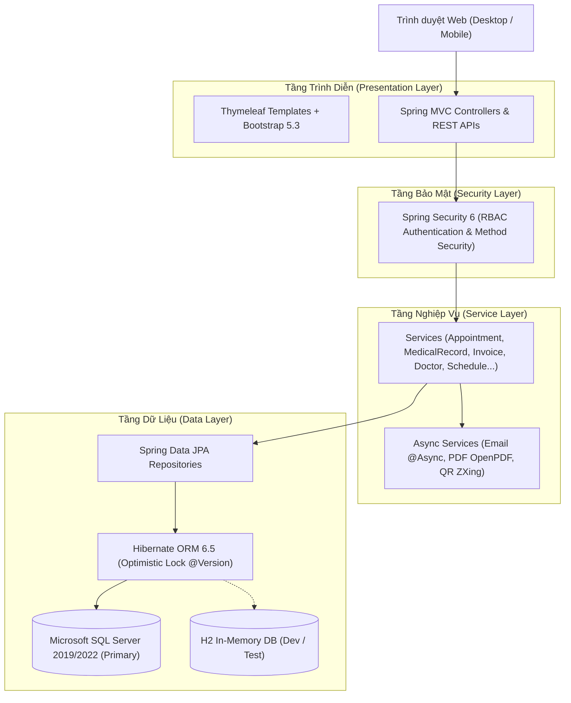

# 🏥 MedClinic - Hệ Thống Quản Lý & Đặt Lịch Khám Phòng Khám Tư Nhân

<div align="center">

[](https://www.oracle.com/java/)
[](https://spring.io/projects/spring-boot)
[](https://spring.io/projects/spring-security)
[](https://www.thymeleaf.org/)
[](https://www.microsoft.com/sql-server/)
[](https://junit.org/junit5/)
[](LICENSE)

*Giải pháp số hóa quy trình y tế toàn diện: Đặt lịch khám trực tuyến, Bàn khám Bác sĩ điện tử, Tiếp nhận tự động & Bệnh án điện tử chống Double Booking trên nền tảng **Microsoft SQL Server**.*

[Khởi Chạy Nhanh](#-hướng-dẫn-cài-đặt--khởi-chạy) • [Cấu Hình SQL Server](#bước-2-cấu-hình-cơ-sở-dữ-liệu-microsoft-sql-server) • [Tài Liệu Kỹ Thuật](#-tài-liệu-kỹ-thuật-phần-mềm) • [Tài Khoản Demo](#-hướng-dẫn-sử-dụng--tài-khoản-mẫu)

</div>

---

## 📑 Mục Lục (Table of Contents)

1. [Giới Thiệu Dự Án (Project Description)](#-giới-thiệu-dự-án-project-description)
   - [Động lực & Vấn đề giải quyết](#động-lực--vấn-đề-giải-quyết)
   - [Điểm nổi bật & Thách thức kỹ thuật](#điểm-nổi-bật--thách-thức-kỹ-thuật)
2. [Tính Năng Nổi Bật (Key Features)](#-tính-năng-nổi-bật-key-features)
3. [Kiến Trúc & Công Nghệ (Architecture & Tech Stack)](#-kiến-trúc--công-nghệ-architecture--tech-stack)
4. [Tài Liệu Kỹ Thuật Phần Mềm (Documentation)](#-tài-liệu-kỹ-thuật-phần-mềm)
5. [Hướng Dẫn Cài Đặt & Khởi Chạy (Installation & Run)](#-hướng-dẫn-cài-đặt--khởi-chạy)
   - [Yêu cầu hệ thống](#yêu-cầu-hệ-thống-prerequisites)
   - [Cấu hình Microsoft SQL Server (Chi tiết)](#bước-2-cấu-hình-cơ-sở-dữ-liệu-microsoft-sql-server)
   - [Khởi chạy ứng dụng](#bước-3-biên-dịch-và-khởi-chạy-ứng-dụng)
6. [Hướng Dẫn Sử Dụng & Tài Khoản Mẫu (Usage & Demo Accounts)](#-hướng-dẫn-sử-dụng--tài-khoản-mẫu)
7. [Kiểm Thử Tự Động (Testing & Coverage)](#-kiểm-thử-tự-động-testing--coverage)
8. [Cấu Trúc Thư Mục (Project Structure)](#-cấu-trúc-thư-mục-project-structure)
9. [Hướng Dẫn Đóng Góp (Contributing)](#-hướng-dẫn-đóng-góp-contributing)
10. [Tác Giả & Lời Cảm Ơn (Credits & Acknowledgments)](#-tác-giả--lời-cảm-ơn-credits--acknowledgments)
11. [Giấy Phép (License)](#-giấy-phép-license)

---

## 📖 Giới Thiệu Dự Án (Project Description)

### Động lực & Vấn đề giải quyết
Tại các phòng khám tư nhân quy mô vừa và nhỏ ở Việt Nam, việc xếp hàng lấy số khám thủ công gây ùn tắc tại sảnh chờ, tốn thời gian cho cả người bệnh lẫn nhân viên y tế. Thêm vào đó, việc lưu trữ hồ sơ bệnh án bằng giấy dễ thất lạc, đơn thuốc viết tay khó đọc và việc thanh toán thường chậm trễ.

**MedClinic** ra đời nhằm giải quyết triệt để các bài toán trên bằng cách:
- Cung cấp cổng đặt lịch khám bệnh trực tuyến mọi lúc mọi nơi theo chuyên khoa, bác sĩ và khung giờ 30 phút.
- Tự động hóa khâu tiếp nhận tại quầy: check-in qua mã QR, cấp số thứ tự điện tử (STT) và tiếp nhận bệnh nhân vãng lai (walk-in).
- Hỗ trợ bác sĩ khám bệnh với Bàn khám điện tử, kê đơn thuốc tự động trừ tồn kho dược phẩm và truy xuất nhanh tiền sử bệnh án.
- Tự động tạo hóa đơn viện phí, hỗ trợ thanh toán tiền mặt hoặc cổng VNPay Sandbox, và xuất PDF đơn thuốc/hóa đơn chuẩn y khoa.

### Điểm nổi bật & Thách thức kỹ thuật
- **Kiểm soát đồng thời chống Double Booking:** Trong môi trường khám bệnh, việc hai bệnh nhân cùng bấm đặt chung một khung giờ (TimeSlot) là rủi ro nghiêm trọng. MedClinic áp dụng cơ chế **Optimistic Locking (`@Version`)** trên JPA Entity kết hợp giao dịch `@Transactional(isolation = Isolation.READ_COMMITTED)`, loại bỏ hoàn toàn hiện tượng xung đột dữ liệu trên **Microsoft SQL Server**.
- **Cơ sở dữ liệu Microsoft SQL Server đạt chuẩn 3NF:** Toàn bộ 13 bảng quan hệ được thiết kế chuẩn mực, tối ưu hóa kiểu dữ liệu (`NVARCHAR`, `DECIMAL(12,2)`, `DATETIME2`, `BIT`), hỗ trợ Unicode toàn vẹn tiếng Việt có dấu.
- **Phân quyền người dùng dựa trên vai trò (RBAC):** Bảo vệ chặt chẽ các tài nguyên theo 4 vai trò: `ROLE_PATIENT`, `ROLE_DOCTOR`, `ROLE_STAFF`, `ROLE_ADMIN` thông qua Spring Security 6.
- **Tích hợp đa dịch vụ:** Tự động tạo mã QR Base64 bằng Google ZXing, xuất hóa đơn & toa thuốc chuẩn PDF bằng OpenPDF, và gửi email xác nhận bất đồng bộ `@Async`.

---

## ✨ Tính Năng Nổi Bật (Key Features)

### 🧑‍💼 Phân Hệ Bệnh Nhân (Patient Portal)
- [x] **Tra cứu & Tìm kiếm:** Xem danh sách bác sĩ chuyên khoa, học hàm/học vị, số năm kinh nghiệm và giá khám.
- [x] **Đặt lịch thông minh:** Chọn ngày, chuyên khoa, bác sĩ và khung giờ trống được tải thời gian thực bằng AJAX REST API.
- [x] **Mã QR Cuộc Hẹn:** Tự động nhận mã đặt lịch (`MED-YYMMDD-XXXX`) và mã QR định dạng Base64 dùng để check-in tức thì tại quầy.
- [x] **Quản lý & Hủy lịch:** Theo dõi danh sách lịch hẹn sắp tới, hủy lịch khám trực tuyến (tự động hoàn trả slot trống).
- [x] **Sổ tay Bệnh Án Điện Tử:** Tra cứu lịch sử chẩn đoán, lời dặn bác sĩ và đơn thuốc các lần khám trước.

### 👨‍⚕️ Phân Hệ Bác Sĩ (Doctor Desk)
- [x] **Hàng Chờ Khám Trực Quan:** Hiển thị danh sách bệnh nhân đã check-in trong ngày theo thứ tự ưu tiên số thứ tự (STT).
- [x] **Bàn Khám Lâm Sàng:** Xem nhanh triệu chứng, tiền sử bệnh án của bệnh nhân.
- [x] **Kê Đơn Thuốc Động:** Chọn thuốc theo tên, định lượng liều dùng, tần suất và cách dùng; hệ thống tự động kiểm tra và trừ số lượng tồn kho dược phẩm.
- [x] **Lịch Công Tác:** Xem lịch trực ca sáng/chiều trong vòng 14 ngày tới.

### 🛎️ Phân Hệ Tiếp Nhận & Thu Ngân (Staff Reception & Billing)
- [x] **Tra Cứu Nhanh Tiếp Nhận:** Tìm kiếm hồ sơ bệnh nhân qua mã đặt lịch, số điện thoại hoặc họ tên.
- [x] **Check-in & Cấp STT Tự Động:** Quét mã QR/xác nhận thông tin và cấp số thứ tự khám tự động (`STT-01`, `STT-02`...).
- [x] **Đăng Ký Khám Vãng Lai (Walk-in):** Đăng ký trực tiếp tại quầy cho người bệnh chưa đặt lịch trước.
- [x] **Quản Lý Hóa Đơn & Thu Phí:** Quản lý viện phí, xác nhận thanh toán tiền mặt tại quầy hoặc qua cổng VNPay.

### ⚙️ Phân Hệ Quản Trị Hệ Thống (Admin System)
- [x] **Bảng Điều Khiển KPI:** Thống kê tổng bệnh nhân, tổng bác sĩ, ca khám trong ngày và tổng doanh thu.
- [x] **Trực Quan Hóa Dữ Liệu:** Biểu đồ Chart.js phân bổ ca khám theo chuyên khoa và tỷ lệ trạng thái lịch hẹn.
- [x] **Quản Trị Danh Mục:** CRUD Chuyên khoa, Hồ sơ bác sĩ, Danh mục & Giá thuốc, Khóa/Mở tài khoản người dùng.

---

## 🏗️ Kiến Trúc & Công Nghệ (Architecture & Tech Stack)

### Sơ đồ Kiến trúc Phân tầng (Layered Architecture)



### Công nghệ sử dụng

| Lớp kiến trúc | Công nghệ / Thư viện | Phiên bản | Mục đích sử dụng |
| :--- | :--- | :---: | :--- |
| **Backend Core** | Java JDK | 21 LTS | Ngôn ngữ hiện đại, hiệu năng cao, Pattern Matching |
| **Framework** | Spring Boot | 3.3.5 | Nền tảng microservices & web monolithic vững chắc |
| **Bảo mật** | Spring Security | 6.x | Xác thực, phân quyền 4 vai trò (RBAC), CSRF, BCrypt |
| **Cơ sở dữ liệu chính** | **Microsoft SQL Server** | **2019 / 2022** | Hệ quản trị CSDL quan hệ chính thức cho dự án |
| **Driver CSDL** | Microsoft JDBC Driver for SQL Server (`mssql-jdbc`) | 12.6+ | Kết nối hiệu năng cao, bảo mật TLS/SSL |
| **Cơ sở dữ liệu Test** | H2 Database In-Memory | 2.x | Chạy kiểm thử tự động và chạy thử nghiệm zero-config |
| **ORM / JPA** | Hibernate / Spring Data JPA | 6.5.3 | Quản lý thực thể, Optimistic Lock (`@Version`) |
| **Giao diện** | Thymeleaf + Layout Dialect | 3.x | Template Engine kết xuất server-side |
| **CSS Framework** | Bootstrap | 5.3 | Giao diện Responsive thích ứng mọi kích cỡ màn hình |
| **Biểu đồ** | Chart.js | 4.x | Biểu đồ trực quan hóa số liệu KPI tại trang Admin |
| **Sinh mã QR** | Google ZXing (Zebra Crossing) | 3.5.3 | Sinh chuỗi Base64 mã QR cuộc hẹn |
| **Xuất PDF** | LibrePDF OpenPDF | 2.0.3 | Xuất đơn thuốc & hóa đơn PDF |
| **Kiểm thử** | JUnit 5, Mockito | Mới nhất | Unit Test nghiệp vụ và kiểm thử đồng thời |

---

## 📚 Tài Liệu Kỹ Thuật Phần Mềm

Toàn bộ tài liệu chuẩn kỹ thuật phần mềm được lưu trữ đầy đủ trong thư mục [`docs/`](file:///docs/):

1. 📄 [**01_SRS_IEEE830.md**](file:///docs/01_SRS_IEEE830.md): Đặc tả yêu cầu phần mềm theo chuẩn quốc tế **IEEE Std 830-1998** (24 Yêu cầu chức năng + 10 Yêu cầu phi chức năng).
2. 📐 [**02_UML_DESIGN.md**](file:///docs/02_UML_DESIGN.md): Thiết kế Sơ đồ UML 2.5 (Use Case Diagram, Activity Diagrams, Sequence Diagrams luồng Concurrency, Class Diagram).
3. 🗄️ [**03_DATABASE_DESIGN_3NF.md**](file:///docs/03_DATABASE_DESIGN_3NF.md): Thiết kế CSDL 13 bảng & Chứng minh chuẩn hóa 3NF kèm Từ điển dữ liệu chi tiết cho SQL Server.
4. 🧭 [**04_RTM_MATRIX.md**](file:///docs/04_RTM_MATRIX.md): Ma trận truy vết yêu cầu 2 chiều (Requirements Traceability Matrix).
5. 🏛️ [**05_SYSTEM_ARCHITECTURE.md**](file:///docs/05_SYSTEM_ARCHITECTURE.md): Tài liệu Kiến trúc Hệ thống chi tiết (Layered Architecture, Design Patterns).
6. 📋 [**DE_XUAT_CAI_THIEN_MEDCLINIC.md**](file:///docs/DE_XUAT_CAI_THIEN_MEDCLINIC.md): Báo cáo rà soát và đề xuất cải tiến toàn diện cho dự án.

---

## 🚀 Hướng Dẫn Cài Đặt & Khởi Chạy

### Yêu cầu hệ thống (Prerequisites)
- **Java Development Kit (JDK):** Phiên bản 21 trở lên ([Tải OpenJDK 21](https://adoptium.net/))
- **Microsoft SQL Server:** Phiên bản 2017, 2019 hoặc 2022 ([Tải SQL Server Express miễn phí](https://www.microsoft.com/en-us/sql-server/sql-server-downloads))
- **SQL Server Management Studio (SSMS):** Công cụ quản trị trực quan ([Tải SSMS](https://learn.microsoft.com/en-us/sql/ssms/download-sql-server-management-studio-ssms))
- **Apache Maven:** Phiên bản 3.9+ (hoặc dùng Maven Wrapper)
- **Git:** Quản lý mã nguồn ([Tải Git](https://git-scm.com/))

---

### Bước 1: Clone kho mã nguồn
```bash
git clone https://github.com/<YOUR_USERNAME>/medclinic-system.git
cd medclinic-system
```

---

### Bước 2: Cấu hình cơ sở dữ liệu Microsoft SQL Server

#### 2.1. Tạo Cơ sở dữ liệu trong SQL Server
Mở SSMS (hoặc công cụ dòng lệnh `sqlcmd`) và chạy lệnh SQL sau:

```sql
-- Tạo Database cho MedClinic với Collation hỗ trợ tiếng Việt
CREATE DATABASE medclinic_db;
GO

USE medclinic_db;
GO
```

#### 2.2. Kiểm tra bật giao thức TCP/IP trên SQL Server (Lưu ý quan trọng!)
Để Spring Boot kết nối được qua cổng mạng `1433`:
1. Mở công cụ **SQL Server Configuration Manager** trên Windows.
2. Tìm đến mục **SQL Server Network Configuration** $\rightarrow$ **Protocols for MSSQLSERVER** (hoặc `Protocols for SQLEXPRESS`).
3. Đảm bảo giao thức **TCP/IP** đang ở trạng thái **Enabled**.
4. Nhấp đúp vào **TCP/IP**, chuyển sang thẻ **IP Addresses**, cuộn xuống mục **IPAll** và điền **TCP Port: `1433`** (xóa mục TCP Dynamic Ports nếu có).
5. Khởi động lại dịch vụ **SQL Server** trong thẻ *SQL Server Services*.

#### 2.3. Cấu hình thông tin đăng nhập trong file cấu hình
Mở file [`src/main/resources/application-sqlserver.properties`](file:///src/main/resources/application-sqlserver.properties) và điều chỉnh mật khẩu tài khoản `sa` (hoặc tài khoản SQL Server của bạn):

```properties
# Cấu hình kết nối SQL Server
spring.datasource.url=jdbc:sqlserver://localhost:1433;databaseName=medclinic_db;encrypt=false;trustServerCertificate=true;sendStringParametersAsUnicode=true
spring.datasource.driver-class-name=com.microsoft.sqlserver.jdbc.SQLServerDriver
spring.datasource.username=sa
spring.datasource.password=YourPassword123

# Cấu hình JPA & Hibernate
spring.jpa.database-platform=org.hibernate.dialect.SQLServerDialect
spring.jpa.hibernate.ddl-auto=update
spring.jpa.defer-datasource-initialization=true
```

> 💡 **Mẹo chạy nhanh không cần cài SQL Server (Dev In-Memory):** Nếu chưa cài đặt SQL Server trên máy, bạn vẫn có thể khởi chạy ngay lập tức bằng CSDL nhúng **H2 Database** tích hợp sẵn (Profile `dev`), toàn bộ dữ liệu mẫu vẫn tự động nạp bình thường.

---

### Bước 3: Biên dịch và Khởi chạy ứng dụng

#### Chạy với Microsoft SQL Server:
```bash
# Biên dịch dự án
mvn clean compile

# Chạy ứng dụng kích hoạt Profile SQL Server
mvn spring-boot:run -Dspring-boot.run.profiles=sqlserver
```

*(Hoặc đổi dòng số 5 trong file `src/main/resources/application.yml` thành `active: sqlserver` rồi chỉ cần gõ `mvn spring-boot:run`)*.

#### Chạy với H2 In-Memory (Zero-config):
```bash
mvn spring-boot:run
```

Sau khi màn hình Console thông báo `Started MedClinicApplication...`, mở trình duyệt truy cập:
👉 **`http://localhost:8080`**

Console H2 Database (nếu chạy profile dev H2):
👉 **`http://localhost:8080/h2-console`** *(JDBC URL: `jdbc:h2:mem:medclinic_db`, User: `sa`, Password: để trống)*

---

## 🔑 Hướng Dẫn Sử Dụng & Tài Khoản Mẫu

Khi khởi chạy lần đầu tiên, hệ thống sẽ tự động nạp (seed) dữ liệu mẫu bao gồm:
- **6 Bác sĩ chuyên khoa hàng đầu** (Tim mạch, Răng hàm mặt, Da liễu, Nhi, Tai mũi họng, Cơ xương khớp).
- **14 ngày ca trực tự động** (Ca sáng 08:00-12:00, Ca chiều 13:30-17:30, mỗi ca 8 khung giờ 30 phút).
- **15 mặt hàng dược phẩm thiết yếu** có sẵn số lượng tồn kho và đơn giá niêm yết.

Bảng tài khoản mẫu cho 4 vai trò:

| Vai trò (Role) | Tên đăng nhập | Mật khẩu | Quyền hạn & Chức năng kiểm thử |
| :--- | :--- | :---: | :--- |
| 👑 **Quản Trị Viên (Admin)** | `admin` | `123456` | Xem Dashboard KPI, biểu đồ Chart.js, quản lý chuyên khoa, bác sĩ, thuốc, tài khoản |
| 👨‍⚕️ **Bác Sĩ (Doctor)** | `doctor` | `123456` | Bàn khám, gọi số STT, chẩn đoán & kê đơn thuốc, xem lịch trực |
| 🛎️ **Lễ Tân (Staff)** | `staff` | `123456` | Tra cứu bệnh nhân, check-in cấp STT, tiếp nhận vãng lai, thu viện phí |
| 🧑‍💼 **Bệnh Nhân (Patient)** | `patient` | `123456` | Đặt lịch khám, nhận mã QR, xem chi tiết lịch hẹn, xem lịch sử bệnh án |

> 💡 **Khách vãng lai (Guest):** Có thể tự đăng ký tài khoản bệnh nhân mới tại trang `/register`.

### Quy trình nghiệp vụ mẫu (End-to-End Workflow)
```
1. [Bệnh nhân] Đăng nhập -> Vào "Đặt lịch khám" -> Chọn BS & Ngày -> Chọn Slot -> Xác nhận
   └──> Nhận mã cuộc hẹn MED-xxxx và mã QR Base64.
2. [Lễ tân] Vào "Tiếp nhận" -> Tìm mã đặt lịch -> Bấm "Check-in"
   └──> Hệ thống cấp số thứ tự STT-01, chuyển trạng thái sang "Chờ khám".
3. [Bác sĩ] Đăng nhập -> Vào "Bàn khám" -> Chọn bệnh nhân STT-01 -> Điền chẩn đoán & Toa thuốc -> "Lưu kết quả"
   └──> Hệ thống tự động trừ kho thuốc trong SQL Server và sinh hóa đơn viện phí.
4. [Lễ tân] Vào "Thu viện phí" -> Xem hóa đơn -> Bấm "Xác nhận thanh toán" -> In hóa đơn PDF.
```

---

## 🧪 Kiểm Thử Tự Động (Testing & Coverage)

Dự án được tích hợp bộ kiểm thử tự động với JUnit 5, Mockito và JaCoCo:

```bash
# Chạy toàn bộ các bài kiểm thử
mvn test
```

### Các kịch bản kiểm thử trọng yếu:
- ✅ **Khởi tạo Context & Seed Data:** Đảm bảo toàn bộ Bean, Hibernate Entity, và dữ liệu mẫu nạp thành công (`MedClinicApplicationTests`).
- ✅ **Đăng ký tài khoản:** Kiểm thử mật khẩu mã hóa BCrypt, kiểm tra tính hợp lệ dữ liệu và ngăn chặn trùng lặp Username/Email (`UserServiceTest`).
- ✅ **Cơ chế chống Double Booking:** Kiểm thử cô lập xử lý đồng thời, kích hoạt `OptimisticLockingFailureException` khi xảy ra tranh chấp khung giờ (`AppointmentServiceTest`).
- ✅ **Cấp số thứ tự STT:** Kiểm thử tự động tính toán STT tăng dần cho hàng chờ khám bệnh trong ngày (`AppointmentServiceTest`).
- ✅ **Hủy lịch & Hoàn slot:** Đảm bảo slot được trả về trạng thái `AVAILABLE` ngay sau khi hủy (`AppointmentServiceTest`).

---

## 📁 Cấu Trúc Thư Mục (Project Structure)

```
medclinic-system/
├── docs/                                 # Toàn bộ tài liệu chuẩn kỹ thuật (SRS, UML, CSDL, RTM, Kiến trúc)
├── src/
│   ├── main/
│   │   ├── java/com/medclinic/
│   │   │   ├── config/                   # SecurityConfig, DataInitializer
│   │   │   ├── controller/               # AdminController, DoctorDeskController, StaffReceptionController...
│   │   │   ├── dto/                      # Data Transfer Objects (Form, Slot, Prescription)
│   │   │   ├── entity/                   # 13 JPA Entities chuẩn 3NF (tương thích SQL Server)
│   │   │   ├── enums/                    # 7 Enums (Status, Role, Shift, Payment...)
│   │   │   ├── exception/                # Bộ xử lý ngoại lệ nghiệp vụ tập trung
│   │   │   ├── repository/               # 12 Spring Data JPA Repositories
│   │   │   ├── security/                 # CustomUserDetails, CustomUserDetailsService
│   │   │   ├── service/                  # 10 Services (Appointment, MedicalRecord, Invoice...)
│   │   │   └── util/                     # Tiện ích QrCodeUtil (ZXing)
│   │   └── resources/
│   │       ├── templates/                # Thymeleaf HTML Templates
│   │       ├── static/                   # File tĩnh (CSS, JS, Images)
│   │       ├── application.yml           # Cấu hình đa profile (dev, sqlserver, mysql)
│   │       └── application-sqlserver.properties  # Cấu hình kết nối Microsoft SQL Server
│   └── test/java/com/medclinic/          # Bộ bài kiểm thử tự động JUnit 5 & Mockito
├── pom.xml                               # Quản lý thư viện Maven & mssql-jdbc Driver
└── README.md                             # Tài liệu giới thiệu & hướng dẫn dự án (Chuẩn freeCodeCamp)
```

---

## 🤝 Hướng Dẫn Đóng Góp (Contributing)

Mọi đóng góp nhằm cải tiến dự án đều được hoan nghênh. Vui lòng tuân thủ các bước sau:

1. **Fork** repository này về tài khoản GitHub của bạn.
2. Tạo một nhánh tính năng mới:
   ```bash
   git checkout -b feature/AmazingFeature
   ```
3. Commit các thay đổi với thông điệp rõ ràng theo chuẩn Conventional Commits:
   ```bash
   git commit -m "feat: Add SMS notification service for booking confirmation"
   ```
4. Đẩy mã nguồn lên nhánh của bạn:
   ```bash
   git push origin feature/AmazingFeature
   ```
5. Mở một **Pull Request** trên GitHub mô tả chi tiết các thay đổi của bạn.

---

## 👥 Tác Giả & Lời Cảm Ơn (Credits & Acknowledgments)

- **Đồ án môn học:** Lập Trình Web (LTW) & Công Nghệ Phần Mềm (CNPM).
- **Hệ quản trị Cơ sở dữ liệu:** [Microsoft SQL Server](https://www.microsoft.com/sql-server/) & Driver `mssql-jdbc`.
- **Tài liệu tham khảo & Hướng dẫn:**
  - Tiêu chuẩn đặc tả yêu cầu phần mềm [IEEE Std 830-1998](https://standards.ieee.org/).
  - Thư viện mã nguồn mở: [Spring Boot](https://spring.io/), [OpenPDF](https://github.com/LibrePDF/OpenPDF), [ZXing](https://github.com/zxing/zxing), [Bootstrap](https://getbootstrap.com/).

---

## 📄 Giấy Phép (License)

Dự án được phân phối dưới giấy phép **MIT License**. Bạn được toàn quyền sử dụng, sửa đổi và phân phối cho mục đích học tập và nghiên cứu. Xem chi tiết tại file [LICENSE](LICENSE) (nếu có).

---

<div align="center">
  <sub>Được xây dựng với sự tận tâm và tình yêu công nghệ ❤️ • © 2026 MedClinic Project</sub>
</div>
