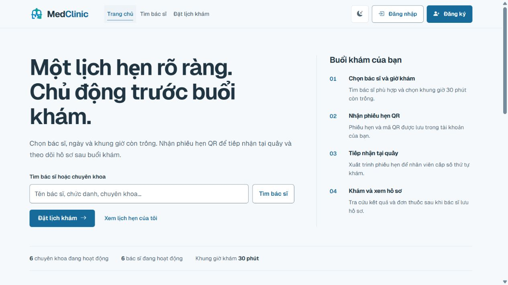
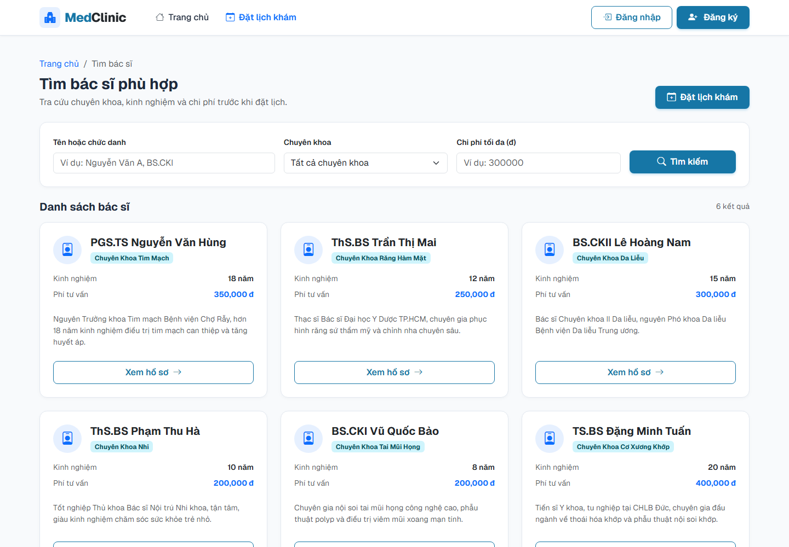
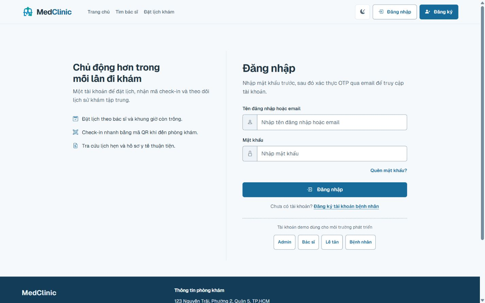

# MedClinic

[](https://openjdk.org/projects/jdk/21/)
[](https://spring.io/projects/spring-boot)
[](https://github.com/tranducanhyn99-prog/medclinic-system/actions/workflows/ci.yml)
[](LICENSE)

Đồ án LTW/CNPM về quản lý phòng khám: đặt lịch, tiếp nhận bằng QR/webcam, khám và kê đơn, quản lý thuốc, thu ngân và xuất PDF. Hỗ trợ bốn vai trò Bệnh nhân, Bác sĩ, Lễ tân và Admin.

## Chức năng

- Đặt lịch theo bác sĩ/chuyên khoa và khung giờ; khóa slot khi đặt để tránh trùng lịch, hủy lịch trả slot.
- Check-in bằng QR, cấp STT, đăng ký vãng lai; hàng chờ bác sĩ cập nhật qua WebSocket sau transaction commit.
- Khám, kê thuốc, rà soát và xác nhận lưu; kiểm tra tồn kho, tạo bệnh án/đơn thuốc/hóa đơn trong transaction.
- Thu tiền mặt hoặc tạo VietQR khi đã cấu hình. Callback HMAC/idempotency và đối soát thủ công; tạo QR không đồng nghĩa đã thanh toán.
- Đăng ký và đăng nhập OTP/magic link, hồ sơ/avatar, phân quyền và audit; tài khoản seed chỉ dành cho dev/demo.
- PDF hóa đơn có chi tiết khoản thu/thuốc; tiền VND dạng **353 000**, không có `.00`.
- Giao diện responsive, dark/light, điều khiển bàn phím và thông báo trạng thái. [16 task UX/UI đã nghiệm thu trong phạm vi local](docs/UX_UI_TASKLIST_2026-10-02.md).

## Giao diện



<p>
  
  
</p>

## Công nghệ và cấu trúc

Java 21, Spring Boot 4.1.1 / Spring Security, Spring MVC + Thymeleaf, JPA/Hibernate, Flyway, SQL Server 2022 hoặc H2. Jackson 3, OpenPDF, ZXing, Bootstrap, Chart.js, JUnit/Mockito, JaCoCo và Node test runner.

```text
src/main/java/com/medclinic/   controller, service, security, repository, entity, DTO, validation
src/main/resources/          templates, static assets, application.yml, Flyway V1–V6
src/test/                    Java integration/unit/concurrency và frontend regression
.github/workflows/ci.yml     Maven + Node + kiểm tra link tài liệu
ops/                        backup, restore drill, mẫu nghiệm thu UX, kiểm tra tài liệu
docs/                       đặc tả, thiết kế, runbook, biên bản và bằng chứng đã chọn
```

## Chạy nhanh bằng H2

Cần JDK 21, Maven 3.6.3+; Node 22 để chạy regression frontend. H2 không cần cài database riêng.

```bash
git clone https://github.com/tranducanhyn99-prog/medclinic-system.git
cd medclinic-system
mvn spring-boot:run
```

Mở [localhost:8080](http://localhost:8080). Profile mặc định `dev` dùng database in-memory; dữ liệu mất khi ứng dụng dừng. H2 console ở `/h2-console`, JDBC URL `jdbc:h2:mem:medclinic_db`, user `sa`, password trống; chỉ dùng trong phát triển.

Tài khoản seed `admin`, `doctor`, `staff`, `patient` dùng mật khẩu **123456** và bỏ qua OTP trong dev/demo. Shortcut đăng nhập chỉ hiển thị ở dev. Tài khoản mới vẫn cần xác thực email; dev dùng dịch vụ email phát triển, không đại diện cho SMTP thật. Các tài khoản/mật khẩu mẫu không được dùng với dữ liệu thật.

## Chạy demo bằng Docker Compose

Cần Docker Desktop với Linux containers. Tạo file env riêng:

```powershell
Copy-Item .env.example .env
```

Điền `MSSQL_SA_PASSWORD` đủ mạnh và `REMEMBER_ME_KEY` ngẫu nhiên trong `.env`, rồi:

```bash
docker compose up --build -d
```

- Ứng dụng: [localhost:8080](http://localhost:8080).
- Mailpit: [localhost:8025](http://localhost:8025), nhận email DEMO local; dùng để xem OTP/magic link.
- SQL Server: `localhost:14333`, có thể đổi qua `SQLSERVER_HOST_PORT`.
- Các cổng host chỉ bind localhost. Volume giữ database và avatar; `docker compose down` giữ volume, `down -v` xóa dữ liệu demo.

Compose dùng `sqlserver,demo`, chạy init guard rồi Flyway V1–V6; Hibernate chỉ validate schema. Bank payment mặc định tắt. Không dùng Compose demo làm cấu hình production.

## SQL Server và production

SQL Server là database chính có migration. Profile MySQL được giữ cho nghiên cứu/roadmap và không thuộc bộ nghiệm thu SQL Server.

[SQL Server runbook](docs/database/SQLSERVER_RUNBOOK.md) mô tả fresh DB, legacy baseline opt-in, backup/restore và SQL integration tests. [Provision admin](docs/database/PRODUCTION_ADMIN_PROVISIONING.md) mô tả tạo tài khoản quản trị khi không dùng seed.

Production chạy `sqlserver,prod`, không chạy cùng dev/demo. Dùng [.env.production.example](.env.production.example) làm danh sách biến tham khảo, nạp secret qua môi trường/secret manager; Spring Boot không tự đọc file `.env`. Cần URL SQL Server TLS hợp lệ, DB credentials, remember-me key, SMTP, HTTPS và `APP_WEBSITE` đúng origin. Không commit env đã điền, mật khẩu, uploads, backup hoặc log thô.

Mật khẩu mới: ít nhất 8 ký tự, tối đa 72 byte UTF-8 nếu dùng BCrypt; chữ có dấu/emoji có thể đạt giới hạn sớm hơn. Giữ định dạng hash hiện hữu; không tự đổi mật khẩu người dùng.

## Kiểm thử và phạm vi nghiệm thu

```bash
mvn clean verify
node --test src/test/frontend/ui-regressions.cjs
node ops/check-doc-links.cjs
```

JaCoCo gate: LINE ≥70%, BRANCH ≥50%. Maven mặc định bỏ qua các case SQL Server cần environment guard. Để chạy chúng, dùng **database test disposable riêng** theo runbook, đặt `RUN_SQLSERVER_IT=true` và DB credentials; không dùng `medclinic_db` chứa dữ liệu cần giữ. Test migration còn tạo/drop `medclinic_flyway_it`.

Kết quả source cuối ngày 03/10/2026 được ghi tại [bàn giao GitHub](docs/GITHUB_RELEASE_2026-10-03.md). Các mốc test trước nâng dependency là lịch sử, không đại diện cho bản hiện tại. CI chạy Maven clean verify, Node regression và kiểm tra link trên push main/feature/codex hoặc PR vào main; SQL Server integration cần môi trường riêng nên không tự chạy trên hosted CI mặc định.

Nghiệm thu local đã có camera thật do người dùng xác nhận, SMTP Mailpit, backup/restore, workflow H2/SQL Server và 16 task UX/UI. Ngân hàng/SMTP nhà cung cấp thật, HTTPS production và mọi tổ hợp thiết bị/trình duyệt chưa được xác nhận. Không suy diễn local pass thành chứng nhận WCAG hoặc sẵn sàng triển khai y tế thực tế.

## Tài liệu

- [Đặc tả yêu cầu](docs/01_SRS_IEEE830.md), [UML](docs/02_UML_DESIGN.md), [thiết kế dữ liệu](docs/03_DATABASE_DESIGN_3NF.md), [kiến trúc](docs/05_SYSTEM_ARCHITECTURE.md).
- [UX/UI tasklist](docs/UX_UI_TASKLIST_2026-10-02.md), [nghiệm thu UX-10](docs/UX10_ACCEPTANCE_2026-10-03.md).
- [Nghiệm thu backend](docs/BACKEND_ACCEPTANCE_2026-10-02.md), [đối chiếu backlog local](docs/BACKLOG_COMPLETION_2026-10-02.md).
- [7 mục chuẩn bị GitHub](docs/GITHUB_READINESS_TASKLIST_2026-10-03.md), [bàn giao source cuối](docs/GITHUB_RELEASE_2026-10-03.md).
- [Chính sách bằng chứng công khai](docs/evidence/README.md). Tài liệu theo ngày giữ bối cảnh lịch sử; raw log, OTP/magic link và khung hình webcam cá nhân được giữ local.

## Đóng góp và giấy phép

Tạo nhánh riêng, chạy verification và mở PR với mô tả hành vi, phạm vi thay đổi và kết quả kiểm thử. Không gửi secret hoặc dữ liệu bệnh nhân thật trong issue/PR.

Dự án dùng [MIT License](LICENSE). Giữ license của font, Chart.js và page mascot trong thư mục nguồn tương ứng. Cảm ơn các dự án Spring, Bootstrap, OpenPDF, ZXing và các thư viện mã nguồn mở được sử dụng. Đây là đồ án môn học Lập Trình Web và Công Nghệ Phần Mềm.
