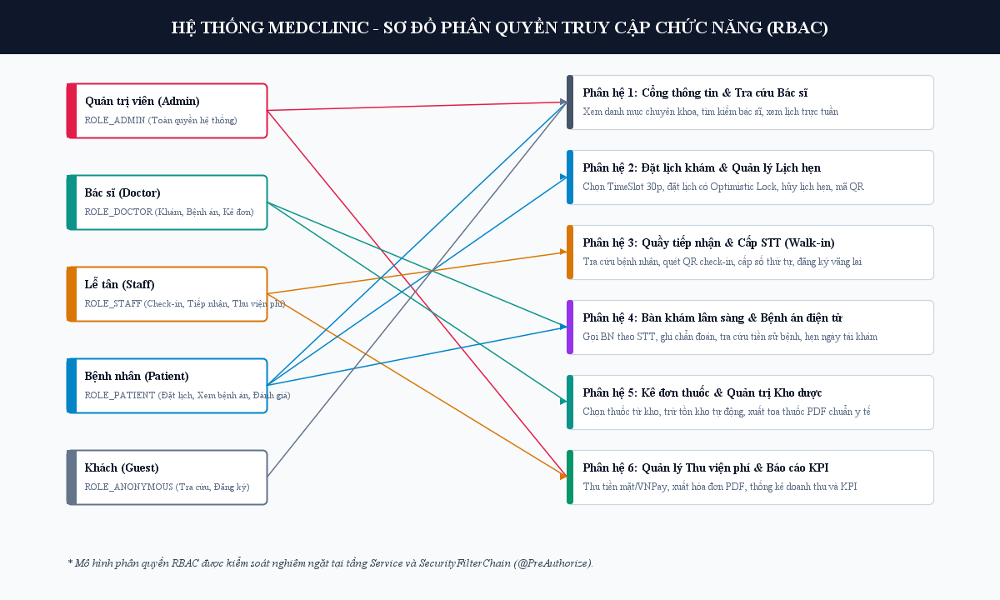
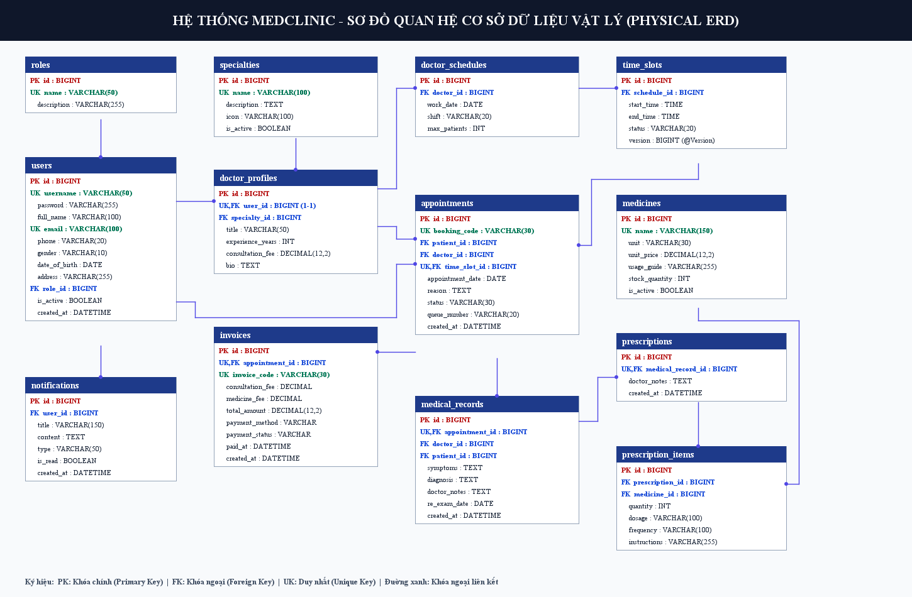

# MedClinic — Nền tảng Quản lý Phòng khám Đa khoa & Đặt lịch Khám Trực tuyến


**MedClinic** là hệ thống quản lý vận hành phòng khám đa khoa và đặt lịch khám bệnh trực tuyến khép kín, kết nối xuyên suốt bốn phân hệ nghiệp vụ: **Cổng Bệnh nhân (`PATIENT`)**, **Quầy Tiếp nhận & Thu ngân (`STAFF`)**, **Không gian Khám Lâm sàng (`DOCTOR`)** và **Trung tâm Quản trị (`ADMIN`)**.

Nền tảng số hóa toàn bộ hành trình khám chữa bệnh từ lúc tìm kiếm bác sĩ, khóa khung giờ đặt lịch trực tuyến, tiếp nhận bằng mã QR tại quầy, điều phối hàng đợi khám thời gian thực qua WebSocket, ghi nhận bệnh án điện tử và kê đơn trừ kho tự động, đến thanh toán đa phương thức (Tiền mặt / VietQR Webhook) và xuất chứng từ PDF Unicode.

```text
Đặt lịch trực tuyến (4 bước) ──► Phát hành thẻ hẹn QR ──► Quét QR Check-in & Cấp STT
                                                                  │
Xuất Bệnh án & Hóa đơn PDF ◄── Thu ngân / Đối soát VietQR ◄── Bác sĩ khám & Kê đơn (WebSocket)
```

---

## Giao diện Sản phẩm

Giao diện được xây dựng theo ngôn ngữ thiết kế y khoa hiện đại ([DESIGN.md](DESIGN.md)) với bảng màu xanh lam lâm sàng (`#0284C7`), kiểu chữ Geist hiển thị sắc nét số liệu y tế và hỗ trợ chuyển đổi giao diện Sáng / Tối (Light / Dark Mode).

| Trang chủ & Cổng thông tin Phòng khám | Đăng nhập Đa phương thức & Xác thực 2 lớp |
| :---: | :---: |
|  |  |

---

## Phân hệ Chức năng Cốt lõi

| Phân hệ | Đối tượng | Tính năng Nghiệp vụ Chính |
| :--- | :--- | :--- |
| **Patient Portal** | Bệnh nhân | • Tìm kiếm bác sĩ theo chuyên khoa, khoảng giá khám và từ khóa.<br>• Đặt lịch khám 4 bước trực quan, tự động kiểm tra xung đột lịch hẹn.<br>• Quản lý phiếu hẹn điện tử kèm mã QR định danh, hủy lịch hợp lệ.<br>• Tra cứu lịch sử bệnh án, toa thuốc và tải về đơn thuốc / hóa đơn PDF tiếng Việt. |
| **Reception & Billing** | Lễ tân & Thu ngân | • Tiếp nhận bệnh nhân bằng camera quét mã QR (ZXing) hoặc mã lịch hẹn.<br>• Cấp số thứ tự khám (STT) tự động theo ngày và đăng ký khám khách vãng lai (Walk-in).<br>• Thu ngân tiền mặt hoặc khởi tạo mã thanh toán chuyển khoản VietQR.<br>• Tự động đối soát giao dịch ngân hàng qua Webhook xác thực chữ ký `HMAC-SHA256`. |
| **Clinical Workspace** | Bác sĩ Chuyên khoa | • Bảng điều khiển hàng đợi khám cập nhật thời gian thực qua WebSocket (`STOMP / SockJS`).<br>• Tiếp nhận ca khám, tra cứu tiền sử bệnh lý và lịch sử dùng thuốc của bệnh nhân.<br>• Ghi nhận triệu chứng, chẩn đoán lâm sàng, chỉ định điều trị và kê đơn thuốc.<br>• Xem lịch trực cá nhân 7 ngày, tra cứu danh sách bệnh án đã hoàn tất và xuất đơn thuốc PDF. |
| **Admin Console** | Quản trị viên | • Dashboard thống kê KPI thời gian thực: doanh thu, lưu lượng lịch hẹn, tỷ lệ hoàn tất khám.<br>• Quản lý danh mục chuyên khoa, hồ sơ bác sĩ, khung giờ làm việc và tài khoản người dùng.<br>• Quản lý danh mục thuốc, nhập kho bổ sung và đối chiếu sổ cái biến động tồn kho (`InventoryTransaction`).<br>• Giám sát nhật ký kiểm toán nghiệp vụ (`BusinessAuditLog`). |

---

## Điểm nhấn Kỹ thuật & Kiến trúc

### 1. Kiểm soát Đồng thời & Toàn vẹn Giao dịch (Concurrency & ACID)
- **Chống đặt trùng khung giờ (Double-Booking Prevention):** Kết hợp khóa bi quan `PESSIMISTIC_WRITE` (`UPDLOCK, ROWLOCK` trên SQL Server) và khóa lạc quan `@Version` trên thực thể `TimeSlot`, kết hợp kiểm tra chồng lấn khung giờ của cùng bệnh nhân.
- **Cấp phát STT & Mã hóa đơn độc lập:** Sử dụng giao dịch cô lập `Propagation.REQUIRES_NEW` trên bảng `daily_queue_counters` và `invoice_code_reservations` để đảm bảo số thứ tự và mã hóa đơn tăng tuần tự, không bị trùng lặp dưới tải đồng thời cao.
- **Chống Deadlock khi kê đơn trừ tồn kho:** Khi bác sĩ hoàn tất khám, hệ thống gom nhóm số lượng thuốc theo `TreeMap<Long, Integer>` (sắp xếp tăng dần theo `medicineId`) trước khi khóa bản ghi tồn kho, triệt tiêu nguy cơ khóa chéo (Circular Wait Deadlock) và ghi nhận đồng bộ Bệnh án + Đơn thuốc + Phiếu xuất kho + Hóa đơn trong cùng một giao dịch.

### 2. Bảo mật Đa lớp (Defense-in-Depth Security)
- **Xác thực 2 bước (2FA OTP & Magic Link):** Hỗ trợ xác thực đăng ký, đăng nhập và khôi phục mật khẩu bằng mã OTP 6 chữ số (băm `BCrypt`, hiệu lực 5 phút, giới hạn số lần thử) hoặc liên kết Magic Link (`SHA-256`).
- **Tích hợp Google OAuth 2.0 (OIDC):** Cho phép bệnh nhân đăng ký/đăng nhập nhanh bằng tài khoản Google (`@gmail.com`) kết hợp bước xác minh OTP bảo vệ tài khoản.
- **Kiểm soát truy cập tức thời:** Bộ lọc `ActiveAccountFilter` thu hồi phiên làm việc ngay lập tức nếu tài khoản bị khóa; `RateLimitFilter` giới hạn tần suất yêu cầu theo IP/Endpoint (hỗ trợ cả `InMemoryRateLimitStore` và `JdbcSqlServerRateLimitStore`).
- **Bảo vệ chống IDOR & Replay Attack:** Mọi truy vấn hồ sơ bệnh án, đơn thuốc PDF và phiếu hẹn đều kiểm tra quyền sở hữu ở tầng Service; cổng Webhook ngân hàng xác thực chữ ký `HMAC-SHA256` bằng thuật toán so sánh hằng số thời gian (`MessageDigest.isEqual`) và lưu vết chống phát lại (`bank_payment_webhook_events`).



---

## Công nghệ Sử dụng

| Tầng Kiến trúc | Công nghệ & Thư viện |
| :--- | :--- |
| **Core Backend** | Java 21 LTS, Spring Boot 4.1.1, Spring Web MVC, Spring Security 7, Jakarta Bean Validation |
| **Persistence & DB** | Spring Data JPA / Hibernate, Microsoft SQL Server 2022, Flyway Migration (`V1`–`V10`), H2 Database (Dev/Test) |
| **Frontend & UI** | Thymeleaf 3.1 + Layout Dialect, Bootstrap 5, Vanilla ES6 JavaScript, Chart.js, Geist Typography |
| **Realtime & Media** | Spring WebSocket (`STOMP` / `SockJS`), Google ZXing 3.5 (QR Code), OpenPDF 2.0 (Unicode PDF Rendering) |
| **DevOps & Quality** | Docker & Docker Compose, Apache Maven, JUnit 5, Mockito, Spring Security Test, Node Test Runner, JaCoCo, GitHub Actions CI |

---

## Hướng dẫn Khởi chạy Nhanh

### Yêu cầu Môi trường
- **JDK 21 LTS** và **Apache Maven 3.9+** (hoặc dùng `./mvnw` đi kèm dự án).
- **Docker Desktop** (nếu khởi chạy cụm SQL Server 2022 + Mailpit bằng Docker Compose).
- **Node.js 20+** (tùy chọn, dùng để chạy bộ kiểm thử hồi quy giao diện).

### Chế độ 1: Khởi chạy tức thì với H2 In-Memory (Development / Quick Demo)

Chế độ mặc định (`dev`) sử dụng cơ sở dữ liệu H2 trong bộ nhớ RAM và tự động nạp sẵn dữ liệu mẫu gồm 6 chuyên khoa, 12 bác sĩ, 20 danh mục thuốc cùng lịch khám 14 ngày:

```powershell
mvn spring-boot:run
```

Sau khi ứng dụng khởi động, truy cập tại **[http://localhost:8080](http://localhost:8080)**.

#### Danh sách Tài khoản Mặc định (Môi trường Demo)

| Vai trò | Tên đăng nhập (`username`) | Mật khẩu | Phân hệ truy cập |
| :--- | :--- | :--- | :--- |
| **Bệnh nhân** | `patient` | `123456` | Đặt lịch khám, Thẻ hẹn QR, Hồ sơ bệnh án (`/patient/**`) |
| **Lễ tân & Thu ngân** | `staff` | `123456` | Quét QR Check-in, Cấp STT, Thu ngân & VietQR (`/staff/**`) |
| **Bác sĩ Chuyên khoa** | `doctor` *(hoặc `doc_mai`, `doc_nam`, `doc_ha`, `doc_bao`, `doc_tuan`, `doc_linh`, `doc_khoa`, `doc_lan`, `doc_duc`, `doc_trang`, `doc_minh`)* | `123456` | Hàng đợi khám WebSocket, Khám lâm sàng & Kê đơn (`/doctor/**`) |
| **Quản trị viên** | `admin` | `123456` | Dashboard KPI, Quản lý Bác sĩ, Chuyên khoa, Kho thuốc (`/admin/**`) |

> **Lưu ý chế độ Demo:** Ở hồ sơ `dev`/`demo`, hệ thống cho phép tiếp nhận và xử lý lịch khám sớm trong khung **+14 ngày** để thuận tiện kiểm thử toàn trình bất kỳ lúc nào. Để bật chế độ kiểm tra đúng ngày khám thực tế, đặt biến môi trường `$env:DEMO_EARLY_CLINICAL_PROCESSING = 'false'` trước khi chạy.

---

### Chế độ 2: Triển khai Chuẩn Sản xuất với Docker Compose (SQL Server 2022 + Mailpit)

Cụm Docker Compose khởi chạy tự động 4 container: ứng dụng Spring Boot (`medclinic-app`), cơ sở dữ liệu Microsoft SQL Server 2022 (`medclinic-sqlserver`), tác vụ khởi tạo DB (`medclinic-sqlserver-init`) và máy chủ hộp thư SMTP (`medclinic-mailpit`).

**Bước 1:** Tạo tệp cấu hình `.env` từ tệp mẫu `.env.example`:

```powershell
if (-not (Test-Path -LiteralPath .env)) {
    Copy-Item -LiteralPath .env.example -Destination .env
}
```

*(Đảm bảo khai báo `MSSQL_SA_PASSWORD` đủ độ mạnh theo quy tắc SQL Server và chuỗi khóa `REMEMBER_ME_KEY` trong tệp `.env`).*

**Bước 2:** Khởi chạy toàn bộ cụm dịch vụ:

```powershell
docker compose up --build -d
```

| Dịch vụ | Địa chỉ Truy cập | Mô tả |
| :--- | :--- | :--- |
| **MedClinic Web App** | [http://localhost:8080](http://localhost:8080) | Giao diện ứng dụng chính (kích hoạt profile `sqlserver,demo`) |
| **Mailpit Web UI** | [http://localhost:8025](http://localhost:8025) | Hộp thư điện tử thu nhận email OTP 6 số, Magic Link và thông báo lịch hẹn |
| **SQL Server 2022** | `localhost:14333` | Cổng kết nối JDBC/SSMS tới cơ sở dữ liệu (schema do Flyway `V1`–`V10` quản lý) |

### Tích hợp Dịch vụ Bên ngoài (Tùy chọn)
- **Đăng nhập Google OAuth 2.0 (OIDC):** Xem hướng dẫn chi tiết tại [docs/GOOGLE_LOGIN_SETUP.md](docs/GOOGLE_LOGIN_SETUP.md).
- **Gửi email OTP thật qua Gmail SMTP:** Xem hướng dẫn cấu hình App Password tại [docs/GMAIL_OTP_SETUP.md](docs/GMAIL_OTP_SETUP.md).
- **Vận hành, Sao lưu & Phục hồi SQL Server:** Xem quy trình quản trị CSDL tại [docs/database/SQLSERVER_RUNBOOK.md](docs/database/SQLSERVER_RUNBOOK.md).
- **Triển khai Môi trường Production (`sqlserver,prod`):** Tham khảo mẫu biến môi trường bảo mật tại [.env.production.example](.env.production.example).

---

## Kiểm thử & Đảm bảo Chất lượng (QA)

Hệ thống được bảo vệ bởi bộ kiểm thử tự động đa tầng và cổng kiểm soát độ phủ mã nguồn **JaCoCo** (yêu cầu tối thiểu `LINE >= 70%`, `BRANCH >= 50%`):

```powershell
# 1. Chạy toàn bộ Unit Test, Integration Test và kiểm tra ngưỡng độ phủ JaCoCo
mvn --batch-mode --no-transfer-progress clean verify

# 2. Chạy bộ kiểm thử hồi quy giao diện người dùng (Frontend UI Regression)
node --test src/test/frontend/ui-regressions.cjs

# 3. Kiểm tra tính toàn vẹn liên kết tài liệu kỹ thuật
node ops/check-doc-links.cjs
```

Quy trình tích hợp liên tục (CI) được định nghĩa tại [.github/workflows/ci.yml](.github/workflows/ci.yml), tự động kiểm định mỗi khi có thay đổi mã nguồn.

---

## Cấu trúc Thư mục Dự án

```text
├── src/main/java/com/medclinic/
│   ├── config/          # Cấu hình bảo mật, WebSocket, Flyway, Rate Limit & Seed Data
│   ├── controller/      # Các tầng điều phối Web SSR, REST API và xuất chứng từ PDF
│   ├── dto/             # Đối tượng truyền tải dữ liệu và ràng buộc Bean Validation
│   ├── entity/          # Mô hình thực thể JPA ánh xạ 21 bảng cơ sở dữ liệu
│   ├── event/           # Sự kiện bất đồng bộ (Email thông báo, cập nhật hàng đợi)
│   ├── repository/      # Truy vấn dữ liệu và khóa giao dịch đồng thời (PESSIMISTIC_WRITE)
│   ├── security/        # Chuỗi bộ lọc xác thực, OAuth2/OIDC, OTP Challenge & RBAC
│   ├── service/         # Tầng xử lý nghiệp vụ cốt lõi và quản lý Transaction
│   └── validation/      # Các bộ kiểm tra hợp lệ dữ liệu chuyên biệt
├── src/main/resources/
│   ├── db/migration/    # 10 kịch bản Flyway Migration (V1–V10) cho SQL Server
│   ├── static/          # Tài nguyên CSS, JS, Font chữ Geist, biểu tượng và ảnh bác sĩ
│   ├── templates/       # Giao diện Thymeleaf phân tách theo 4 vai trò người dùng
│   └── application.yml  # Cấu hình đa môi trường (dev, demo, sqlserver, prod)
├── src/test/            # Bộ kiểm thử JUnit 5, MockMvc, SQL Server Concurrency & UI Tests
├── docker/ & deploy/    # Kịch bản khởi tạo container, sao lưu/phục hồi và cấu hình Nginx
├── ops/                 # Công cụ kiểm tra tự động và vận hành hệ thống
└── docs/                # Tài liệu kiến trúc, đặc tả hệ thống và cẩm nang vận hành
```

---

## Tài liệu Kỹ thuật & Kiến trúc Hệ thống



- **Đặc tả & Thiết kế Hệ thống:**
  - [Đặc tả Yêu cầu Phần mềm (SRS — IEEE 830)](docs/01_SRS_IEEE830.md)
  - [Thiết kế UML & Luồng Nghiệp vụ](docs/02_UML_DESIGN.md)
  - [Thiết kế Cơ sở Dữ liệu Chuẩn 3NF (21 Bảng)](docs/03_DATABASE_DESIGN_3NF.md)
  - [Ma trận Truy vết Yêu cầu (RTM)](docs/04_RTM_MATRIX.md)
  - [Kiến trúc Hệ thống & Bảo mật](docs/05_SYSTEM_ARCHITECTURE.md)
  - [Hệ thống Thiết kế Giao diện (Design System)](DESIGN.md) & [Đặc tả UI/UX](docs/06_UI_UX_DESIGN.md)

---

## Giấy phép (License)

Dự án được phân phối dưới giấy phép **[MIT License](LICENSE)**.
