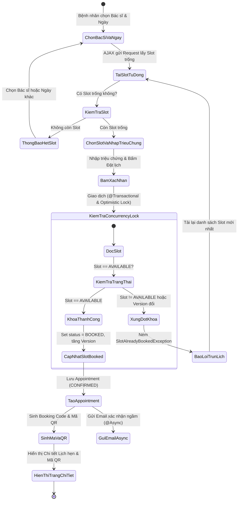
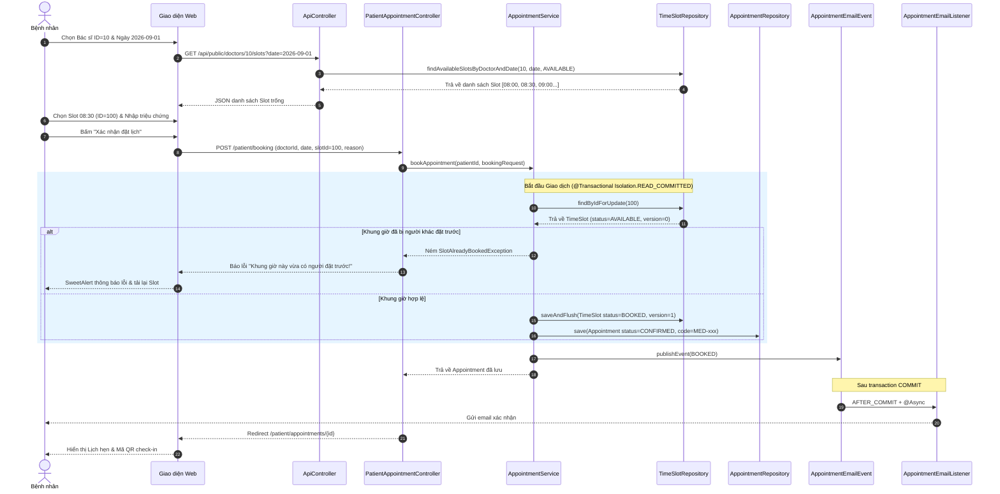
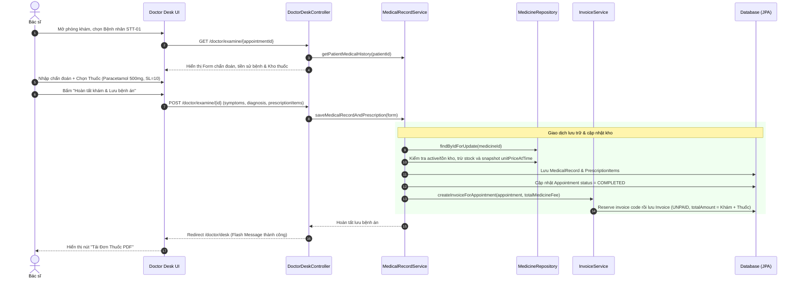
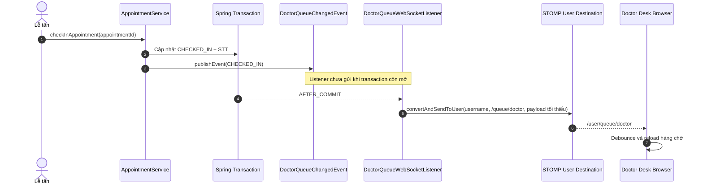
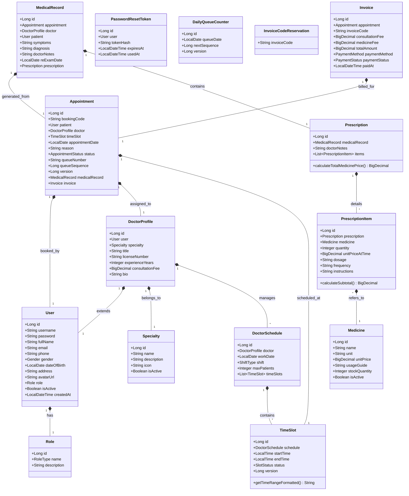

# TÀI LIỆU THIẾT KẾ SƠ ĐỒ UML (UML DESIGN DOCUMENT)
**Dự án:** MedClinic - Phòng Khám Tư Nhân  
**Chuẩn thiết kế:** UML 2.5 (Render trực quan bằng Mermaid)  
**Học phần:** Lập trình Web & Công nghệ Phần mềm  

---

## 1. SƠ ĐỒ USE CASE (USE CASE DIAGRAM)

### 1.1. Sơ đồ Use Case Tổng quan Toàn hệ thống

```mermaid
graph TD
    subgraph MedClinic System
        UC1[Đăng ký, Đăng nhập & Khôi phục mật khẩu]
        UC2[Tra cứu Bác sĩ & Chuyên khoa]
        UC3[Đặt lịch khám theo Khung giờ]
        UC4[Quản lý Lịch hẹn & Hủy lịch]
        UC5[Xem Lịch sử Bệnh án & Đơn thuốc PDF]
        
        UC6[Tra cứu & Check-in Mã QR]
        UC7[Cấp Số thứ tự tiếp nhận STT]
        UC8[Tiếp nhận Bệnh nhân Vãng lai]
        UC9[Thu viện phí & Xuất Hóa đơn PDF]
        
        UC10[Xem Hàng chờ & Lịch trực cá nhân]
        UC11[Chẩn đoán & Ghi Bệnh án điện tử]
        UC12[Kê đơn thuốc & Trừ kho dược]
        
        UC13[Quản lý Chuyên khoa]
        UC14[Quản lý Hồ sơ Bác sĩ]
        UC15[Quản lý Kho thuốc]
        UC16[Quản lý Tài khoản Người dùng]
        UC17[Xem Dashboard Thống kê Doanh thu]
    end

    Patient((Bệnh nhân)) --> UC1
    Patient --> UC2
    Patient --> UC3
    Patient --> UC4
    Patient --> UC5

    Staff((Lễ tân / Tiếp nhận)) --> UC1
    Staff --> UC6
    Staff --> UC7
    Staff --> UC8
    Staff --> UC9

    Doctor((Bác sĩ)) --> UC1
    Doctor --> UC10
    Doctor --> UC11
    Doctor --> UC12

    Admin((Quản trị viên)) --> UC1
    Admin --> UC13
    Admin --> UC14
    Admin --> UC15
    Admin --> UC16
    Admin --> UC17
```

---

## 2. ĐẶC TẢ USE CASE CHI TIẾT (USE CASE SPECIFICATIONS)

### 2.1. Đặc tả Use Case UC3: Đặt lịch khám trực tuyến (Online Appointment Booking)
- **Actor:** Bệnh nhân (`ROLE_PATIENT`)
- **Pre-conditions (Tiền điều kiện):** Bệnh nhân đã đăng nhập vào hệ thống.
- **Main Flow (Luồng chính):**
  1. Bệnh nhân truy cập trang "Đặt lịch khám".
  2. Bệnh nhân chọn Bác sĩ phụ trách và Chuyên khoa mong muốn.
  3. Bệnh nhân chọn Ngày khám (từ ngày hiện tại trở đi).
  4. Hệ thống tự động gửi yêu cầu AJAX lấy danh sách các khung giờ 30 phút còn khả dụng (`status = AVAILABLE`) của bác sĩ trong ngày đó.
  5. Bệnh nhân chọn một khung giờ (Slot) phù hợp và nhập lý do/triệu chứng bệnh.
  6. Bệnh nhân bấm nút "Xác nhận đặt lịch".
  7. Hệ thống thực hiện kiểm tra khóa đồng thời (Optimistic Lock):
     - Chuyển trạng thái Slot sang `BOOKED` (tăng `@Version`).
     - Tạo bản ghi `Appointment` với trạng thái `CONFIRMED` và sinh Mã đặt lịch duy nhất (`MED-YYMMDD-XXXX`).
     - Sinh mã QR Base64.
  8. Hệ thống kích hoạt gửi email xác nhận ngầm (`@Async`).
  9. Hệ thống chuyển hướng bệnh nhân tới trang Chi tiết lịch hẹn kèm mã QR.
- **Alternate Flows (Luồng ngoại lệ):**
  - *7a. Khung giờ vừa bị người khác đặt trước:* Hệ thống phát hiện xung đột dữ liệu (OptimisticLockingFailure hoặc Slot khác AVAILABLE) $\rightarrow$ Ném ngoại lệ `SlotAlreadyBookedException` $\rightarrow$ Thông báo người bệnh chọn lại khung giờ khác mà không gây lỗi dữ liệu.
- **Post-conditions (Hậu điều kiện):** Lịch hẹn được lưu vào CSDL, slot chuyển sang `BOOKED`, email xác nhận được gửi đi.

---

### 2.2. Đặc tả Use Case UC6 & UC7: Check-in tiếp nhận & Cấp số thứ tự khám
- **Actor:** Lễ tân (`ROLE_STAFF`)
- **Pre-conditions:** Lễ tân đã đăng nhập vào hệ thống portal.
- **Main Flow:**
  1. Lễ tân vào giao diện "Quầy Tiếp Nhận".
  2. Lễ tân nhập Mã đặt lịch (hoặc quét QR / nhập SĐT bệnh nhân) vào ô tìm kiếm.
  3. Hệ thống hiển thị thông tin lịch hẹn của bệnh nhân trong ngày.
  4. Lễ tân đối chiếu và bấm nút "Check-in (Cấp STT)".
  5. Hệ thống gọi `DailyQueueCounterAllocator.allocateNext(appointmentDate)` để lấy `queue_sequence` duy nhất theo ngày, sau đó định dạng `STT-XX`.
  6. Trạng thái lịch hẹn chuyển sang `CHECKED_IN`.
  7. Hệ thống phát `DoctorQueueChangedEvent`; sau khi transaction commit, `DoctorQueueWebSocketListener` gửi STOMP user destination tới đúng tài khoản Bác sĩ phụ trách. Doctor Desk tự tải lại hàng chờ.
- **Post-conditions:** Lịch hẹn có số thứ tự, sẵn sàng cho Bác sĩ gọi vào khám.

---

### 2.3. Đặc tả Use Case UC11 & UC12: Chẩn đoán khám bệnh & Kê đơn thuốc điện tử
- **Actor:** Bác sĩ (`ROLE_DOCTOR`)
- **Pre-conditions:** Bác sĩ đăng nhập vào hệ thống, bệnh nhân đã có trạng thái `CHECKED_IN`.
- **Main Flow:**
  1. Bác sĩ mở giao diện "Bàn Khám Bác Sĩ", chọn bệnh nhân từ hàng chờ trong ngày.
  2. Trạng thái lịch hẹn chuyển sang `IN_PROGRESS`; sau commit hệ thống phát cập nhật realtime để các Doctor Desk đang mở đồng bộ hàng chờ.
  3. Hệ thống hiển thị thông tin bệnh nhân và tiền sử các lần khám bệnh trước đây.
  4. Bác sĩ nhập triệu chứng lâm sàng quan sát được, nhập kết luận chẩn đoán y khoa, lời dặn và ngày hẹn tái khám.
  5. Bác sĩ chọn thuốc từ danh mục kho dược, nhập số lượng, liều dùng, cách dùng.
  6. Bác sĩ bấm "Hoàn tất khám bệnh".
  7. Hệ thống kiểm tra số lượng tồn kho của từng loại thuốc:
     - Trừ tồn kho trong bảng `medicines`.
     - Lưu `MedicalRecord`, `Prescription`, và `PrescriptionItem`.
     - Tự động sinh `Invoice` (tính tiền công khám + tổng tiền thuốc).
     - Cập nhật trạng thái lịch hẹn sang `COMPLETED`; sau commit phát sự kiện realtime loại `EXAMINATION_COMPLETED`.
  8. Hệ thống sẵn sàng cho phép Bác sĩ hoặc Bệnh nhân in Đơn thuốc định dạng PDF.
- **Alternate Flows:**
  - *7a. Thuốc trong kho không đủ số lượng:* Hệ thống cảnh báo thông báo thuốc không đủ tồn kho để Bác sĩ điều chỉnh số lượng hoặc đổi thuốc khác.
- **Post-conditions:** Hồ sơ bệnh án và đơn thuốc được lưu trữ, hóa đơn được tạo chờ thanh toán.

---

### 2.4. Đặc tả Use Case UC15: Quản lý Kho thuốc & Nhập bổ sung
- **Actor:** Quản trị viên (`ROLE_ADMIN`)
- **Pre-conditions:** Admin đã đăng nhập; thuốc đã tồn tại nếu thực hiện nhập bổ sung.
- **Main Flow:**
  1. Admin mở trang Kho thuốc và xem tồn hiện tại, ngưỡng nhập lại và trạng thái từng thuốc.
  2. Hệ thống đánh dấu `Hết hàng` khi tồn bằng 0, `Sắp hết` khi tồn nhỏ hơn hoặc bằng `reorderLevel`, ngược lại là `Bình thường`.
  3. Admin chọn `Nhập thêm`, nhập số lượng lớn hơn 0, giá nhập tùy chọn và ghi chú phiếu nhập.
  4. Hệ thống khóa bản ghi thuốc, tăng tồn kho nguyên tử và lưu `InventoryTransaction` loại `RESTOCK` với tồn trước/sau và người thực hiện.
  5. Lịch sử giao dịch kho hiển thị các lần nhập và các lần xuất theo đơn thuốc (`DISPENSE`).
- **Alternate Flows:**
  - *3a. Số lượng nhập <= 0 hoặc giá nhập âm:* từ chối giao dịch, tồn kho không thay đổi.
  - *4a. Có cập nhật đồng thời:* thao tác sử dụng pessimistic lock để tránh lost update.
- **Post-conditions:** Tồn kho và nhật ký giao dịch nhất quán trong cùng transaction; Dashboard phản ánh lại số thuốc dưới ngưỡng.

---

## 3. SƠ ĐỒ HOẠT ĐỘNG (ACTIVITY DIAGRAMS)

### 3.1. Sơ đồ Hoạt động: Quy trình Đặt lịch khám trực tuyến

---

## 4. SƠ ĐỒ TRÌNH TỰ (SEQUENCE DIAGRAMS)

### 4.1. Sơ đồ Trình tự: Đặt lịch khám & Concurrency Locking

---

### 4.2. Sơ đồ Trình tự: Khám bệnh, Kê đơn thuốc & Lập hóa đơn

---

### 4.3. Sơ đồ Trình tự: Hàng chờ bác sĩ Realtime qua WebSocket/STOMP

> Cùng cơ chế được dùng khi ca khám chuyển sang `IN_PROGRESS` và `COMPLETED`. Nếu transaction rollback, listener `AFTER_COMMIT` không broadcast. Client không gửi lệnh nghiệp vụ qua WebSocket; các thao tác vẫn đi qua HTTP controller/service có Spring Security và transaction.

## 5. SƠ ĐỒ LỚP CHI TIẾT (CLASS DIAGRAM)

