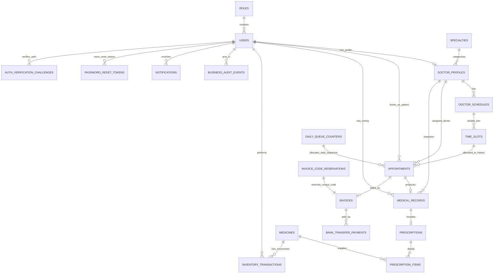

# THIẾT KẾ CƠ SỞ DỮ LIỆU & CHỨNG MINH CHUẨN HÓA 3NF (DATABASE DESIGN)
**Dự án:** MedClinic - Phòng Khám Tư Nhân
**Học phần:** Lập trình Web & Công nghệ Phần mềm
**Hệ quản trị CSDL mục tiêu:** Microsoft SQL Server (current/production); H2 Database chỉ dùng cho Dev/Test. MySQL là khả năng tương thích dự kiến trong roadmap tương lai.

---

## 1. SƠ ĐỒ THỰC THỂ LIÊN KẾT (ERD - ENTITY RELATIONSHIP DIAGRAM)

---

## 2. CHỨNG MINH CHUẨN HÓA CƠ SỞ DỮ LIỆU ĐẠT DẠNG CHUẨN 3 (3NF PROOF)

Mô hình tách danh mục, lịch khám, đơn thuốc và thanh toán để hạn chế bất thường cập nhật. Phân tích dưới đây giải thích các phụ thuộc chính; đây không phải chứng minh hình thức rằng mọi quan hệ đều đạt 3NF. Một số liên kết được lưu dư có chủ đích và phải giữ nhất quán trong service.

### 2.1. Chuẩn hóa Cấp 1 (1NF - First Normal Form)
- **Định nghĩa:** Một quan hệ đạt 1NF nếu và chỉ nếu mọi thuộc tính đều chứa các giá trị nguyên tử (Atomic values), không chứa tập hợp hay danh sách lặp lại trong một cột.
- **Áp dụng trong MedClinic:**
  - Danh mục thuốc trong một đơn thuốc không lưu dưới dạng mảng JSON/chuỗi phân tách dấu phẩy trong bảng `prescriptions`, mà được tách thành từng bản ghi riêng biệt trong bảng `prescription_items`.
  - Phần lớn bảng dùng `id BIGINT IDENTITY`. Ngoại lệ: `invoice_code_reservations` dùng `invoice_code`, `security_rate_limit_buckets` dùng `bucket_key`; bảng lịch sử Flyway do Flyway quản lý.

### 2.2. Chuẩn hóa Cấp 2 (2NF - Second Normal Form)
- **Định nghĩa:** Một quan hệ đạt 2NF nếu đạt 1NF và mọi thuộc tính không khóa đều phụ thuộc hàm đầy đủ vào toàn bộ khóa chính (Không tồn tại phụ thuộc bộ phận vào một phần của khóa chính ghép).
- **Áp dụng trong MedClinic:**
  - Khóa chính đơn không có phụ thuộc bộ phận vào chính khóa đó. Tuy nhiên, thêm khóa thay thế `id` chưa đủ chứng minh 2NF: cần xét mọi khóa ứng viên và phụ thuộc nghiệp vụ. Ví dụ, dòng đơn thuốc gắn với một đơn, một thuốc và thông tin cách dùng; không sao chép tên chuyên khoa vào dòng thuốc.

### 2.3. Chuẩn hóa Cấp 3 (3NF - Third Normal Form)
- **Định nghĩa:** Một quan hệ đạt 3NF nếu đạt 2NF và không tồn tại phụ thuộc hàm bắc cầu ($X \rightarrow Y$ và $Y \rightarrow Z$, trong đó $Z$ là thuộc tính không khóa).
- **Áp dụng trong MedClinic:**
  - *Ví dụ 1 (Bảng `appointments`):* Bảng này chỉ lưu khóa ngoại `doctor_id` và `time_slot_id`. Tên chuyên khoa, học vị của bác sĩ không được lưu trong bảng `appointments` mà phải truy vấn qua liên kết $Appointment \rightarrow DoctorProfile \rightarrow Specialty$.
  - *Ví dụ 2 (Bảng `prescription_items`):* Tên thuốc và đơn vị tiếp tục được chuẩn hóa tại `medicines`. `unit_price_at_time` là snapshot giá tại thời điểm kê đơn, một sự kiện lịch sử bất biến phục vụ hóa đơn; không dùng để thay thế giá hiện hành ở `medicines`.

---

### 2.4. Liên kết dư và giá lịch sử

`medical_records` giữ cả `appointment_id`, `doctor_id`, `patient_id`, trong khi lịch hẹn đã xác định bác sĩ và bệnh nhân. `appointments` cũng giữ bác sĩ cùng `time_slot_id`, dù slot qua lịch trực xác định bác sĩ. Đây là liên kết dư để truy vấn nghiệp vụ; không dùng sự tồn tại của `id` để phủ nhận phụ thuộc này. `AppointmentService` kiểm tra slot đúng bác sĩ/ngày; `MedicalRecordService` lấy bác sĩ và bệnh nhân từ lịch hẹn khi lưu.

`unit_price_at_time` phụ thuộc sự kiện kê đơn, không phải giá hiện hành của thuốc. Tên thuốc/đơn vị vẫn được đọc từ danh mục nên chưa phải snapshot toàn bộ danh mục. Trang bệnh án chỉ đọc giá đã lưu; đọc hồ sơ không xuất kho lại hay tạo hóa đơn mới.

## 3. TỪ ĐIỂN DỮ LIỆU CHI TIẾT (DATA DICTIONARY)

### 3.1. Bảng `roles` (Vai trò người dùng)
| Tên Cột | Kiểu Dữ Liệu | Ràng Buộc | Ý Nghĩa / Diễn Giải |
| :--- | :--- | :--- | :--- |
| `id` | BIGINT | PK, IDENTITY | Khóa chính |
| `name` | NVARCHAR(50) | NOT NULL, UNIQUE | Tên quyền (`ROLE_PATIENT`, `ROLE_DOCTOR`, `ROLE_STAFF`, `ROLE_ADMIN`) |
| `description` | NVARCHAR(255) | NULL | Diễn giải chức năng vai trò |

### 3.2. Bảng `users` (Tài khoản người dùng)
| Tên Cột | Kiểu Dữ Liệu | Ràng Buộc | Ý Nghĩa / Diễn Giải |
| :--- | :--- | :--- | :--- |
| `id` | BIGINT | PK, IDENTITY | Khóa chính |
| `username` | NVARCHAR(50) | NOT NULL, UNIQUE | Tên đăng nhập hệ thống |
| `password` | NVARCHAR(255) | NOT NULL | Mật khẩu đã băm bằng giải thuật BCrypt |
| `full_name` | NVARCHAR(100) | NOT NULL | Họ và tên đầy đủ |
| `email` | NVARCHAR(100) | NOT NULL, UNIQUE | Địa chỉ email liên hệ |
| `phone` | NVARCHAR(20) | NULL, UNIQUE filtered khi khác NULL | Số điện thoại dùng chung quy tắc PhoneNumbers, không trùng giữa các tài khoản |
| `gender` | NVARCHAR(10) | NULL | Giới tính (`MALE`, `FEMALE`, `OTHER`) |
| `date_of_birth`| DATE | NULL | Ngày tháng năm sinh |
| `address` | NVARCHAR(255) | NULL | Địa chỉ cư trú |
| `avatar_url` | NVARCHAR(255) | NULL | Đường dẫn ảnh đại diện đã upload |
| `email_verified` | BIT | NOT NULL, DEFAULT TRUE cho legacy | Email đã được xác thực; đăng ký mới được application đặt FALSE tới khi OTP thành công |
| `otp_bypass` | BIT | NOT NULL, DEFAULT FALSE | Chỉ dành cho seed/test account; tài khoản thường luôn FALSE |
| `security_version` | BIGINT | NOT NULL, DEFAULT 0 | Thu hồi phiên cũ khi khóa tài khoản hoặc thay đổi bảo mật |
| `google_subject` | NVARCHAR(255) | NULL, UNIQUE filtered, collation BIN2 | Định danh Google sub, phân biệt hoa/thường; không phải tên hiển thị |
| `role_id` | BIGINT | NOT NULL, FK -> `roles(id)` | Vai trò người dùng |
| `is_active` | BIT | NOT NULL, DEFAULT TRUE | Trạng thái kích hoạt tài khoản |
| `created_at` | DATETIME2 | NOT NULL | Thời điểm tạo tài khoản |
| `updated_at` | DATETIME2 | NULL | Thời điểm cập nhật cuối |

### 3.3. Bảng `specialties` (Chuyên khoa khám bệnh)
| Tên Cột | Kiểu Dữ Liệu | Ràng Buộc | Ý Nghĩa / Diễn Giải |
| :--- | :--- | :--- | :--- |
| `id` | BIGINT | PK, IDENTITY | Khóa chính |
| `name` | NVARCHAR(100) | NOT NULL, UNIQUE | Tên chuyên khoa (Tim mạch, Nhi khoa...) |
| `description` | NVARCHAR(MAX) | NULL | Mô tả chi tiết phạm vi khám |
| `icon` | NVARCHAR(100) | NULL | Mã class Icon Bootstrap |
| `is_active` | BIT | NOT NULL, DEFAULT TRUE | Trạng thái hoạt động |

### 3.4. Bảng `doctor_profiles` (Hồ sơ chuyên môn Bác sĩ)
| Tên Cột | Kiểu Dữ Liệu | Ràng Buộc | Ý Nghĩa / Diễn Giải |
| :--- | :--- | :--- | :--- |
| `id` | BIGINT | PK, IDENTITY | Khóa chính |
| `user_id` | BIGINT | NOT NULL, UNIQUE, FK -> `users(id)` | Khóa ngoại tài khoản người dùng |
| `specialty_id` | BIGINT | NOT NULL, FK -> `specialties(id)` | Khóa ngoại chuyên khoa trực thuộc |
| `title` | NVARCHAR(50) | NOT NULL | Học hàm/học vị (PGS.TS, ThS.BS, BS.CKII) |
| `license_number` | NVARCHAR(50) | NULL trong schema legacy; bắt buộc khi tạo bác sĩ mới | Số giấy phép hành nghề |
| `experience_years`| INT | NOT NULL | Số năm kinh nghiệm công tác |
| `consultation_fee`| DECIMAL(12,2) | NOT NULL | Giá tiền khám tư vấn cơ bản (VNĐ) |
| `bio` | NVARCHAR(MAX) | NULL | Tiểu sử quá trình đào tạo và công tác |

### 3.5. Bảng `doctor_schedules` (Lịch làm việc ca của Bác sĩ)
| Tên Cột | Kiểu Dữ Liệu | Ràng Buộc | Ý Nghĩa / Diễn Giải |
| :--- | :--- | :--- | :--- |
| `id` | BIGINT | PK, IDENTITY | Khóa chính |
| `doctor_id` | BIGINT | NOT NULL, FK -> `doctor_profiles(id)` | Khóa ngoại bác sĩ |
| `work_date` | DATE | NOT NULL | Ngày trực khám |
| `shift` | NVARCHAR(20) | NOT NULL | Ca trực (`MORNING`, `AFTERNOON`) |
| `max_patients` | INT | NOT NULL, DEFAULT 8 | Số bệnh nhân tối đa trong ca |
| *Constraint* | UNIQUE (`doctor_id`, `work_date`, `shift`) | Đảm bảo mỗi bác sĩ chỉ có 1 ca sáng/chiều trong 1 ngày |

### 3.6. Bảng `time_slots` (Khung giờ khám 30 phút & Concurrency Lock)
| Tên Cột | Kiểu Dữ Liệu | Ràng Buộc | Ý Nghĩa / Diễn Giải |
| :--- | :--- | :--- | :--- |
| `id` | BIGINT | PK, IDENTITY | Khóa chính |
| `schedule_id` | BIGINT | NOT NULL, FK -> `doctor_schedules(id)` | Khóa ngoại ca trực |
| `start_time` | TIME | NOT NULL | Giờ bắt đầu (VD: 08:00) |
| `end_time` | TIME | NOT NULL | Giờ kết thúc (VD: 08:30) |
| `status` | NVARCHAR(20) | NOT NULL | Trạng thái (`AVAILABLE`, `BOOKED`, `BLOCKED`) |
| `version` | BIGINT | NOT NULL, DEFAULT 0 | **Optimistic Locking Version** chống Double Booking |

### 3.7. Bảng `appointments` (Lịch hẹn khám bệnh)
| Tên Cột | Kiểu Dữ Liệu | Ràng Buộc | Ý Nghĩa / Diễn Giải |
| :--- | :--- | :--- | :--- |
| `id` | BIGINT | PK, IDENTITY | Khóa chính |
| `booking_code` | NVARCHAR(30) | NOT NULL, UNIQUE, INDEX | Mã lịch hẹn (VD: `MED-260831-A1B2`) |
| `patient_id` | BIGINT | NOT NULL, FK -> `users(id)` | Khóa ngoại bệnh nhân |
| `doctor_id` | BIGINT | NOT NULL, FK -> `doctor_profiles(id)` | Khóa ngoại bác sĩ |
| `time_slot_id` | BIGINT | NOT NULL, FK -> `time_slots(id)`| Khung giờ khám; nhiều appointment lịch sử được phép tham chiếu cùng slot sau khi hủy |
| `appointment_date`| DATE | NOT NULL, INDEX | Ngày khám thực tế |
| `reason` | NVARCHAR(MAX) | NULL | Lý do khám & Triệu chứng ban đầu |
| `status` | NVARCHAR(30) | NOT NULL | `CONFIRMED`, `CHECKED_IN`, `IN_PROGRESS`, `COMPLETED`, `CANCELLED`, `NO_SHOW` |
| `queue_number` | NVARCHAR(20) | NULL | Số thứ tự tiếp nhận trong ngày (VD: `STT-01`) |
| `queue_sequence` | BIGINT | NULL, UNIQUE cùng `appointment_date` | Giá trị số dùng để sắp hàng queue đúng sau 99 |
| `version` | BIGINT | NOT NULL | Optimistic locking khi đổi trạng thái appointment |
| `created_at` | DATETIME2 | NOT NULL | Thời điểm đặt lịch |
| `updated_at` | DATETIME2 | NULL | Thời điểm cập nhật cuối |

### 3.8. Bảng `medical_records` (Hồ sơ bệnh án điện tử)
| Tên Cột | Kiểu Dữ Liệu | Ràng Buộc | Ý Nghĩa / Diễn Giải |
| :--- | :--- | :--- | :--- |
| `id` | BIGINT | PK, IDENTITY | Khóa chính |
| `appointment_id`| BIGINT | NOT NULL, UNIQUE, FK -> `appointments(id)`| Liên kết lịch hẹn |
| `doctor_id` | BIGINT | NOT NULL, FK -> `doctor_profiles(id)` | Bác sĩ khám |
| `patient_id` | BIGINT | NOT NULL, FK -> `users(id)` | Bệnh nhân |
| `symptoms` | NVARCHAR(MAX) | NOT NULL | Triệu chứng lâm sàng ghi nhận |
| `diagnosis` | NVARCHAR(MAX) | NOT NULL | Kết luận chẩn đoán y khoa |
| `doctor_notes` | NVARCHAR(MAX) | NULL | Lời dặn, chế độ dinh dưỡng |
| `re_exam_date` | DATE | NULL | Ngày hẹn tái khám |
| `created_at` | DATETIME2 | NOT NULL | Thời điểm hoàn tất khám |

### 3.9. Bảng `medicines` (Danh mục thuốc & Kho dược)
| Tên Cột | Kiểu Dữ Liệu | Ràng Buộc | Ý Nghĩa / Diễn Giải |
| :--- | :--- | :--- | :--- |
| `id` | BIGINT | PK, IDENTITY | Khóa chính |
| `name` | NVARCHAR(150) | NOT NULL, UNIQUE | Tên thuốc biệt dược / hoạt chất |
| `unit` | NVARCHAR(30) | NOT NULL | Đơn vị tính (Viên, Hộp, Vỉ, Chai, Gói) |
| `unit_price` | DECIMAL(12,2)| NOT NULL | Đơn giá bán lẻ (VNĐ) |
| `usage_guide` | NVARCHAR(255) | NULL | Hướng dẫn sử dụng cơ bản |
| `stock_quantity`| INT | NOT NULL, DEFAULT 1000 | Số lượng tồn trong kho |
| `reorder_level`| INT | NOT NULL, DEFAULT 50, CHECK >= 0 | Ngưỡng cảnh báo cần nhập bổ sung của từng thuốc |
| `is_active` | BIT | NOT NULL, DEFAULT TRUE | Trạng thái kinh doanh |
| `version` | BIGINT | NOT NULL | Optimistic locking khi trừ tồn kho |

### 3.10. Bảng `inventory_transactions` (Nhật ký nhập/xuất kho)
| Tên Cột | Kiểu Dữ Liệu | Ràng Buộc | Ý Nghĩa / Diễn Giải |
| :--- | :--- | :--- | :--- |
| `id` | BIGINT | PK, IDENTITY | Khóa chính |
| `medicine_id` | BIGINT | NOT NULL, FK -> `medicines(id)` | Thuốc phát sinh biến động |
| `type` | NVARCHAR(20) | NOT NULL | `RESTOCK`, `DISPENSE`, `ADJUSTMENT` |
| `quantity_change` | INT | NOT NULL, != 0 | Biến động có dấu: nhập dương, xuất âm |
| `stock_before` / `stock_after` | INT | NOT NULL, CHECK >= 0 | Snapshot tồn trước/sau để audit |
| `unit_cost` | DECIMAL(12,2) | NULL, CHECK >= 0 | Giá nhập theo đơn vị nếu có |
| `note` | NVARCHAR(255) | NULL | Ghi chú phiếu nhập/xuất |
| `reference_type`, `reference_id` | NVARCHAR(30), BIGINT | NULL | Tham chiếu nghiệp vụ; xuất kê đơn dùng `APPOINTMENT` |
| `performed_by_user_id` | BIGINT | NOT NULL, FK -> `users(id)` | Người gây ra giao dịch |
| `created_at` | DATETIME2 | NOT NULL | Thời điểm giao dịch |

### 3.11. Bảng `prescriptions` & `prescription_items` (Đơn thuốc & Chi tiết đơn thuốc)
- **`prescriptions`:** `id` (PK), `medical_record_id` (FK Unique), `doctor_notes` (TEXT), `created_at` (DATETIME).
- **`prescription_items`:** `id` (PK), `prescription_id` (FK), `medicine_id` (FK), `quantity` (INT), `unit_price_at_time` (DECIMAL(12,2), NOT NULL), `dosage` (VARCHAR), `frequency` (VARCHAR), `instructions` (VARCHAR). Giá snapshot được dùng cho tổng tiền của đơn cũ.

### 3.12. Bảng `invoices` (Hóa đơn thanh toán viện phí)
| Tên Cột | Kiểu Dữ Liệu | Ràng Buộc | Ý Nghĩa / Diễn Giải |
| :--- | :--- | :--- | :--- |
| `id` | BIGINT | PK, IDENTITY | Khóa chính |
| `appointment_id`| BIGINT | NOT NULL, UNIQUE, FK -> `appointments(id)`| Liên kết ca khám |
| `invoice_code` | NVARCHAR(30) | NOT NULL, UNIQUE, INDEX | Mã hóa đơn tài chính (`INV-YYMMDD-XXXX`) |
| `consultation_fee`| DECIMAL(12,2)| NOT NULL | Tiền công khám bác sĩ |
| `medicine_fee` | DECIMAL(12,2)| NOT NULL, DEFAULT 0 | Tổng tiền thuốc trong đơn |
| `total_amount` | DECIMAL(12,2)| NOT NULL | Tổng tiền thanh toán (`consultation_fee + medicine_fee`) |
| `payment_method`| NVARCHAR(20) | NOT NULL | `CASH`, `BANK_TRANSFER`; `VNPAY` chỉ giữ tương thích dữ liệu cũ và không được UI tạo mới |
| `payment_status`| NVARCHAR(20) | NOT NULL | `UNPAID`, `PAID`, `REFUNDED` |
| `paid_at` | DATETIME2 | NULL | Thời điểm thanh toán |
| `created_at` | DATETIME2 | NOT NULL | Thời điểm lập hóa đơn |

### 3.13. Bảng `daily_queue_counters` (Bộ cấp số thứ tự theo ngày)
| Tên Cột | Kiểu Dữ Liệu | Ràng Buộc | Ý Nghĩa / Diễn Giải |
| :--- | :--- | :--- | :--- |
| `id` | BIGINT | PK, IDENTITY | Khóa chính |
| `queue_date` | DATE | NOT NULL, UNIQUE | Một counter cho mỗi ngày khám |
| `next_sequence` | BIGINT | NOT NULL | Sequence kế tiếp để cấp STT |
| `version` | BIGINT | NOT NULL | Optimistic locking cho counter |

### 3.14. Bảng `invoice_code_reservations` (Giữ chỗ mã hóa đơn)
| Tên Cột | Kiểu Dữ Liệu | Ràng Buộc | Ý Nghĩa / Diễn Giải |
| :--- | :--- | :--- | :--- |
| `invoice_code` | NVARCHAR(30) | PK, UNIQUE | Bản ghi reservation được insert trước khi phát hành hóa đơn để xử lý collision mã |

### 3.15. Bảng `notifications` (Thông báo nội bộ)
- `id` BIGINT IDENTITY PK; `user_id` FK -> `users(id)`; `title` NVARCHAR(150) NOT NULL; `content` NVARCHAR(MAX) NOT NULL; `type` NVARCHAR(50) NULL; `is_read` BIT NOT NULL; `created_at` DATETIME2 NOT NULL.
- Hiện project mới có entity/repository; notification center hoàn chỉnh thuộc roadmap.

### 3.16. Bảng `password_reset_tokens` (Token khôi phục mật khẩu)
- `id` BIGINT IDENTITY PK; `user_id` FK -> `users(id)`; `token_hash` NVARCHAR(64) NOT NULL UNIQUE + index; `expires_at` DATETIME2 NOT NULL; `used_at` DATETIME2 NULL; `created_at` DATETIME2 NOT NULL.
- Chỉ lưu SHA-256 hash token, không lưu token thô; token hết hạn sau 24 giờ và chỉ dùng một lần.

### 3.17. Bảng `auth_verification_challenges` (OTP / Magic Link)
- `id` BIGINT IDENTITY PK; `user_id` FK -> `users(id)`; `type` (`REGISTRATION`, `LOGIN`); `code_hash` NVARCHAR(100); `magic_token_hash` NVARCHAR(64) UNIQUE; `expires_at`; `consumed_at`; `attempts`; `created_at`.
- OTP 6 số chỉ lưu BCrypt hash; magic token entropy cao chỉ lưu SHA-256 hash. Challenge hết hạn sau 5 phút, dùng một lần và tối đa 5 lần nhập OTP sai. Gửi lại mã sẽ consume challenge cũ và tạo challenge mới.

### 3.18. Bảng `bank_transfer_payments` (Yêu cầu chuyển khoản VietQR)

| Cột | Ràng buộc / ý nghĩa |
|---|---|
| `id` | BIGINT IDENTITY, PK |
| `invoice_id` | FK → `invoices`; một hóa đơn có thể tạo lại yêu cầu sau khi yêu cầu cũ hết hạn |
| `transfer_code` | NVARCHAR(25), UNIQUE; nội dung chuyển khoản riêng để đối soát |
| `amount` | DECIMAL(12,2), CHECK > 0; snapshot số tiền phải khớp callback |
| `bank_id` | Mã BIN/short code ngân hàng thụ hưởng, ví dụ MB `970422` |
| `status` | `PENDING`, `CONFIRMED`, `REJECTED`, `EXPIRED` |
| `provider_event_id` | UNIQUE filtered khi khác NULL; idempotency của callback |
| `bank_transaction_id` | UNIQUE filtered khi khác NULL; chống dùng một giao dịch cho nhiều hóa đơn |
| `expires_at`, `confirmed_at`, `created_at`, `version` | Thời hạn, thời điểm xác nhận và optimistic version |

### 3.19. Bảng `business_audit_events` (Audit nghiệp vụ)

Lưu actor id (nếu có), action, entity type/id, outcome, correlation id, detail code và thời điểm. Bảng không lưu raw callback, số tài khoản, password, OTP, token hoặc secret. Các luồng tiền mặt, tạo VietQR, callback và đối soát thủ công đều ghi sự kiện.

### 3.20. Bảng `security_rate_limit_buckets` (Rate limit dùng chung)

Khóa chính `bucket_key` là SHA-256 của remote IP + endpoint; `window_start` và `request_count` được cập nhật trong transaction `SERIALIZABLE` với SQL Server lock hints. Nhờ đó nhiều instance dùng chung ngưỡng mà không lưu IP thô.

> SQL Server dùng `NVARCHAR`/`NVARCHAR(MAX)` thông qua `hibernate.use_nationalized_character_data=true` để bảo toàn Unicode tiếng Việt trên collation `SQL_Latin1_General_CP1_CI_AS`.

## 4. Triển khai migration

SQL Server là database chính của phiên bản hiện tại. Profile `sqlserver` dùng **Flyway** để quản lý schema theo version và giữ `spring.jpa.hibernate.ddl-auto=validate`; vì vậy Hibernate chỉ xác minh mapping sau khi migration hoàn tất, không tự sửa production schema.

Các migration hiện tại:

- `src/main/resources/db/migration/sqlserver/V1__baseline_schema.sql`: baseline 16 bảng, foreign key, unique constraint và filtered index của SQL Server.
- `src/main/resources/db/migration/sqlserver/V2__reference_roles.sql`: seed idempotent bốn role hệ thống bắt buộc.
- `src/main/resources/db/migration/sqlserver/V3__restore_jdbc_session_state.sql`: trả SQL Server session về `NOCOUNT OFF` để connection pool/JDBC generated keys hoạt động ổn định sau migration.
- `src/main/resources/db/migration/sqlserver/V4__inventory_restock_and_low_stock.sql`: thêm `medicines.reorder_level`, bảng `inventory_transactions`, FK/check/index phục vụ cảnh báo tồn thấp và audit nhập/xuất kho.
- `src/main/resources/db/migration/sqlserver/V5__email_otp_and_profile_security.sql`: thêm `users.email_verified`, `users.otp_bypass` và bảng `auth_verification_challenges` cho OTP/magic link 5 phút.
- `src/main/resources/db/migration/sqlserver/V6__bank_payments_audit_and_shared_rate_limits.sql`: thêm VietQR payment request, audit nghiệp vụ, shared rate-limit bucket và mở `BANK_TRANSFER` trong payment method.

`V1` và `V2` là hai script khởi tạo schema chuẩn và seed bốn role hệ thống trên SQL Server.

- `V7__unique_patient_phone.sql`: chuẩn hóa/kiểm tra dữ liệu trước khi thêm unique filtered index cho số điện thoại.
- `V8__account_security_version.sql`: phiên đăng nhập bị thu hồi khi tài khoản thay đổi phiên bản bảo mật.
- `V9__integral_vnd_catalog_prices.sql`: giá danh mục phải là số nguyên VND và nằm trong miền hợp lệ.
- `V10__google_patient_identity.sql`: `users.google_subject`, unique filtered index với collation phân biệt hoa/thường cho định danh Google.

`users` hiện có `security_version` và `google_subject` ngoài các cột baseline. V7–V10 không thêm bảng nghiệp vụ mới; màn hình đọc bệnh án tái sử dụng schema hiện có.

### Database mới

Flyway tạo `flyway_schema_history`, áp dụng tuần tự `V1` đến `V10`; sau đó Hibernate chạy `validate`. Nếu schema không khớp entity, application startup phải fail.

### Database legacy 16 bảng

Production mặc định giữ `baseline-on-migrate=false`. Sau backup và pre-check xác nhận đúng baseline 16 bảng, operator mới bật `SPRING_FLYWAY_BASELINE_ON_MIGRATE=true` cho lần adoption đầu tiên. Flyway ghi baseline version 1, bỏ qua V1 và áp dụng các migration sau đó (`V2` đến `V10`). Sau khi history được tạo, bỏ opt-in này. Không baseline schema dở dang hoặc không rõ nguồn gốc.

`SqlServerFlywayMigrationIntegrationTest` kiểm chứng cả fresh migration và legacy adoption trên database disposable `medclinic_flyway_it`, sau đó drop database test. Docker init chỉ áp dụng guard `0`/`16` khi chưa có `flyway_schema_history`; khi history đã tồn tại, Flyway/Hibernate chịu trách nhiệm kiểm tra các version schema tương lai.

Project deploy mục tiêu SQL Server 2019/2022. Lượt QA lịch sử ngày 19/09 dùng SQL Server 17.0 (2025); Flyway 10.10.0 phát cảnh báo đây là server mới hơn mức hỗ trợ đã công bố (16.0), nhưng migration acceptance local vẫn PASS. Không dùng cảnh báo này để suy diễn rằng SQL Server 17 đã được Flyway 10.10 chứng nhận chính thức.

MySQL chỉ thuộc roadmap tương lai.
