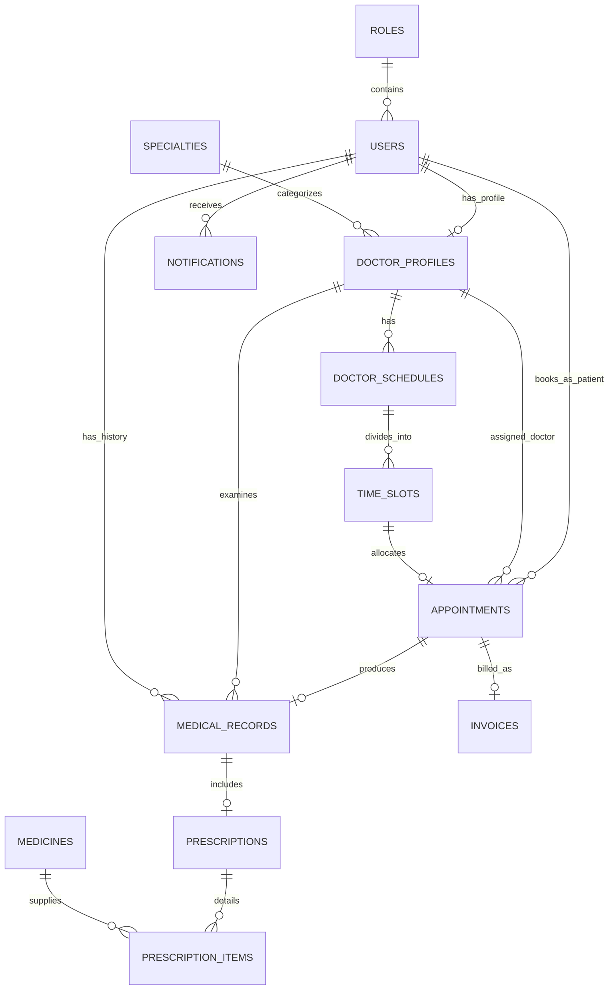

# THIẾT KẾ CƠ SỞ DỮ LIỆU & CHỨNG MINH CHUẨN HÓA 3NF (DATABASE DESIGN)
**Dự án:** MedClinic - Phòng Khám Tư Nhân  
**Học phần:** Lập trình Web & Công nghệ Phần mềm  
**Hệ quản trị CSDL hỗ trợ:** H2 Database (Dev Mode) / MySQL 8.0 / MS SQL Server  

---

## 1. SƠ ĐỒ THỰC THỂ LIÊN KẾT (ERD - ENTITY RELATIONSHIP DIAGRAM)

---

## 2. CHỨNG MINH CHUẨN HÓA CƠ SỞ DỮ LIỆU ĐẠT DẠNG CHUẨN 3 (3NF PROOF)

Để đảm bảo CSDL không bị dư thừa dữ liệu (Data Redundancy) và tránh các bất thường khi thao tác (Insert, Update, Delete Anomalies), toàn bộ các bảng trong hệ thống MedClinic được thiết kế và chứng minh chuẩn hóa đạt **Dạng chuẩn 3 (3NF)**:

### 2.1. Chuẩn hóa Cấp 1 (1NF - First Normal Form)
- **Định nghĩa:** Một quan hệ đạt 1NF nếu và chỉ nếu mọi thuộc tính đều chứa các giá trị nguyên tử (Atomic values), không chứa tập hợp hay danh sách lặp lại trong một cột.
- **Áp dụng trong MedClinic:**
  - Danh mục thuốc trong một đơn thuốc không lưu dưới dạng mảng JSON/chuỗi phân tách dấu phẩy trong bảng `prescriptions`, mà được tách thành từng bản ghi riêng biệt trong bảng `prescription_items`.
  - Mọi bảng đều có Khóa chính đơn nhất (`id` kiểu `BIGINT AUTO_INCREMENT`).

### 2.2. Chuẩn hóa Cấp 2 (2NF - Second Normal Form)
- **Định nghĩa:** Một quan hệ đạt 2NF nếu đạt 1NF và mọi thuộc tính không khóa đều phụ thuộc hàm đầy đủ vào toàn bộ khóa chính (Không tồn tại phụ thuộc bộ phận vào một phần của khóa chính ghép).
- **Áp dụng trong MedClinic:**
  - Toàn bộ các bảng đều sử dụng khóa chính đơn (`id`), do đó không tồn tại bất kỳ phụ thuộc hàm bộ phận nào vào khóa ghép. Mọi thuộc tính như `fullName`, `email`, `consultationFee` đều phụ thuộc hoàn toàn vào khóa chính `id`.

### 2.3. Chuẩn hóa Cấp 3 (3NF - Third Normal Form)
- **Định nghĩa:** Một quan hệ đạt 3NF nếu đạt 2NF và không tồn tại phụ thuộc hàm bắc cầu ($X \rightarrow Y$ và $Y \rightarrow Z$, trong đó $Z$ là thuộc tính không khóa).
- **Áp dụng trong MedClinic:**
  - *Ví dụ 1 (Bảng `appointments`):* Bảng này chỉ lưu khóa ngoại `doctor_id` và `time_slot_id`. Tên chuyên khoa, học vị của bác sĩ không được lưu trong bảng `appointments` mà phải truy vấn qua liên kết $Appointment \rightarrow DoctorProfile \rightarrow Specialty$.
  - *Ví dụ 2 (Bảng `prescription_items`):* Bảng này chỉ lưu `medicine_id` và `quantity`. Tên thuốc `name`, đơn vị tính `unit` và giá thuốc `unitPrice` được lưu tại bảng `medicines`, loại bỏ hoàn toàn phụ thuộc bắc cầu $PrescriptionItem \rightarrow Medicine \rightarrow (name, unit, unitPrice)$.

---

## 3. TỪ ĐIỂN DỮ LIỆU CHI TIẾT (DATA DICTIONARY)

### 3.1. Bảng `roles` (Vai trò người dùng)
| Tên Cột | Kiểu Dữ Liệu | Ràng Buộc | Ý Nghĩa / Diễn Giải |
| :--- | :--- | :--- | :--- |
| `id` | BIGINT | PK, AUTO_INCREMENT | Khóa chính |
| `name` | VARCHAR(50) | NOT NULL, UNIQUE | Tên quyền (`ROLE_PATIENT`, `ROLE_DOCTOR`, `ROLE_STAFF`, `ROLE_ADMIN`) |
| `description` | VARCHAR(255) | NULL | Diễn giải chức năng vai trò |

### 3.2. Bảng `users` (Tài khoản người dùng)
| Tên Cột | Kiểu Dữ Liệu | Ràng Buộc | Ý Nghĩa / Diễn Giải |
| :--- | :--- | :--- | :--- |
| `id` | BIGINT | PK, AUTO_INCREMENT | Khóa chính |
| `username` | VARCHAR(50) | NOT NULL, UNIQUE | Tên đăng nhập hệ thống |
| `password` | VARCHAR(255) | NOT NULL | Mật khẩu đã băm bằng giải thuật BCrypt |
| `full_name` | VARCHAR(100) | NOT NULL | Họ và tên đầy đủ |
| `email` | VARCHAR(100) | NOT NULL, UNIQUE | Địa chỉ email liên hệ |
| `phone` | VARCHAR(20) | NULL | Số điện thoại di động |
| `gender` | VARCHAR(10) | NULL | Giới tính (`MALE`, `FEMALE`, `OTHER`) |
| `date_of_birth`| DATE | NULL | Ngày tháng năm sinh |
| `address` | VARCHAR(255) | NULL | Địa chỉ cư trú |
| `avatar_url` | VARCHAR(255) | NULL | Đường dẫn ảnh đại diện |
| `role_id` | BIGINT | NOT NULL, FK -> `roles(id)` | Vai trò người dùng |
| `is_active` | BOOLEAN | NOT NULL, DEFAULT TRUE | Trạng thái kích hoạt tài khoản |
| `created_at` | DATETIME | NOT NULL | Thời điểm tạo tài khoản |
| `updated_at` | DATETIME | NULL | Thời điểm cập nhật cuối |

### 3.3. Bảng `specialties` (Chuyên khoa khám bệnh)
| Tên Cột | Kiểu Dữ Liệu | Ràng Buộc | Ý Nghĩa / Diễn Giải |
| :--- | :--- | :--- | :--- |
| `id` | BIGINT | PK, AUTO_INCREMENT | Khóa chính |
| `name` | VARCHAR(100) | NOT NULL, UNIQUE | Tên chuyên khoa (Tim mạch, Nhi khoa...) |
| `description` | TEXT | NULL | Mô tả chi tiết phạm vi khám |
| `icon` | VARCHAR(100) | NULL | Mã class Icon Bootstrap |
| `is_active` | BOOLEAN | NOT NULL, DEFAULT TRUE | Trạng thái hoạt động |

### 3.4. Bảng `doctor_profiles` (Hồ sơ chuyên môn Bác sĩ)
| Tên Cột | Kiểu Dữ Liệu | Ràng Buộc | Ý Nghĩa / Diễn Giải |
| :--- | :--- | :--- | :--- |
| `id` | BIGINT | PK, AUTO_INCREMENT | Khóa chính |
| `user_id` | BIGINT | NOT NULL, UNIQUE, FK -> `users(id)` | Khóa ngoại tài khoản người dùng |
| `specialty_id` | BIGINT | NOT NULL, FK -> `specialties(id)` | Khóa ngoại chuyên khoa trực thuộc |
| `title` | VARCHAR(50) | NOT NULL | Học hàm/học vị (PGS.TS, ThS.BS, BS.CKII) |
| `experience_years`| INT | NOT NULL | Số năm kinh nghiệm công tác |
| `consultation_fee`| DECIMAL(12,2) | NOT NULL | Giá tiền khám tư vấn cơ bản (VNĐ) |
| `bio` | TEXT | NULL | Tiểu sử quá trình đào tạo và công tác |

### 3.5. Bảng `doctor_schedules` (Lịch làm việc ca của Bác sĩ)
| Tên Cột | Kiểu Dữ Liệu | Ràng Buộc | Ý Nghĩa / Diễn Giải |
| :--- | :--- | :--- | :--- |
| `id` | BIGINT | PK, AUTO_INCREMENT | Khóa chính |
| `doctor_id` | BIGINT | NOT NULL, FK -> `doctor_profiles(id)` | Khóa ngoại bác sĩ |
| `work_date` | DATE | NOT NULL | Ngày trực khám |
| `shift` | VARCHAR(20) | NOT NULL | Ca trực (`MORNING`, `AFTERNOON`) |
| `max_patients` | INT | NOT NULL, DEFAULT 8 | Số bệnh nhân tối đa trong ca |
| *Constraint* | UNIQUE (`doctor_id`, `work_date`, `shift`) | Đảm bảo mỗi bác sĩ chỉ có 1 ca sáng/chiều trong 1 ngày |

### 3.6. Bảng `time_slots` (Khung giờ khám 30 phút & Concurrency Lock)
| Tên Cột | Kiểu Dữ Liệu | Ràng Buộc | Ý Nghĩa / Diễn Giải |
| :--- | :--- | :--- | :--- |
| `id` | BIGINT | PK, AUTO_INCREMENT | Khóa chính |
| `schedule_id` | BIGINT | NOT NULL, FK -> `doctor_schedules(id)` | Khóa ngoại ca trực |
| `start_time` | TIME | NOT NULL | Giờ bắt đầu (VD: 08:00) |
| `end_time` | TIME | NOT NULL | Giờ kết thúc (VD: 08:30) |
| `status` | VARCHAR(20) | NOT NULL | Trạng thái (`AVAILABLE`, `BOOKED`, `BLOCKED`) |
| `version` | BIGINT | NOT NULL, DEFAULT 0 | **Optimistic Locking Version** chống Double Booking |

### 3.7. Bảng `appointments` (Lịch hẹn khám bệnh)
| Tên Cột | Kiểu Dữ Liệu | Ràng Buộc | Ý Nghĩa / Diễn Giải |
| :--- | :--- | :--- | :--- |
| `id` | BIGINT | PK, AUTO_INCREMENT | Khóa chính |
| `booking_code` | VARCHAR(30) | NOT NULL, UNIQUE, INDEX | Mã lịch hẹn (VD: `MED-260831-A1B2`) |
| `patient_id` | BIGINT | NOT NULL, FK -> `users(id)` | Khóa ngoại bệnh nhân |
| `doctor_id` | BIGINT | NOT NULL, FK -> `doctor_profiles(id)` | Khóa ngoại bác sĩ |
| `time_slot_id` | BIGINT | NOT NULL, UNIQUE, FK -> `time_slots(id)`| Khung giờ khám được đặt |
| `appointment_date`| DATE | NOT NULL, INDEX | Ngày khám thực tế |
| `reason` | TEXT | NULL | Lý do khám & Triệu chứng ban đầu |
| `status` | VARCHAR(30) | NOT NULL | `CONFIRMED`, `CHECKED_IN`, `IN_PROGRESS`, `COMPLETED`, `CANCELLED`, `NO_SHOW` |
| `queue_number` | VARCHAR(20) | NULL | Số thứ tự tiếp nhận trong ngày (VD: `STT-01`) |
| `created_at` | DATETIME | NOT NULL | Thời điểm đặt lịch |
| `updated_at` | DATETIME | NULL | Thời điểm cập nhật cuối |

### 3.8. Bảng `medical_records` (Hồ sơ bệnh án điện tử)
| Tên Cột | Kiểu Dữ Liệu | Ràng Buộc | Ý Nghĩa / Diễn Giải |
| :--- | :--- | :--- | :--- |
| `id` | BIGINT | PK, AUTO_INCREMENT | Khóa chính |
| `appointment_id`| BIGINT | NOT NULL, UNIQUE, FK -> `appointments(id)`| Liên kết lịch hẹn |
| `doctor_id` | BIGINT | NOT NULL, FK -> `doctor_profiles(id)` | Bác sĩ khám |
| `patient_id` | BIGINT | NOT NULL, FK -> `users(id)` | Bệnh nhân |
| `symptoms` | TEXT | NOT NULL | Triệu chứng lâm sàng ghi nhận |
| `diagnosis` | TEXT | NOT NULL | Kết luận chẩn đoán y khoa |
| `doctor_notes` | TEXT | NULL | Lời dặn, chế độ dinh dưỡng |
| `re_exam_date` | DATE | NULL | Ngày hẹn tái khám |
| `created_at` | DATETIME | NOT NULL | Thời điểm hoàn tất khám |

### 3.9. Bảng `medicines` (Danh mục thuốc & Kho dược)
| Tên Cột | Kiểu Dữ Liệu | Ràng Buộc | Ý Nghĩa / Diễn Giải |
| :--- | :--- | :--- | :--- |
| `id` | BIGINT | PK, AUTO_INCREMENT | Khóa chính |
| `name` | VARCHAR(150) | NOT NULL, UNIQUE | Tên thuốc biệt dược / hoạt chất |
| `unit` | VARCHAR(30) | NOT NULL | Đơn vị tính (Viên, Hộp, Vỉ, Chai, Gói) |
| `unit_price` | DECIMAL(12,2)| NOT NULL | Đơn giá bán lẻ (VNĐ) |
| `usage_guide` | VARCHAR(255) | NULL | Hướng dẫn sử dụng cơ bản |
| `stock_quantity`| INT | NOT NULL, DEFAULT 1000 | Số lượng tồn trong kho |
| `is_active` | BOOLEAN | NOT NULL, DEFAULT TRUE | Trạng thái kinh doanh |

### 3.10. Bảng `prescriptions` & `prescription_items` (Đơn thuốc & Chi tiết đơn thuốc)
- **`prescriptions`:** `id` (PK), `medical_record_id` (FK Unique), `doctor_notes` (TEXT), `created_at` (DATETIME).
- **`prescription_items`:** `id` (PK), `prescription_id` (FK), `medicine_id` (FK), `quantity` (INT), `dosage` (VARCHAR), `frequency` (VARCHAR), `instructions` (VARCHAR).

### 3.11. Bảng `invoices` (Hóa đơn thanh toán viện phí)
| Tên Cột | Kiểu Dữ Liệu | Ràng Buộc | Ý Nghĩa / Diễn Giải |
| :--- | :--- | :--- | :--- |
| `id` | BIGINT | PK, AUTO_INCREMENT | Khóa chính |
| `appointment_id`| BIGINT | NOT NULL, UNIQUE, FK -> `appointments(id)`| Liên kết ca khám |
| `invoice_code` | VARCHAR(30) | NOT NULL, UNIQUE, INDEX | Mã hóa đơn tài chính (`INV-YYMMDD-XXXX`) |
| `consultation_fee`| DECIMAL(12,2)| NOT NULL | Tiền công khám bác sĩ |
| `medicine_fee` | DECIMAL(12,2)| NOT NULL, DEFAULT 0 | Tổng tiền thuốc trong đơn |
| `total_amount` | DECIMAL(12,2)| NOT NULL | Tổng tiền thanh toán (`consultation_fee + medicine_fee`) |
| `payment_method`| VARCHAR(20) | NOT NULL | `CASH`, `VNPAY` |
| `payment_status`| VARCHAR(20) | NOT NULL | `UNPAID`, `PAID`, `REFUNDED` |
| `paid_at` | DATETIME | NULL | Thời điểm thanh toán |
| `created_at` | DATETIME | NOT NULL | Thời điểm lập hóa đơn |
