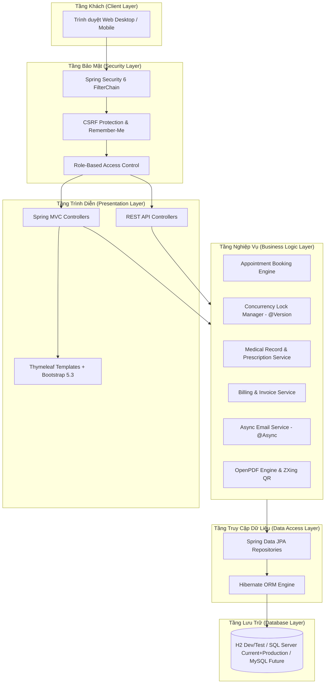

# TÀI LIỆU KIẾN TRÚC HỆ THỐNG (SYSTEM ARCHITECTURE DOCUMENT)
**Dự án:** MedClinic - Phòng Khám Tư Nhân  
**Phiên bản:** 1.0  
**Học phần:** Lập trình Web & Công nghệ Phần mềm  

---

## 1. TỔNG QUAN KIẾN TRÚC (ARCHITECTURAL OVERVIEW)

Hệ thống MedClinic được xây dựng theo mô hình **Kiến trúc Phân tầng (Layered Architecture)** kết hợp mẫu thiết kế **Model-View-Controller (MVC)** nhằm đảm bảo tính phân tách trách nhiệm (Separation of Concerns), dễ bảo trì, dễ mở rộng và kiểm thử độc lập.

---

## 2. CHI TIẾT CÁC TẦNG KIẾN TRÚC

### 2.1. Presentation Layer (Tầng Trình diễn)
- **Công nghệ:** Thymeleaf 3 + Thymeleaf Layout Dialect + Bootstrap 5.3 + Bootstrap Icons + Chart.js + SweetAlert2.
- **Vai trò:** Render giao diện phía máy chủ (Server-Side Rendering - SSR), đảm bảo thời gian tải trang nhanh, thân thiện với SEO và tương thích đa thiết bị.
- **Cơ chế Layout:** Sử dụng `layout:decorate="~{layout/main}"` cho trang công khai/bệnh nhân và `layout:decorate="~{layout/dashboard}"` cho khu vực quản trị/bác sĩ/lễ tân.

### 2.2. Security Layer (Tầng Bảo mật & Phân quyền)
- **Công nghệ:** Spring Security 6 với cấu hình `SecurityFilterChain`.
- **Cơ chế xác thực:** Session-based authentication kết hợp Remember-me token 14 ngày.
- **Phân quyền RBAC:**
  - `ROLE_PATIENT`: Truy cập `/patient/**`
  - `ROLE_DOCTOR`: Truy cập `/doctor/**`
  - `ROLE_STAFF`: Truy cập `/staff/**`
  - `ROLE_ADMIN`: Truy cập `/admin/**`
- **Mã hóa:** Giải thuật băm mật khẩu `BCryptPasswordEncoder` với salt ngẫu nhiên.

### 2.3. Business Service Layer & Concurrency Engine (Tầng Nghiệp vụ)
- **Concurrency Locking (Xử lý đồng thời chống Double Booking):**
  - Booking khóa hàng `TimeSlot`; check-in khóa `Appointment` và dùng `DailyQueueCounter` theo ngày để cấp `queue_sequence` dạng số. `Appointment`, `TimeSlot`, `Medicine` và counter có `@Version` phù hợp.
  - Appointment giữ tham chiếu many-to-one tới slot để lịch sử hủy không chặn lần đặt sau. Dữ liệu production cần migration có kiểm soát cho thay đổi unique constraint.
  - Mã hóa đơn được reserve bằng insert vào `invoice_code_reservations`; tồn kho được đọc bằng pessimistic lock và giá kê đơn được snapshot tại `PrescriptionItem.unitPriceAtTime`.
  - Lần tạo `DailyQueueCounter` đầu tiên đồng thời trên nhiều node chưa có retry unique-collision; cần xử lý trước khi scale ngang.
- **Xử lý Bất đồng bộ (Async Processing):**
  - Tích hợp `@EnableAsync` với cấu hình `ThreadPoolTaskExecutor` (Core Pool: 4, Max Pool: 10, Queue: 100).
  - Tác vụ gửi email (`EmailService`) được tách khỏi luồng request chính, loại bỏ độ trễ phản hồi mạng.
- **Động cơ Xuất PDF & QR Code:**
  - `OpenPDF`: Sinh tài liệu PDF đơn thuốc và hóa đơn bằng luồng `ByteArrayOutputStream`, truyền trực tiếp qua `InputStreamResource` không ghi rác ra ổ đĩa máy chủ.
  - `ZXing`: Sinh mã QR định danh Base64 nhúng thẳng vào HTML hoặc gửi qua email.

### 2.4. Data Access Layer (Tầng Dữ liệu)
- **Công nghệ:** Spring Data JPA + Hibernate.
- **Cơ sở dữ liệu:** Cấu hình linh hoạt đa môi trường:
  - Profile `dev`: H2 In-Memory Database (tự động khởi tạo schema và seed data, zero-configuration).
  - Profile `sqlserver`: Microsoft SQL Server — database chính cho môi trường hiện tại và production.
  - Profile `mysql`: giữ lại cho khả năng tương thích/roadmap tương lai; không thuộc phạm vi nghiệm thu hiện tại.
- **Chuẩn hóa CSDL:** Toàn bộ quan hệ được thiết kế chuẩn mực **3NF**.
