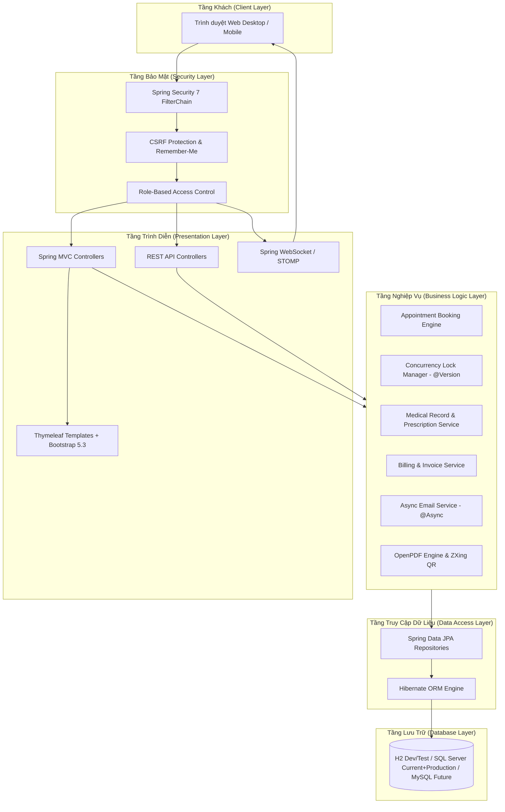

# TÀI LIỆU KIẾN TRÚC HỆ THỐNG (SYSTEM ARCHITECTURE DOCUMENT)
**Dự án:** MedClinic - Phòng Khám Tư Nhân  
**Phiên bản:** 1.0  
**Học phần:** Lập trình Web & Công nghệ Phần mềm  

---

## 1. TỔNG QUAN KIẾN TRÚC (ARCHITECTURAL OVERVIEW)

Hệ thống MedClinic được xây dựng theo mô hình **Kiến trúc Phân tầng (Layered Architecture)** kết hợp mẫu thiết kế **Model-View-Controller (MVC)** nhằm đảm bảo tính phân tách trách nhiệm (Separation of Concerns), dễ bảo trì, dễ mở rộng và kiểm thử độc lập.

---

## 2. CHI TIẾT CÁC TẦNG KIẾN TRÚC

### 2.1. Presentation Layer (Tầng Trình diễn)
- **Công nghệ:** Thymeleaf 3 + Thymeleaf Layout Dialect + Bootstrap 5.3 + Bootstrap Icons + Chart.js + SweetAlert2.
- **Vai trò:** Render giao diện phía máy chủ (Server-Side Rendering - SSR), đảm bảo thời gian tải trang nhanh, thân thiện với SEO và tương thích đa thiết bị.
- **Cơ chế Layout:** Sử dụng `layout:decorate="~{layout/main}"` cho trang công khai/bệnh nhân và `layout:decorate="~{layout/dashboard}"` cho khu vực quản trị/bác sĩ/lễ tân.

### 2.2. Security Layer (Tầng Bảo mật & Phân quyền)
- **Công nghệ:** Spring Security 7 với cấu hình `SecurityFilterChain`.
- **Cơ chế xác thực:** Session-based authentication kết hợp Remember-me token 14 ngày. Endpoint SockJS/STOMP `/ws/**` yêu cầu session đã xác thực; Doctor Desk nhận cập nhật qua user destination riêng của tài khoản đăng nhập.
- **Phân quyền RBAC:**
  - `ROLE_PATIENT`: Truy cập `/patient/**`
  - `ROLE_DOCTOR`: Truy cập `/doctor/**`
  - `ROLE_STAFF`: Truy cập `/staff/**`
  - `ROLE_ADMIN`: Truy cập `/admin/**`
- **Mã hóa:** Giải thuật băm mật khẩu `BCryptPasswordEncoder` với salt ngẫu nhiên.
- **Password reset:** Token thô chỉ gửi qua email; CSDL lưu SHA-256 hash trong `password_reset_tokens`, hạn 24 giờ và đánh dấu `used_at` sau khi dùng.
- **Session/cookie hardening:** Session timeout 30 phút; chống session fixation bằng `migrateSession`; `JSESSIONID` dùng `HttpOnly` + `SameSite=Lax`. Profile SQL Server mặc định `Secure=true`; local HTTP phải opt-out rõ ràng.
- **Abuse protection:** các POST xác thực/OTP/reset dùng rate limit theo remote IP + endpoint, mặc định 20 login và 5 request nhạy cảm trong 300 giây. Profile SQL Server dùng bucket chung trong DB với khóa IP đã băm; trả HTTP 429 + `Retry-After` khi vượt ngưỡng.
- **Response hardening:** Không expose error message/binding error/stacktrace; thêm `Referrer-Policy: strict-origin-when-cross-origin` và `Permissions-Policy` tắt camera/microphone/geolocation.

### 2.3. Business Service Layer & Concurrency Engine (Tầng Nghiệp vụ)
- **Concurrency Locking (Xử lý đồng thời chống Double Booking):**
  - Booking khóa hàng `TimeSlot`; check-in khóa `Appointment` và dùng `DailyQueueCounter` theo ngày để cấp `queue_sequence` dạng số. `Appointment`, `TimeSlot`, `Medicine` và counter có `@Version` phù hợp.
  - Appointment giữ tham chiếu many-to-one tới slot để lịch sử hủy không chặn lần đặt sau. Dữ liệu production cần migration có kiểm soát cho thay đổi unique constraint.
  - Mã hóa đơn được reserve bằng insert vào `invoice_code_reservations`; tồn kho được đọc bằng pessimistic lock và giá kê đơn được snapshot tại `PrescriptionItem.unitPriceAtTime`.
  - `DailyQueueCounterAllocator` retry tối đa 8 lần khi nhiều node cùng tạo counter đầu ngày và gặp unique-collision; writer chạy transaction riêng để mỗi lần retry có trạng thái sạch.
- **Xử lý Bất đồng bộ & Realtime:**
  - Tích hợp `@EnableAsync` với `AsyncConfig.taskExecutor` riêng (Core Pool: 4, Max Pool: 10, Queue: 100, prefix `medclinic-async-`) để không xung đột với các executor nội bộ của WebSocket/STOMP.
  - Booking/hủy lịch phát `AppointmentEmailEvent`; `AppointmentEmailListener` dùng `@TransactionalEventListener(AFTER_COMMIT)` + `@Async`, nên email chỉ gửi sau commit và lỗi SMTP không rollback dữ liệu nghiệp vụ.
  - Email retry hữu hạn và xuất Micrometer metric `medclinic.email.delivery`; recipient chỉ xuất hiện dưới dạng hash trong log.
  - Thanh toán chuyển khoản tạo VietQR từ cấu hình ngân hàng (MB Bank dùng BIN `970422`). Callback công khai chỉ được chấp nhận khi HMAC SHA-256, event id, bank transaction id, transfer code và amount đều hợp lệ; hóa đơn được lock trước khi đổi `PAID`.
  - Check-in, bắt đầu khám và hoàn tất khám phát `DoctorQueueChangedEvent`. `DoctorQueueWebSocketListener` chỉ xử lý ở pha `AFTER_COMMIT`, sau đó gửi payload tối thiểu qua `SimpMessagingTemplate.convertAndSendToUser(..., "/queue/doctor", ...)`; rollback không tạo thông báo realtime.
- **Động cơ Xuất PDF & QR Code:**
  - `OpenPDF`: Sinh tài liệu PDF đơn thuốc và hóa đơn bằng luồng `ByteArrayOutputStream`, truyền trực tiếp qua `InputStreamResource` không ghi rác ra ổ đĩa máy chủ.
  - `ZXing`: Sinh mã QR định danh Base64 nhúng thẳng vào HTML hoặc gửi qua email.

### 2.4. Data Access Layer (Tầng Dữ liệu)
- **Công nghệ:** Spring Data JPA + Hibernate.
- **Cơ sở dữ liệu:** Cấu hình linh hoạt đa môi trường:
  - Profile `dev`: H2 In-Memory Database (tự động khởi tạo schema và seed data, zero-configuration).
  - Profile `sqlserver`: Microsoft SQL Server — database chính cho môi trường hiện tại và production.
  - Profile `mysql`: giữ lại cho khả năng tương thích/roadmap tương lai; không thuộc phạm vi nghiệm thu hiện tại.
- **Schema versioning:** Profile `sqlserver` dùng Flyway V1–V6 chạy trước Hibernate; `ddl-auto=validate` chỉ xác minh mapping sau migration. Database legacy 16 bảng chỉ được nhận quản lý bằng baseline version 1 khi operator bật opt-in sau pre-check/backup; mặc định production không tự baseline.
- **Migration safety:** Docker init chỉ áp dụng guard `0`/`16` khi chưa có Flyway history; khi history đã tồn tại, versioning thuộc Flyway/Hibernate. Migration test destructive chạy trên database disposable `medclinic_flyway_it`, không dùng production database.
- **Chuẩn hóa CSDL:** Toàn bộ quan hệ được thiết kế chuẩn mực **3NF**.

### 2.5. Operational Observability
- **Actuator exposure:** Chỉ expose `health` và `metrics`; `/actuator/health` cho anonymous nhưng chỉ trả `status`, còn `/actuator/metrics/**` yêu cầu `ROLE_ADMIN`.
- **Micrometer:** Theo dõi JVM/HTTP metrics mặc định và hai metric custom: `medclinic.security.authentication{outcome=...}` và `medclinic.security.rate_limit.rejected{endpoint=...}`.
- **Security audit log:** Login success/failure, logout và rate-limit rejection ghi log dạng key=value; không log password, reset token hoặc secret.
- **Giới hạn hiện tại:** Rate limiter là in-memory per JVM. Khi scale nhiều instance cần chuyển enforcement lên trusted gateway hoặc shared store như Redis; không tin trực tiếp `X-Forwarded-For` nếu proxy chưa được trust-configure.
