# Thiết kế UI/UX — MedClinic

## 1. Mục tiêu và phạm vi

Tài liệu này mô tả giao diện của MedClinic theo vai trò, luồng tác vụ và trạng thái xử lý. Thiết kế bám SRS IEEE 830, UI guideline của đồ án và mã nguồn Thymeleaf hiện có. Mục tiêu là để bệnh nhân đặt lịch nhanh, nhân viên tiếp nhận chính xác, bác sĩ khám hiệu quả và quản trị viên vận hành dữ liệu an toàn.

Nguyên tắc: hiển thị thông tin nghiệp vụ thay vì ID kỹ thuật; một hành động chính rõ ràng trên mỗi màn hình; mọi luồng quan trọng có trạng thái thành công, lỗi, rỗng và bị vô hiệu hóa khi chưa đủ điều kiện.

## 2. Hệ thống màn hình

| Nhóm | Màn hình | Người dùng | Mục tiêu chính |
|---|---|---|---|
| Công khai | Trang chủ, danh sách/chi tiết bác sĩ | Khách, bệnh nhân | Tìm hiểu dịch vụ và chọn bác sĩ |
| Xác thực | Đăng nhập, đăng ký, quên/đặt lại mật khẩu, hồ sơ | Tất cả | Xác thực và quản lý tài khoản |
| Bệnh nhân | Đặt lịch, lịch hẹn, chi tiết lịch, bệnh án | Bệnh nhân | Đặt, theo dõi hoặc hủy lịch; xem QR và tiền sử |
| Bác sĩ | Bàn khám, khám bệnh, lịch trực | Bác sĩ | Xử lý hàng chờ, chẩn đoán, kê đơn |
| Tiếp nhận | Tiếp nhận, đăng ký vãng lai, thu ngân | Lễ tân | Check-in, cấp STT, thu phí/in hóa đơn |
| Quản trị | Dashboard, chuyên khoa, bác sĩ, thuốc, tài khoản | Admin | Theo dõi KPI và quản trị danh mục |

## 3. Luồng chuyển màn hình

```mermaid
flowchart LR
    A[Trang chủ / Danh sách bác sĩ] --> B[Đăng nhập hoặc Đặt lịch]
    B --> C[Chọn chuyên khoa]
    C --> D[Chọn bác sĩ]
    D --> E[Chọn ngày và khung giờ]
    E --> F[Xác nhận đặt lịch]
    F --> G[Chi tiết lịch + mã QR]
    G --> H[Tiếp nhận: quét QR / tra cứu]
    H --> I[Check-in + cấp STT]
    I --> J[Bác sĩ: bàn khám]
    J --> K[Khám, chẩn đoán, kê đơn]
    K --> L[Thu ngân: xác nhận thanh toán]
```

Điều kiện chuyển: chỉ hiển thị bác sĩ/slot hợp lệ; slot hết chỗ không chọn được; hủy lịch trả slot; check-in tạo STT; chỉ bác sĩ được mở ca khám; chỉ lễ tân được thu phí. Luồng lỗi giữ lại lựa chọn hiện có và đưa thông điệp có hướng xử lý.

## 4. Mô tả màn hình trọng yếu

### 4.1 Đặt lịch khám — Bệnh nhân

- Loại: nhập liệu xử lý; luồng: chuyên khoa → bác sĩ → ngày → slot → xác nhận.
- Input: chuyên khoa, bác sĩ, ngày, khung giờ, lý do khám.
- Hệ thống tự sinh: mã đặt lịch, QR, trạng thái lịch, số thứ tự sau check-in.
- Phản hồi: cảnh báo khi chưa chọn bác sĩ/ngày; empty state khi không có slot; error state riêng khi API tải slot thất bại, có nút thử lại.

### 4.2 Tiếp nhận và check-in — Lễ tân

- Loại: tra cứu + xử lý.
- Tiêu chí: mã lịch, họ tên, số điện thoại; hỗ trợ quét QR.
- Kết quả: thông tin cuộc hẹn, trạng thái, nút check-in khi hợp lệ; sau thành công hiện STT và hướng tới bàn khám/thu ngân.

### 4.3 Bàn khám — Bác sĩ

- Loại: màn hình xử lý nghiệp vụ.
- Hiển thị: hàng chờ theo STT, triệu chứng, tiền sử, thông tin lịch.
- Action chính: hoàn tất khám và lưu bệnh án; kê nhiều thuốc theo tên thay vì mã thuốc. Hệ thống kiểm tra tồn kho và tạo dữ liệu viện phí.

### 4.4 Bảng quản trị — Admin

- Loại: dashboard và tra cứu/quản trị danh mục.
- Dashboard trả lời số bệnh nhân, bác sĩ, lịch hôm nay và doanh thu. Các bảng chuyên khoa, bác sĩ, thuốc, tài khoản có tìm kiếm/lọc, trạng thái rỗng kèm CTA và phân trang khi dữ liệu tăng.
- Hành động khóa/mở phải biểu đạt rõ trạng thái hiện tại; form dùng tên nghiệp vụ, không yêu cầu người dùng nhập ID kỹ thuật.

## 5. Quy ước trạng thái giao diện

| Trạng thái | Cách thể hiện | Hành động tiếp theo |
|---|---|---|
| Loading | Nút bị khóa hoặc thông báo đang tải | Không gửi lặp thao tác |
| Success | Alert thành công, giữ ngữ cảnh nghiệp vụ | Xem chi tiết hoặc tiếp tục bước sau |
| Empty | Thông điệp theo ngữ cảnh + CTA | Tạo dữ liệu, đặt lịch hoặc xóa bộ lọc |
| Error | Nêu nguyên nhân bằng ngôn ngữ người dùng | Thử lại, chỉnh input hoặc liên hệ quầy |
| Disabled | Nút/slot không khả dụng, kèm lý do | Chọn điều kiện hợp lệ khác |

Trạng thái lịch hẹn luôn gồm chữ, badge/icon và màu; không dùng màu đơn lẻ.

## 6. Accessibility và responsive

- Hai layout dùng chung có skip link, focus indicator bàn phím, nhãn cho menu thu gọn/dropdown/modal và `aria-current` cho điều hướng đang mở.
- Bệnh nhân ưu tiên mobile: form một luồng, nút đủ lớn, nội dung quan trọng trước.
- Portal nội bộ ưu tiên desktop/tablet; bảng giữ khả năng cuộn ngang trên màn hình hẹp.
- Label đặt gần control; lỗi không xóa dữ liệu đã nhập; thông tin màu luôn có nhãn chữ.

## 7. Đối chiếu yêu cầu

| Nội dung thiết kế | Nhóm yêu cầu SRS |
|---|---|
| Đăng ký, đăng nhập, khôi phục mật khẩu | Quản lý tài khoản và xác thực |
| Chọn chuyên khoa/bác sĩ/slot, chống trùng lịch | Đặt lịch khám trực tuyến |
| QR, check-in, STT, walk-in | Tiếp nhận bệnh nhân |
| Bàn khám, bệnh án, đơn thuốc, tồn kho | Khám và điều trị |
| Hóa đơn, thanh toán, PDF | Thu ngân và viện phí |
| Dashboard, danh mục, RBAC | Quản trị hệ thống |

## 8. Bằng chứng triển khai

Template được tổ chức theo role tại `src/main/resources/templates/{patient,doctor,staff,admin}`; hai layout dùng chung là `layout/main.html` và `layout/dashboard.html`. Các thay đổi UX được theo dõi trong `tasklist.md` và lịch sử commit theo từng nhánh review.