# Thiết kế UI/UX — MedClinic

## 1. Mục tiêu và phạm vi

Tài liệu này mô tả giao diện của MedClinic theo vai trò, luồng tác vụ và trạng thái xử lý. Thiết kế bám SRS IEEE 830, UI guideline của đồ án và mã nguồn Thymeleaf hiện có. Mục tiêu là để bệnh nhân đặt lịch nhanh, nhân viên tiếp nhận chính xác, bác sĩ khám hiệu quả và quản trị viên vận hành dữ liệu an toàn.

Nguyên tắc: hiển thị thông tin nghiệp vụ thay vì ID kỹ thuật; một hành động chính rõ ràng trên mỗi màn hình; mọi luồng quan trọng có trạng thái thành công, lỗi, rỗng và bị vô hiệu hóa khi chưa đủ điều kiện.

## 2. Hệ thống màn hình

| Nhóm | Màn hình | Người dùng | Mục tiêu chính |
|---|---|---|---|
| Công khai | Trang chủ, danh sách/chi tiết bác sĩ | Khách, bệnh nhân | Tìm hiểu dịch vụ và chọn bác sĩ |
| Xác thực | Đăng nhập, đăng ký, xác thực OTP (`/auth/otp`), quên/đặt lại mật khẩu, hồ sơ | Tất cả | Xác thực và quản lý tài khoản |
| Bệnh nhân | Đặt lịch, lịch hẹn, chi tiết lịch, bệnh án | Bệnh nhân | Đặt, theo dõi hoặc hủy lịch; xem QR và tiền sử |
| Bác sĩ | Bàn khám, khám bệnh, lịch trực, danh sách & chi tiết bệnh án đã khám (`/doctor/records`, `/doctor/records/{id}`) | Bác sĩ | Xử lý hàng chờ, chẩn đoán, kê đơn và tra cứu bệnh án |
| Tiếp nhận | Tiếp nhận, đăng ký vãng lai, thu ngân, thanh toán chuyển khoản VietQR (`/staff/billing/bank/payment/{id}`) | Lễ tân | Check-in, cấp STT, thu phí tiền mặt/VietQR và in hóa đơn |
| Quản trị | Dashboard, chuyên khoa, bác sĩ, thuốc, tài khoản | Admin | Theo dõi KPI và quản trị danh mục |

## 3. Luồng chuyển màn hình

```mermaid
flowchart LR
    A[Trang chủ / Danh sách bác sĩ] --> B[Đăng nhập hoặc Đặt lịch]
    B --> C[Chọn chuyên khoa]
    C --> D[Chọn bác sĩ]
    D --> E[Chọn ngày và khung giờ]
    E --> F[Xác nhận đặt lịch]
    F --> G[Chi tiết lịch + mã QR]
    G --> H[Tiếp nhận: quét QR / tra cứu]
    H --> I[Check-in + cấp STT]
    I --> J[Bác sĩ: bàn khám]
    J --> K[Khám, chẩn đoán, kê đơn]
    K --> L[Thu ngân: xác nhận thanh toán]
```

Điều kiện chuyển: chỉ hiển thị bác sĩ/slot hợp lệ; slot hết chỗ không chọn được; hủy lịch trả slot; check-in tạo STT; chỉ bác sĩ được mở ca khám; chỉ lễ tân được thu phí. Luồng lỗi giữ lại lựa chọn hiện có và đưa thông điệp có hướng xử lý.

## 4. Mô tả màn hình trọng yếu

### 4.1 Đặt lịch khám — Bệnh nhân

- Loại: nhập liệu xử lý; luồng: chuyên khoa → bác sĩ → ngày → slot → xác nhận.
- Input: chuyên khoa, bác sĩ, ngày, khung giờ, lý do khám.
- Hệ thống tự sinh: mã đặt lịch, QR, trạng thái lịch, số thứ tự sau check-in.
- Phản hồi: cảnh báo khi chưa chọn bác sĩ/ngày; empty state khi không có slot; error state riêng khi API tải slot thất bại, có nút thử lại.

### 4.2 Tiếp nhận và check-in — Lễ tân

- Loại: tra cứu + xử lý.
- Tiêu chí: mã lịch, họ tên, số điện thoại; hỗ trợ quét QR.
- Kết quả: thông tin cuộc hẹn, trạng thái, nút check-in khi hợp lệ; sau thành công hiện STT và hướng tới bàn khám/thu ngân.

### 4.3 Bàn khám — Bác sĩ

- Loại: màn hình xử lý nghiệp vụ.
- Hiển thị: hàng chờ theo STT, triệu chứng, tiền sử, thông tin lịch.
- Action chính: hoàn tất khám và lưu bệnh án; kê nhiều thuốc theo tên thay vì mã thuốc. Hệ thống kiểm tra tồn kho và tạo dữ liệu viện phí.

### 4.4 Bảng quản trị — Admin

- Loại: dashboard và tra cứu/quản trị danh mục.
- Dashboard trả lời số bệnh nhân, bác sĩ, lịch hôm nay và doanh thu. Các bảng chuyên khoa, bác sĩ, thuốc, tài khoản có tìm kiếm/lọc, trạng thái rỗng kèm CTA và phân trang khi dữ liệu tăng.
- Hành động khóa/mở phải biểu đạt rõ trạng thái hiện tại; form dùng tên nghiệp vụ, không yêu cầu người dùng nhập ID kỹ thuật.

## 5. Quy ước trạng thái giao diện

| Trạng thái | Cách thể hiện | Hành động tiếp theo |
|---|---|---|
| Loading | Nút bị khóa hoặc thông báo đang tải | Không gửi lặp thao tác |
| Success | Alert thành công, giữ ngữ cảnh nghiệp vụ | Xem chi tiết hoặc tiếp tục bước sau |
| Empty | Thông điệp theo ngữ cảnh + CTA | Tạo dữ liệu, đặt lịch hoặc xóa bộ lọc |
| Error | Nêu nguyên nhân bằng ngôn ngữ người dùng | Thử lại, chỉnh input hoặc liên hệ quầy |
| Disabled | Nút/slot không khả dụng, kèm lý do | Chọn điều kiện hợp lệ khác |

Trạng thái lịch hẹn luôn gồm chữ, badge/icon và màu; không dùng màu đơn lẻ.

## 6. Accessibility và responsive

- Hai layout dùng chung có skip link, focus indicator bàn phím, nhãn cho menu thu gọn/dropdown/modal và `aria-current` cho điều hướng đang mở.
- Bệnh nhân ưu tiên mobile: form một luồng, nút đủ lớn, nội dung quan trọng trước.
- Portal nội bộ ưu tiên desktop/tablet; bảng giữ khả năng cuộn ngang trên màn hình hẹp.
- Label đặt gần control; lỗi không xóa dữ liệu đã nhập; thông tin màu luôn có nhãn chữ.

## 7. Đối chiếu yêu cầu

| Nội dung thiết kế | Nhóm yêu cầu SRS |
|---|---|
| Đăng ký, đăng nhập, khôi phục mật khẩu | Quản lý tài khoản và xác thực |
| Chọn chuyên khoa/bác sĩ/slot, chống trùng lịch | Đặt lịch khám trực tuyến |
| QR, check-in, STT, walk-in | Tiếp nhận bệnh nhân |
| Bàn khám, bệnh án, đơn thuốc, tồn kho | Khám và điều trị |
| Hóa đơn, thanh toán, PDF | Thu ngân và viện phí |
| Dashboard, danh mục, RBAC | Quản trị hệ thống |

## 8. Bằng chứng triển khai

Template được tổ chức theo role tại `src/main/resources/templates/{patient,doctor,staff,admin}`; hai layout dùng chung là `layout/main.html` và `layout/dashboard.html`. Bằng chứng triển khai UX được giữ trong test render/accessibility, JaCoCo và lịch sử commit của repository.

Các token và quy tắc giao diện hiện tại nằm trong [DESIGN.md](../DESIGN.md). Phần handoff bên dưới là hướng dẫn thiết kế, không khẳng định đã có file Figma hoàn chỉnh.

## 9. Figma handoff — cấu trúc file thiết kế

Khi dựng trên Figma, tạo file `MedClinic UI Kit & Screens` với các Pages sau. Không đặt toàn bộ màn hình và component trên một canvas.

| Page Figma | Nội dung | Quy ước |
|---|---|---|
| `00 · Cover & Notes` | Mục tiêu, vai trò, link tài liệu và phiên bản | Chỉ đọc, ghi ngày cập nhật |
| `01 · Foundations` | Màu sắc, chữ, khoảng cách, elevation, icon | Dùng Variables/Styles, không tô màu rời rạc |
| `02 · Components` | Button, input, select, badge, alert, card, modal, bảng, Mascot An Nhiên | Tạo component + variant trước khi ghép màn hình |
| `03 · Public & Auth` | Trang chủ, danh sách bác sĩ, đăng nhập, đăng ký | Frame độc lập theo breakpoint |
| `04 · Patient Flow` | Đặt lịch, lịch hẹn, QR, bệnh án | Có prototype flow hoàn chỉnh |
| `05 · Internal Portal` | Bác sĩ, lễ tân, thu ngân, admin | Desktop-first, kèm trạng thái bảng |
| `06 · States & Prototype` | Loading, empty, error, disabled, success | Liên kết từ màn hình chính tới state tương ứng |

### Quy tắc đặt tên layer

- Frame: `Role / Screen / Breakpoint`, ví dụ `Patient / Booking / Mobile`.
- Section: `Header`, `Primary action`, `Search & filter`, `Content`, `Feedback`.
- Component instance: `Button / Primary / Default`, `Badge / Appointment / Confirmed`.
- Không dùng các tên mặc định như `Frame 123`, `Group 8` hoặc `Rectangle 4`.

## 10. Foundations và design tokens

### 10.1. Màu (Đồng bộ với medclinic-design-system.css)

| Token | Giá trị | Mục đích |
|---|---:|---|
| `color/primary/default` | `#176B9B` | Medical Blue chính, CTA, viền active, icon |
| `color/primary/hover` | `#0E527B` | Hover nút bấm chính, link tương tác |
| `color/primary/strong` | `#155E75` | Tiêu đề trang, văn bản thương hiệu, viền nhấn |
| `color/primary/soft` | `#EBF5FB` | Nền thẻ bác sĩ, nền slot chọn, background badge |
| `color/secondary/default` | `#0D9488` | Nhãn chuyên khoa, tag dịch vụ hỗ trợ |
| `color/navy/950` | `#090E1A` | Nền thanh điều hướng Sidebar quản trị (Dashboard) |
| `color/navy/900` | `#0F172A` | Tiêu đề Headings, văn bản chính, footer |
| `color/surface/default` | `#FFFFFF` | Nền card, modal, input |
| `color/background/subtle` | `#F5F9FC` | Nền trang tổng thể Cool White (chống lóa) |
| `color/text/primary` | `#203442` | Nội dung văn bản chính |
| `color/text/secondary` | `#526675` | Nội dung phụ, subtitle |
| `color/border/default` | `#D5E2EC` | Viền input, card, table |
| `color/success/600` | `#166534` | Thành công, đã khám, đã thanh toán |
| `color/warning/600` | `#92400E` | Cảnh báo, chờ khám, tồn kho thấp |
| `color/danger/600` | `#9F1239` | Lỗi, đã hủy lịch, hotline cấp cứu |

Không truyền đạt trạng thái chỉ bằng màu: badge trạng thái luôn có icon và nhãn chữ.

### 10.2. Typography, spacing và frame

- Font: `Geist` variable font nội bộ (`400–650`, có `GeistMono` cho mã đặt lịch/hóa đơn/số tiền `tabular-nums`); không phụ thuộc CDN font ngoài.
- Cỡ: `Display 32/40`, `H1 28/36`, `H2 22/30`, `H3 18/26`, `Body 16/24`, `Small 14/20`, `Caption 12/16`.
- Spacing scale: `4, 8, 12, 16, 24, 32, 48` px; radius: `8` px cho button/input, `12–14` px cho card.
- Frame cần dựng: Desktop `1440`, Tablet `768`, Mobile `390` px. Nội dung desktop tối đa `1140` px; portal có sidebar `244` px.
- Dùng Auto Layout cho mọi card, form group, toolbar, header, sidebar item và danh sách; không dùng tọa độ tuyệt đối trừ overlay/modal.

## 11. Component specification

| Component | Variants tối thiểu | Nội dung/accessibility |
|---|---|---|
| `Button` | Primary, Secondary, Outline, Danger; Default/Hover/Disabled/Loading | Cao tối thiểu 44 px trên mobile; icon có tooltip/label nếu không có text |
| `Text field` | Default, Focus, Filled, Error, Disabled | Label luôn hiển thị, helper/error ở dưới field |
| `Select & date picker` | Default, Open, Selected, Disabled, Error | Không dùng ID kỹ thuật làm giá trị hiển thị |
| `Badge / Status` | Appointment, Payment, Account, Inventory | Icon + text + màu; có variant trạng thái domain |
| `Alert` | Success, Warning, Error, Info | Thông điệp ngắn và action thử lại khi phù hợp |
| `Empty state` | Booking, Table, Search | Illustration/icon, tiêu đề, mô tả, một CTA rõ ràng |
| `Modal` | Add, Confirm, Payment, QR scanner | Title, close label, secondary action, primary action |
| `Data table` | Default, Loading, Empty, Filtered, Paginated | Search/filter ở trên; action mỗi hàng dễ nhận biết |
| `Navigation item` | Default, Hover, Active, Focus | Active có nền + `aria-current`, không chỉ đổi màu chữ |

## 12. Brief dựng màn hình và prototype trong Figma

### 12.1. Patient / Booking

Dựng ba frame: `Mobile`, `Tablet`, `Desktop`. Giữ thứ tự thông tin: chuyên khoa → bác sĩ → ngày → khung giờ → lý do khám → xác nhận. Tạo component `Time slot` với variants `Available`, `Selected`, `Unavailable`, `Loading`. Prototype: chọn bác sĩ/ngày mở danh sách slot; chọn slot mở tóm tắt; xác nhận dẫn tới `Appointment detail / Success` có mã QR.

### 12.2. Staff / Reception

Dựng desktop frame với tiêu chí tra cứu ở đầu, KPI trạng thái ngắn ở giữa và danh sách hẹn ở dưới. Prototype nối `Search` → `Appointment result` → `Check-in success` → `Queue ticket`. Thêm empty state cho kết quả không khớp và modal scanner QR.

### 12.3. Doctor / Examine

Dựng desktop hai cột: trái là thông tin bệnh nhân/tiền sử, phải là chẩn đoán và đơn thuốc. Component dòng thuốc phải có thêm/xóa, cảnh báo tồn kho và trạng thái validation. Prototype nối hàng chờ → ca khám → hoàn tất ca khám.

### 12.4. Admin / Management table

Dựng `Dashboard` và một bảng mẫu cho chuyên khoa/thuốc/tài khoản. Trên bảng có search/filter, pagination, row action; bên trong canvas đặt variants `Data`, `Empty`, `No search result`, `Loading`. CTA của empty state mở modal tạo mới.

### 12.5. Kiểm tra trước khi review Figma

- Auto Layout không vỡ ở 390, 768, 1440 px.
- Có state Focus và Disabled cho button/input trọng yếu.
- Prototype bao phủ success, empty và error của đặt lịch/check-in.
- Text, màu, spacing đều lấy từ Variables/Styles.
- Không có layer chưa đặt tên hoặc component bị detach không cần thiết.
