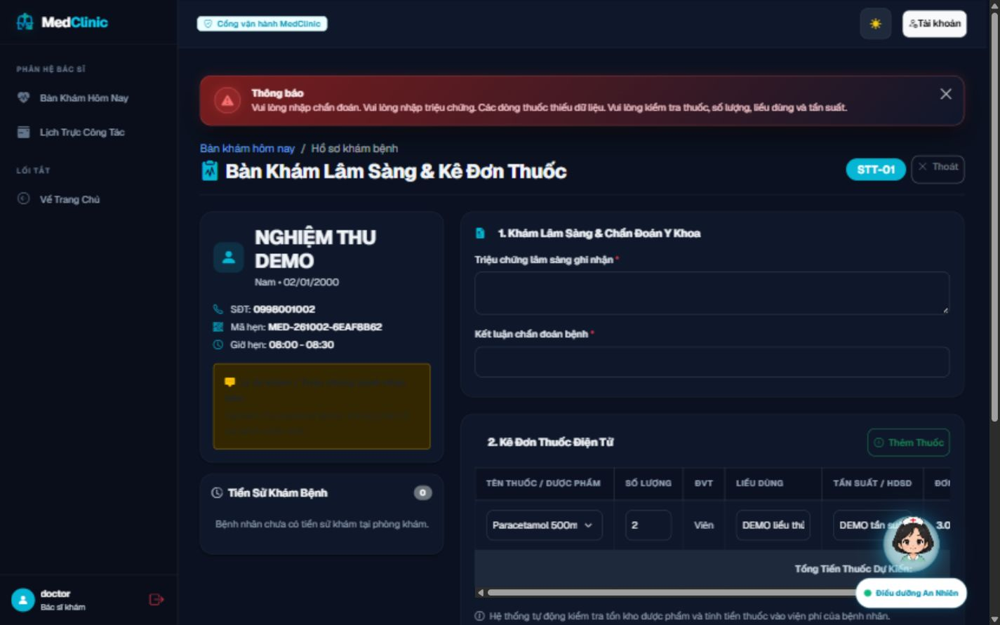
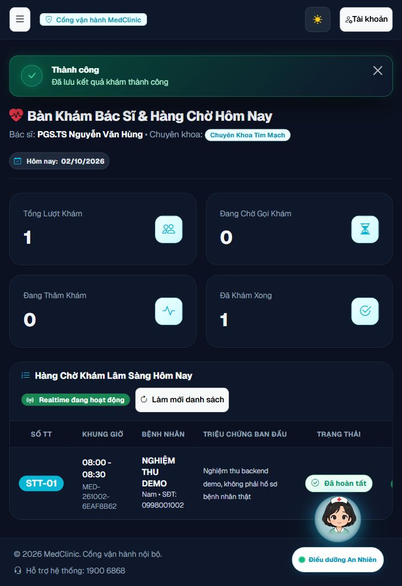
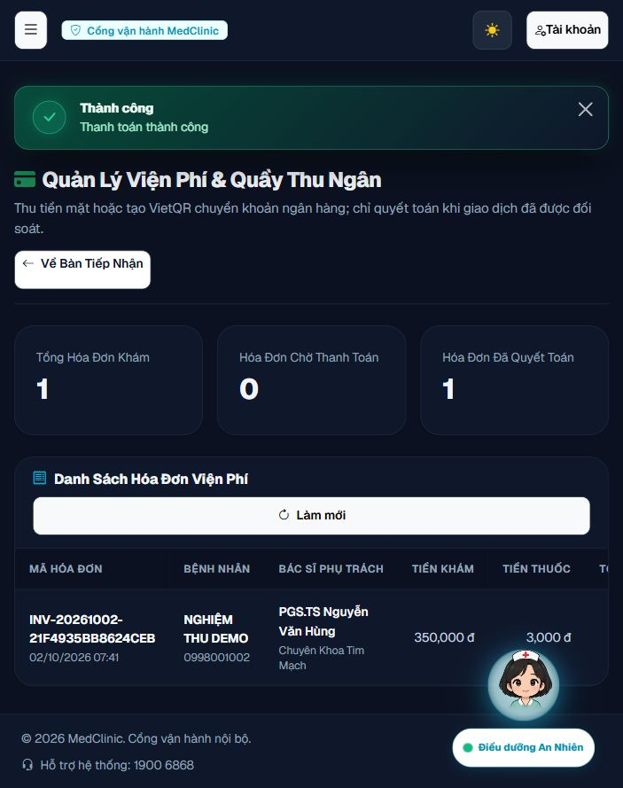

# Nghiệm thu camera thật và backend — 02/10/2026

> Cập nhật sau phiên nghiệm thu này: [mẫu hóa đơn PDF mới](INVOICE_PDF_UPDATE_2026-10-02.md) đã sửa định dạng tiền/ngày và bổ sung chi tiết, với 186/186 tests PASS. Số liệu/image bên dưới ghi lại phiên backend trước thay đổi PDF.

> Cập nhật cuối: [đối chiếu backlog và bổ sung validation đơn thuốc](BACKLOG_COMPLETION_2026-10-02.md) đạt **194/194 tests**, JS 9/9, coverage **84,15% LINE / 67,31% BRANCH**, đã cập nhật app 18087 và kiểm tra browser/SQL. Kết quả camera/SMTP/backup của phiên dưới đây vẫn được giữ làm bằng chứng cho các phần không thay đổi.

## Kết luận

Các mục backend trong backlog và camera thật đã đạt trong phạm vi nghiệm thu local. Lượt cuối `mvn clean verify` hoàn tất lúc **07:41:24, ngày 02/10/2026 (Asia/Ho_Chi_Minh)**: **182 tests / 66 classes, 0 failures, 0 errors, 0 skipped**. JaCoCo **82,38% LINE / 62,54% BRANCH**, qua gate 70%/50%. Frontend regression **9/9 PASS**; `git diff --check` không có lỗi whitespace (Git còn thông báo chuyển LF sang CRLF).

Đây là nghiệm thu với dữ liệu DEMO, SQL Server riêng, SMTP Mailpit và callback ngân hàng giả lập bằng HTTP integration tests. Chưa nghiệm thu giao dịch ngân hàng thật, SMTP nhà cung cấp bên ngoài, HTTPS/cookie secure trên production hoặc GitHub Actions cho trạng thái mã hiện tại.

## Môi trường và bằng chứng

- Ứng dụng: http://127.0.0.1:18087, profile `sqlserver,demo`, Java 21, image `medclinic-system:acceptance`.
- Image đang chạy: `sha256:13d97c162e90c952aab23cf92f999fc4ecbf8d71be1c9fd69b05bfcd27b00645`. Docker build bằng Dockerfile của dự án đã thành công.
- SQL Server 2022: container `medclinic-acceptance-sqlserver`, cổng loopback 14334. Tests dùng `medclinic_e2e`; browser và backup dùng `medclinic_db`.
- SMTP: container `medclinic-acceptance-mailpit`, cổng SMTP 11025, giao diện http://127.0.0.1:18025. Email giả `qa_backend_1002@example.test`; không gửi email ra ngoài.
- Network `medclinic-acceptance`, uploads volume `medclinic-acceptance-uploads`. Không sửa dữ liệu trong các container dự án gốc.
- Múi giờ container và Java: `Asia/Ho_Chi_Minh`, thời gian quan sát `2026-10-02 07:46:29 +07 +0700`.
- Thư mục bằng chứng giữ ngày bắt đầu phiên: [backend-2026-10-01](evidence/backend-2026-10-01). Log cuối đã lưu vào dự án, không phụ thuộc log tạm bị ghi đè trong lần tạm dừng.
- [Tóm tắt tests/coverage theo từng class](evidence/backend-2026-10-01/verification-summary.json), [Maven clean verify — bằng chứng local, xem tóm tắt](evidence/README.md), [Docker build — bằng chứng local, xem tóm tắt](evidence/README.md).

## Đối chiếu backlog

| ID | Kết quả | Kiểm chứng |
|---|---|---|
| P1-01 | PASS | Mã chuyển khoản mới do service sinh qua validation HTTP; HMAC sai 401, số tiền sai 422, đúng 200; retry không trả tiền hai lần; mã legacy vẫn hoạt động. Chạy trên H2 và SQL Server. |
| P1-02 | PASS | Tài khoản bị khóa không consume OTP/magic link để đăng nhập; controller kiểm tra lại trước tạo session. Khóa qua admin vô hiệu hóa challenge còn mở, kể cả sau mở khóa. Đăng ký vẫn kích hoạt qua OTP. |
| P1-03 | PASS | Input triệu chứng/chẩn đoán trắng bị chặn ở controller và service; không tạo bệnh án/hóa đơn hoặc trừ tồn kho khi input lỗi. Browser đã kiểm tra giữ dữ liệu và lưu hợp lệ. |
| P1-04 | PASS, camera thật | Người dùng cấp quyền và đưa QR trước webcam; trình duyệt tự nhận mã, tìm đúng lịch hẹn. Người dùng xác nhận webcam hiển thị hình thật và quét tự động thành công. Check-in thành công, cấp STT-01. |
| P1-05 | PASS, giữ kết quả UI | Hủy xác nhận khám không khóa nút lưu; regression JS kiểm tra cả thứ tự listener bất đồng bộ. |
| P2-01 | PASS | Danh sách thuốc thiếu/lệch bị từ chối bằng lỗi form, giữ nội dung nhập; không NPE/index error. Một dòng thuốc có hướng dẫn dùng tùy chọn trống lưu thành công qua HTTP H2, SQL Server và browser. |
| P2-02 | PASS | Bác sĩ/tài khoản/chuyên khoa ngừng hoạt động bị loại khỏi public list/API; GET detail 404 và POST đặt lịch trực tiếp bị chặn. |
| P2-03 | PASS | Status lỗi 400/403/404/500 được kiểm tra theo loại request; REST API trả JSON an toàn; nội dung exception nội bộ không xuất hiện trong lỗi công khai. |
| P2-04 | PASS | Referer ngoài origin, protocol-relative và dạng không an toàn bị loại; fallback nội bộ. Referer cùng origin hợp lệ được giữ. |
| P2-05 | PASS, giữ kết quả UI | Avatar bác sĩ public đã sửa và regression controller/security vẫn đạt trong lượt cuối. |
| CHECK-02 | PASS | Service thực thi giới hạn 14 ngày; API không trả slot ngoài cửa sổ hoặc slot đã bắt đầu/đã qua. |
| CHECK-03 | PASS | Hai request reset đồng thời chỉ một request consume token thành công trên H2 và SQL Server. Policy đăng ký/đổi/reset thống nhất 8–72 ký tự. |
| CHECK-05 | PASS | Docker TZ và Java business clock Việt Nam; test cố định quanh UTC 17:00/VN 00:00 kiểm tra chuyển ngày; test slot theo giờ Việt Nam. |
| CHECK-06 | PASS, SMTP local | Browser đăng ký → SMTP Mailpit → OTP sai bị chặn → OTP đúng kích hoạt; đăng nhập bằng magic link từ email SMTP thực. Profile `dev` dùng luồng email phát triển, không được coi là nghiệm thu SMTP. |
| VERIFY-01 | PASS | 182/182 tests, JaCoCo đạt gate. 12 acceptance cases chạy lại trên mỗi database H2/SQL Server. |
| VERIFY-02 | PASS | 9 cases SQL Server trước đây bị skip đã chạy; gồm booking concurrency, migration, invoice reservation, rollback, stock concurrency, performance baseline, release E2E và rate limit dùng chung. Thêm 12 acceptance cases SQL Server. |
| VERIFY-03 | PASS, browser local | OTP/đăng ký mobile 390px; booking, tiếp nhận, QR webcam, khám và thu tiền DEMO. Luồng khám/thu tiền hoàn tất trên SQL Server sau cập nhật image. |
| VERIFY-04 | PASS | Backup COPY_ONLY/CHECKSUM, RESTORE VERIFYONLY, restore database tạm, DBCC CHECKDB, đối chiếu dữ liệu và khôi phục file uploads thử. |
| DOC-01 / DOC-02 | PASS | README và backlog cập nhật số liệu cuối; whitespace diff đã xử lý. |

CHECK-01 và CHECK-04 tiếp tục được bảo vệ bởi regression JavaScript cho response slot và service worker.

## Luồng browser và dữ liệu SQL Server

Tài khoản giả `qa_backend_1002`, bệnh nhân **NGHIỆM THU DEMO**, lịch hẹn **MED-261002-6EAF8B62**, appointment ID 1:

1. Đăng ký, nhận OTP qua SMTP Mailpit, nhập OTP sai rồi đúng, kích hoạt tài khoản. Đặt lịch 02/10/2026 lúc 08:00–08:30; email xác nhận được nhận trong Mailpit.
2. Đăng nhập lại bằng magic link từ email. Lễ tân check-in → STT-01; bác sĩ bắt đầu khám → IN_PROGRESS.
3. Form khám có triệu chứng/chẩn đoán trắng bị từ chối; lời dặn, thuốc, số lượng, liều và tần suất giữ nguyên sau response lỗi.
4. Sau sửa lỗi binding hướng dẫn dùng trống, nhập nội dung DEMO hợp lệ; Paracetamol ID 1, số lượng 2, đơn giá 1.500đ. Lưu thành công → COMPLETED, 1 bệnh án, 1 đơn thuốc, tồn kho **2000 → 1998**.
5. Hóa đơn **INV-20261002-21F4935BB8624CEB**, phí khám 350.000đ + thuốc 3.000đ = **353.000đ**, ban đầu UNPAID. Lễ tân xác nhận thu tiền giả → **PAID/CASH**, `paid_at` được ghi. Không phát sinh giao dịch tiền thật.
6. Tải PDF từ `/export/invoice/1` trong phiên lễ tân. PDF một trang, chữ Việt đọc được, đúng tên/mã/số tiền; đã render PNG và kiểm tra trực quan. Ngày và số tiền trong PDF còn dùng định dạng thô ISO/số thập phân; có thể cải thiện trình bày ở đợt polish sau.

[SQL sau khám — bằng chứng local, xem tóm tắt](evidence/README.md), [SQL sau thu tiền — bằng chứng local, xem tóm tắt](evidence/README.md), [PDF đã tải](evidence/backend-2026-10-01/invoice-demo.pdf), [text PDF](evidence/backend-2026-10-01/invoice-demo-text.txt).

[Camera nhận đúng QR — bằng chứng local, xem tóm tắt](evidence/README.md)







## Sao lưu và khôi phục

Runbook thực thi với tham số container riêng, không dùng container SQL Server gốc:

```powershell
./ops/backup.ps1 -SqlServerContainer medclinic-acceptance-sqlserver -AppContainer medclinic-acceptance-app -OutputDirectory ./backups/acceptance-20261002
./ops/restore-drill.ps1 -SqlServerContainer medclinic-acceptance-sqlserver -BackupFile ./backups/acceptance-20261002/20261002_074802/medclinic_20261002_074802.bak
```

- Backup đầu `20261002_074407`: COPY_ONLY/CHECKSUM và RESTORE VERIFYONLY đạt; khôi phục vào database tạm, DBCC CHECKDB đạt. Kiểm tra thêm số bản ghi appointments/medical_records/prescriptions/prescription_items/invoices, toàn bộ tồn kho và hóa đơn DEMO PAID đều đúng. [SQL đối chiếu](evidence/backend-2026-10-01/restore-content-check.sql), [kết quả — bằng chứng local, xem tóm tắt](evidence/README.md).
- Backup đầy đủ `20261002_074802`: thêm **PNG fixture** `acceptance-backup-qr.png` vào volume riêng để kiểm tra uploads có nội dung. Backup database và restore drill lần này cũng đạt. [Backup — bằng chứng local, xem tóm tắt](evidence/README.md), [restore — bằng chứng local, xem tóm tắt](evidence/README.md).
- PNG trong backup có SHA256 trùng nguồn; khôi phục vào vị trí tạm trong container app và `cmp` trùng bản gốc. [Checksum](evidence/backend-2026-10-01/uploads-checksums.json), [kết quả so sánh — bằng chứng local, xem tóm tắt](evidence/README.md). Đây là fixture kiểm tra runbook, không phải avatar thật của bệnh nhân.
- Database tạm của các lượt restore đã được xóa sau kiểm tra; source `medclinic_db`, test `medclinic_e2e` và volume uploads vẫn giữ nguyên. [Danh sách sau đối chiếu — bằng chứng local, xem tóm tắt](evidence/README.md).

## Trạng thái bàn giao

Người dùng đã cho phép tiếp tục sau lần tạm dừng; lượt kiểm tra cuối và các mục còn dở đã hoàn tất. [Ghi chú tạm dừng](BACKEND_ACCEPTANCE_PAUSED_2026-10-02.md) được giữ làm lịch sử, không phải trạng thái hiện tại.

Ứng dụng nghiệm thu ở **18087** vẫn chạy để xem kết quả; preview H2 cũ ở 18086 đã dừng và không được coi là môi trường nghiệm thu cuối. Không commit hoặc triển khai production trong đợt này. Các giới hạn nhà cung cấp thật/production ở phần kết luận còn mở.
