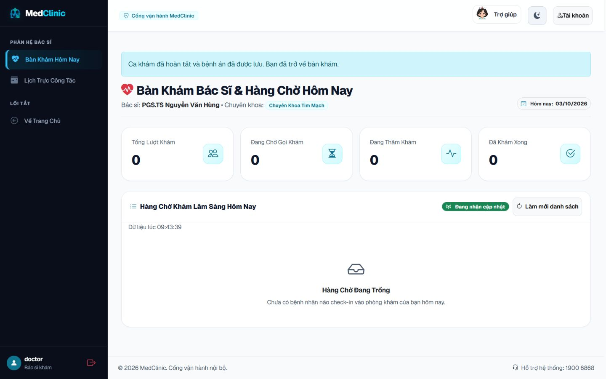

# Bàn giao source GitHub — 03/10/2026

Source đã đủ điều kiện commit/push lên nhánh `feature/frontend-design-system` sau khi hoàn tất GH-01–06 và kiểm chứng local dưới đây. Trạng thái GitHub Actions sẽ được ghi sau khi push, không suy ra từ local pass.

## Kiểm chứng source cuối

| Kiểm tra | Kết quả |
|---|---|
| Maven `clean verify`, Java 21, hoàn tất 09:42:11 +07 ngày 03/10/2026 | BUILD SUCCESS, 214 test / 71 suite, 0 failure/error/skipped |
| SQL Server integration | 31 test chạy trên `medclinic_e2e` và `medclinic_flyway_it` disposable; fresh/legacy Flyway V1–V6 và Hibernate validate đạt; không chạy trên DB browser chứa ca DEMO |
| JaCoCo từ clean run | LINE 84,46%, BRANCH 67,42%; gate 70%/50% đạt |
| Node regression | 24/24 pass, 0 skipped |
| Dependency runtime | OSV query 131 tọa độ compile/runtime: 0 finding trong lần rà cuối |
| Candidate secret audit | 447 file tracked/non-ignored, không khớp secret hiện có trong `.env` hoặc pattern private key/GitHub/AWS đã kiểm tra |
| Diff whitespace | Đạt, có xét CRLF Windows |
| GH-06 browser | Banner ca hoàn tất đọc được desktop/mobile, không tràn ngang, không có form khám trên trang redirect |

Chi tiết có thể kiểm tra trong [verification summary](evidence/github-release-2026-10-03/verification-summary.json), [inventory/OSV](evidence/github-release-2026-10-03/dependency-audit.json) và [UI check](evidence/github-release-2026-10-03/ui-check.json). Scan dependency chỉ gửi tên/phiên bản package công khai; không kiểm chứng mọi đường khai thác. Secret scan không bao gồm toàn bộ lịch sử Git và không phải chứng nhận không có mọi loại secret. Raw log nằm local trong `output/`.

## Thay đổi bàn giao

- Spring Boot **4.1.1**, Security **7.1.1**, Framework **7.0.9**; Tomcat **11.0.26**, Jackson **3.1.7**, Hibernate **7.4.5.Final**, Flyway **12.4.0**. Dùng starter Boot 4 tương thích, Jackson 3, `MockitoBean`, API mới của `DaoAuthenticationProvider`/URI builder và error controller.
- Nâng Tomcat/Jackson vượt BOM patch để xử lý advisory mới. Nguồn: [Spring BCrypt](https://spring.io/security/cve-2025-22228/), [Tomcat 11](https://tomcat.apache.org/security-11.html), [Jackson databind](https://github.com/advisories/GHSA-cxp5-3px4-pw24), [Jackson core](https://github.com/advisories/GHSA-7hhh-6rmp-j9qf). Không suy diễn mọi advisory đều khai thác được trên app.
- Policy mật khẩu chung ở DTO/service/encoder: ít nhất 8 ký tự, tối đa 72 byte UTF-8. Đăng ký/đổi/reset/tạo bác sĩ từ chối input lỗi trước mutation; regression BCrypt và HTTP đăng nhập kiểm tra ASCII/Unicode đúng 72 byte và suffix vượt giới hạn. Giữ hash BCrypt hiện hữu và tài khoản seed ngắn trong dev/demo.
- Ca COMPLETED kiểm tra quyền bác sĩ trước khi redirect `/doctor/desk?closed=true`; thông báo bệnh án đã lưu, không mở form tạo bệnh án mới. Chặn lưu trùng ở backend được giữ. Đây là redirect, chưa bổ sung màn đọc bệnh án riêng cho bác sĩ.
- CI chạy Maven clean verify, Node 24 cases và link checker khi push main/feature/codex hoặc PR main. Hosted CI mặc định không có SQL Server nên giữ guard skip SQL; kết quả SQL đầy đủ ở lần chạy local nêu trên.
- README/runbook cập nhật, link docs tương đối; lịch sử nghiệm thu theo ngày được giữ. Commit có source/test, assets/vendor/license và bằng chứng DEMO đã chọn; `.env*` đã điền, output, hook, webcam cá nhân, OTP/magic-link và raw log không được đưa lên.
- Dọn **54 file tạm / 10 219 038 byte** gồm preview dựng lại được, PDF mẫu và reproducer/script một lần. Giữ bằng chứng công khai, license và model thiết kế; Compose chỉ bind cổng host localhost, giữ volume hiện có.

[Ảnh mobile](evidence/github-release-2026-10-03/completed-desk-mobile.png). Browser kiểm tra banner trên JAR cuối với hàng chờ trống; redirect từ appointment COMPLETED và phân quyền được xác minh bằng integration test, không tạo thêm ca khám qua UI.

## Git và CI

Repo đích: [medclinic-system](https://github.com/tranducanhyn99-prog/medclinic-system). Push thường lên nhánh đang làm việc, không force-push hoặc merge main. Chờ xác nhận run trên [GitHub Actions](https://github.com/tranducanhyn99-prog/medclinic-system/actions/workflows/ci.yml).

Ngân hàng/SMTP nhà cung cấp thật, HTTPS production và matrix thiết bị toàn diện vẫn thuộc nghiệm thu triển khai riêng; source demo được công bố không thay thế gate đó.

Các mốc trước thay đổi được giữ tại [tasklist kiểm tra](GITHUB_READINESS_TASKLIST_2026-10-03.md), [backlog local](BACKLOG_COMPLETION_2026-10-02.md) và [UX/UI 16 task](UX_UI_TASKLIST_2026-10-02.md).
