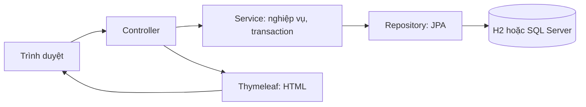

# Hướng dẫn thuyết trình MedClinic — môn Lập trình Web

Cập nhật **15/10/2026**. Kịch bản dành cho **một người, 15 phút**, có thể rút xuống 10 phút. Điền họ tên, MSSV, lớp và giảng viên vào slide mở đầu. Repo: [medclinic-system](https://github.com/tranducanhyn99-prog/medclinic-system).

Mục tiêu: trình diễn **một ca khám hoàn chỉnh**, giải thích được dữ liệu và code phía sau mỗi bước. Tài liệu này hợp nhất kịch bản cũ và hồ sơ minh chứng; không cần đọc toàn bộ thành tiếng.

## 1. Bám rubric môn học

Đã đối chiếu bảng rubric Excel có sẵn trên máy, học kỳ 1 năm học 2026–2027. Trọng số là của môn học; phần minh chứng là gợi ý chuẩn bị, không phải điểm tự chấm.

| Tiêu chí | Trọng số | Cần thể hiện khi bảo vệ |
| --- | ---: | --- |
| Độ khó, thực tiễn, phân công | 10% | Liên thông đặt lịch–khám–thu tiền; chống trùng lịch, lệch tồn kho. Trình bày đúng phần việc cá nhân. |
| AI hỗ trợ, làm chủ code, cộng tác GitHub | 20% | Một ví dụ đọc/sửa/test code có AI hỗ trợ; commit và diff thật; giải thích được quy tắc. |
| Cấu trúc dữ liệu, vai trò, giao diện | 20% | Quan hệ bảng, bốn vai trò và giao diện theo công việc; trình bày có trình tự. |
| Ứng dụng, code, cài đặt, chức năng | 35% | Demo xuyên suốt; service transaction; README chạy được; kết quả test có phạm vi rõ. |
| Sáng tạo ngoài chương trình | 15% | Nội dung mở rộng, code và cách kiểm chứng; đối chiếu đề cương môn học. |

Rubric có mức 7–8 nội dung cho tiêu chí sáng tạo cao nhất. Tám nhóm ở mục 6 là ứng viên để đối chiếu với giảng viên; số thư viện không tự tương ứng số nội dung ngoài chương trình. Với đồ án cá nhân, trình bày quản lý phiên bản của mình và xác nhận cách áp dụng tiêu chí cộng tác với giảng viên.

## 2. Chuẩn bị trước buổi bảo vệ

1. Chạy thử theo [README](../README.md). Demo chính có thể dùng H2/dev: `mvn spring-boot:run`, mở `http://localhost:8080`. H2 nằm trong RAM, dừng app sẽ mất dữ liệu.
2. Dùng tài khoản seed bên dưới. Seed đăng nhập bằng mật khẩu bỏ qua OTP ở dev/demo; `dev` không gửi email. Muốn demo đăng ký/OTP dùng SQL Server/demo + Mailpit hoặc SMTP đã cấu hình.
3. Chọn bác sĩ **Nguyễn Văn Hùng**, gắn với tài khoản `doctor`. Chọn **ngày mai, giờ còn trống**: dev/demo cho xử lý sớm lịch trong 14 ngày. Ngoài dev/demo phải xử lý đúng ngày; vãng lai luôn chỉ hôm nay.
4. Tập trọn ca một lần, ghi thời lượng và mã hẹn thực tế. Không cố định appointment ID vì mỗi lần chạy có thể khác nhau. Chỉ dùng dữ liệu mô phỏng cho môn học.
5. Mở sẵn code ở mục 5, sơ đồ dữ liệu, README và [kết quả kiểm thử](KIEM_THU.md). Chuẩn bị ảnh trong `docs/assets/readme` và PDF của ca đã chạy để dự phòng.
6. Các tab cùng trình duyệt dùng chung phiên đăng nhập: logout/login khi đổi vai trò. Muốn cho thấy realtime, mở bác sĩ ở trình duyệt hoặc profile riêng, lễ tân ở phiên còn lại.
7. Nếu demo Google, tập trước Google → OTP → tài khoản bệnh nhân; xem [Google OAuth](GOOGLE_LOGIN_SETUP.md) và [Gmail OTP](GMAIL_OTP_SETUP.md). Giữ secret và mã OTP ngoài màn hình chia sẻ.

| Tài khoản | Vai trò | Mật khẩu demo |
| --- | --- | --- |
| `patient` | Bệnh nhân | `123456` |
| `staff` | Lễ tân, thu ngân | `123456` |
| `doctor` | Bác sĩ Nguyễn Văn Hùng | `123456` |
| `admin` | Quản trị viên | `123456` |

## 3. Dàn ý 8 slide, 15 phút

| Slide | Thời gian | Nội dung trên slide | Phần trình bày/demo |
| --- | --- | --- | --- |
| 1. Đề tài và bài toán | 00:00–01:00 | Tên, MSSV, vấn đề phòng khám | Phạm vi và chuỗi một ca khám. |
| 2. Kiến trúc và dữ liệu | 01:00–02:30 | MVC, quan hệ bảng, bốn vai trò | Một request đi qua các tầng. |
| 3. Bệnh nhân | 02:30–04:00 | Chọn bác sĩ, ngày, slot; QR | Tạo lịch, ghi mã hẹn. |
| 4. Lễ tân và bác sĩ | 04:00–07:30 | Check-in → STT → khám → kê đơn | Tiếp nhận, bắt đầu khám, lưu bệnh án. |
| 5. Thu ngân và quản trị | 07:30–09:30 | Hóa đơn, PDF, kho, dashboard | Thu tiền mặt, tải PDF, xem kho. |
| 6. Code và mở rộng | 09:30–11:30 | Transaction, khóa, phân quyền, realtime | Mở 2–3 file ở mục 5. |
| 7. Kiểm thử, AI, GitHub | 11:30–13:30 | Test, coverage, ví dụ sửa code, commit | Đọc executed/skipped; giải thích một test. |
| 8. Kết quả, giới hạn | 13:30–15:00 | Luồng đã hoàn thành, bước tiếp | Kết quả và mời câu hỏi. |

Nếu chỉ có **10 phút**: 1 phút bài toán; 1 phút kiến trúc; 5 phút demo; 2 phút code/test/AI; 1 phút giới hạn. Chuyển Google, vãng lai và chuyển khoản sang phần hỏi đáp. File này là hướng dẫn nội dung, chưa phải PowerPoint.

## 4. Lời thoại và thao tác mẫu

### Mở đầu — bài toán

> Em xin trình bày MedClinic, hệ thống quản lý và đặt lịch khám cho một phòng khám tư nhân. Bài toán em giải quyết là kết nối lịch hẹn, tiếp nhận, bệnh án, đơn thuốc và hóa đơn. Khi các bước dùng chung một ca khám, người dùng có thể theo dõi tiến trình và hạn chế nhập lại dữ liệu.
>
> Hệ thống có bốn vai trò: bệnh nhân, lễ tân, bác sĩ và quản trị viên. Em sẽ demo một ca từ lúc đặt lịch đến lúc có hồ sơ và hóa đơn đã thanh toán. Dữ liệu trong buổi trình bày là dữ liệu mô phỏng.

### Kiến trúc — chỉ vào sơ đồ



> Backend dùng Java 21, Spring Boot 4.1.1 và Spring MVC. Controller nhận request và dữ liệu form; service kiểm tra nghiệp vụ; repository truy cập database qua JPA. Thymeleaf tạo HTML trên server. JavaScript tải khung giờ qua API và nhận cập nhật hàng chờ qua WebSocket.
>
> Appointment là trung tâm, liên kết bệnh nhân, bác sĩ và khung giờ. Ca khám có MedicalRecord; bệnh án có Prescription và các PrescriptionItem. Invoice lưu phí khám, tiền thuốc và trạng thái thanh toán. H2 dùng chạy nhanh; SQL Server dùng Flyway quản lý thay đổi schema.

Mở [ERD](diagrams/diagram_logical_erd.png) hoặc [thiết kế CSDL](03_DATABASE_DESIGN_3NF.md). Quan hệ chính: bệnh nhân/bác sĩ có nhiều lịch hẹn; lịch hẹn có tối đa một bệnh án và một hóa đơn; một đơn có nhiều dòng, mỗi dòng tham chiếu một thuốc. Mỗi dòng giữ giá lúc kê. Mô hình còn có liên kết dư/snapshot phục vụ nghiệp vụ; khi hỏi 3NF, phân biệt chuẩn hóa danh mục với lưu dữ liệu lịch sử có chủ đích.

### Bệnh nhân đặt lịch

**Thao tác:** login `patient` → `/patient/booking` → Nguyễn Văn Hùng → ngày mai → slot trống → lý do “Demo môn Lập trình Web” → xác nhận → mở chi tiết, ghi mã hẹn và xem QR.

> Backend kiểm tra ngày khám, bác sĩ, chuyên khoa và khung giờ. Slot phải thuộc đúng bác sĩ, đúng ngày và còn trống. Trong transaction, repository khóa slot trước khi chuyển sang đã đặt. Hai request chọn cùng một giờ phải lần lượt lấy khóa và kiểm tra lại trạng thái.
>
> Mã hẹn và QR giúp lễ tân tìm ca. Quyền tiếp nhận vẫn được kiểm tra bằng tài khoản đăng nhập. Em chọn ngày mai vì môi trường demo cho xử lý sớm; đó là chính sách demo có cấu hình riêng.

**Kết quả:** lịch `CONFIRMED`. Giữ ca này cho các bước tiếp theo.

### Lễ tân tiếp nhận

**Thao tác:** logout → login `staff` → `/staff/reception` → tìm đúng mã → “Tiếp Nhận & Cấp STT”. Nhập mã là demo chính; quét camera dành cho phần mở rộng đã thử thiết bị.

> Lịch chuyển sang CHECKED_IN và có số thứ tự theo ngày khám. Mã hẹn nhận diện lịch, số thứ tự phục vụ hàng chờ. Sau khi transaction commit, hệ thống gửi sự kiện đến bác sĩ phụ trách.

**Kết quả:** `CHECKED_IN` và STT. Với hai phiên riêng, chỉ ra bác sĩ nhận WebSocket và client tự làm mới hàng chờ, không bấm refresh thủ công. Nếu logout/login cùng browser, mô tả đó là tải dữ liệu sau đổi vai trò.

### Bác sĩ khám và kê đơn

**Thao tác:** login `doctor` → `/doctor/desk` → chọn ca vừa tiếp nhận → “Bắt đầu khám” → form `/doctor/examine/{appointmentId}`.

Điền triệu chứng “Dữ liệu mô phỏng cho đồ án”, chẩn đoán “Hồ sơ demo, không dùng cho điều trị”, lời dặn “Minh họa quy trình phần mềm”. Chọn **Paracetamol 500mg (Hasan), số lượng 2**; dùng “Demo” cho ô liều dùng/tần suất nếu cần, để trống ngày tái khám hoặc chọn ngày hợp lệ. Đây là dữ liệu minh họa phần mềm.

> Bác sĩ chỉ xử lý ca do mình phụ trách. Bắt đầu khám chuyển sang IN_PROGRESS. Khi lưu, service kiểm tra chẩn đoán, dữ liệu đơn và tổng số lượng từng thuốc. Thuốc được khóa theo thứ tự ID để giảm nguy cơ deadlock.
>
> Lưu bệnh án, đơn thuốc, xuất kho, tạo hóa đơn và hoàn tất ca nằm trong cùng transaction. Nếu một bước lỗi, các thay đổi trong transaction được rollback. Giá được chụp vào dòng đơn lúc kê. Hóa đơn mới ở trạng thái UNPAID; thu ngân xác nhận tiền ở bước riêng.

**Thao tác tiếp:** hoàn tất khám → mở “Bệnh án đã hoàn tất” → đọc lại chẩn đoán, lời dặn và đơn giá. Màn hình chỉ đọc này không xuất kho hoặc tạo hóa đơn thêm.

**Kết quả:** ca `COMPLETED`, có bệnh án/đơn thuốc và hóa đơn `UNPAID`.

### Thu ngân, PDF và quản trị

**Thao tác:** login `staff` → `/staff/billing` → tìm hóa đơn đúng ca → đối chiếu tổng → thanh toán **tiền mặt** → mở bộ lọc đã thanh toán, tải PDF. Login `patient` xem hồ sơ và tải đơn thuốc. Login `admin` xem thuốc, biến động tồn kho và dashboard.

> Tổng hóa đơn bằng phí khám cộng tổng số lượng nhân đơn giá mỗi dòng thuốc. Với seed chưa đổi: 350.000 + 2 × 1.500 = 353.000 đồng. Service khóa hóa đơn và yêu cầu trạng thái chưa thanh toán. Thao tác lần hai bị từ chối, tránh thu trùng.
>
> PDF dùng font Unicode để giữ tiếng Việt. Backend kiểm tra quyền đọc hồ sơ và tải PDF. Admin xem biến động kho phát sinh từ ca khám và thống kê hóa đơn.

Nếu giá seed đã đổi, đọc tổng thực tế và giải thích công thức. **Tạo VietQR chưa làm hóa đơn thành PAID**; callback/đối soát phải hợp lệ. Demo chính dùng tiền mặt để hoàn thành trong thời gian cho phép.

### Kiểm thử và kết thúc

> Em dùng test unit, integration H2/MockMvc, regression JavaScript và test SQL Server chạy khi có môi trường riêng. Gate JaCoCo là 70% line và 50% branch. Em tách số test đã chạy khỏi test bị bỏ qua và phân biệt kết quả local với CI của commit trên GitHub.
>
> Kết quả là một quy trình đủ bốn vai trò từ đặt lịch đến hồ sơ và thu tiền. Giới hạn là dữ liệu demo nhỏ, tích hợp bên ngoài phụ thuộc cấu hình và chưa nghiệm thu tải thực tế. Hướng tiếp theo là kiểm thử triển khai, đối soát ngân hàng và mở rộng dữ liệu hiệu năng. Em xin kết thúc phần trình bày và nhận câu hỏi.

Lấy số liệu mới nhất từ [KIEM_THU.md](KIEM_THU.md), không học thuộc số test từ báo cáo cũ.

## 5. Các file code nên mở sẵn

Chọn ba trọng tâm: **chống trùng lịch → transaction khám/kho/hóa đơn → phân quyền**. Các file còn lại để trả lời khi được hỏi.

| Câu hỏi | File / vị trí | Điểm phải giải thích |
| --- | --- | --- |
| Request đặt lịch đi đâu? | [PatientAppointmentController](../src/main/java/com/medclinic/controller/PatientAppointmentController.java), [AppointmentService](../src/main/java/com/medclinic/service/AppointmentService.java) | Form → validation → service → lưu → trả kết quả. |
| Chặn đặt trùng bằng gì? | [TimeSlotRepository](../src/main/java/com/medclinic/repository/TimeSlotRepository.java), `bookAppointment` | `PESSIMISTIC_WRITE`, kiểm tra trạng thái trong transaction. |
| Thiếu thuốc có trừ kho dở dang? | [MedicalRecordService](../src/main/java/com/medclinic/service/MedicalRecordService.java), `saveMedicalRecordAndPrescription` | Cộng số lượng, thứ tự khóa, rollback, giá snapshot. |
| Thu tiền hai lần? | [InvoiceService](../src/main/java/com/medclinic/service/InvoiceService.java), `processPayment` | Khóa invoice, kiểm tra UNPAID, lưu PAID và audit. |
| Ẩn nút đã đủ phân quyền? | [SecurityConfig](../src/main/java/com/medclinic/config/SecurityConfig.java), [PdfExportService](../src/main/java/com/medclinic/service/PdfExportService.java) | Role, quyền từng hồ sơ, CSRF, BCrypt. |
| Rollback có gửi realtime? | [DoctorQueueWebSocketListener](../src/main/java/com/medclinic/event/DoctorQueueWebSocketListener.java) | `AFTER_COMMIT`, gửi đúng user destination. |
| Vì sao demo ngày mai? | [ClinicalDatePolicy](../src/main/java/com/medclinic/util/ClinicalDatePolicy.java) | Dev/demo mới được bật xử lý sớm; giới hạn +14 ngày. |
| Thay đổi schema thế nào? | [Migration SQL Server](../src/main/resources/db/migration/sqlserver) | Flyway V1–V10, validate, ràng buộc database. |

## 6. Tám nhóm mở rộng có thể đề xuất

| Nhóm | Code hoặc kiểm thử | Điều cần nói chính xác |
| --- | --- | --- |
| Google OIDC | [GoogleLoginConfig](../src/main/java/com/medclinic/config/GoogleLoginConfig.java), [GoogleAccountService](../src/main/java/com/medclinic/service/GoogleAccountService.java) | Subject ổn định, email đã xác thực; Google thành công vẫn chờ OTP. |
| OTP và magic link | [AuthVerificationService](../src/main/java/com/medclinic/service/AuthVerificationService.java), `OtpAuthenticationIntegrationTest` | Hạn dùng, hash, dùng một lần, gắn phiên, resend vô hiệu mã cũ. Google và OTP cùng Gmail không phải hai yếu tố độc lập. |
| QR tiếp nhận | [QrCodeUtil](../src/main/java/com/medclinic/util/QrCodeUtil.java), `StaffReceptionController` | QR hỗ trợ tra cứu; camera cần thử thiết bị. |
| WebSocket | `DoctorQueueWebSocketAfterCommitIntegrationTest` | Gửi sau commit và đúng user; payload không chứa bệnh án. |
| PDF tiếng Việt | `PdfUnicodeFontTest`, `PrescriptionPdfPresentationTest` | Font local, nội dung và quyền export. |
| Transaction/cạnh tranh | `ConcurrentBookingIntegrationTest`, `MedicineStockConcurrencyIntegrationTest`, `MedicalRecordRollbackIntegrationTest` | Test request có kiểm soát không thay thế tải lớn. |
| Callback thanh toán | [BankTransferPaymentService](../src/main/java/com/medclinic/service/BankTransferPaymentService.java), `BankTransferPaymentServiceTest` | HMAC, khớp tiền/mã, idempotency; chưa xác nhận giao dịch ngân hàng thật. |
| Vận hành | Docker Compose, Flyway, [CI](../.github/workflows/ci.yml), JaCoCo | Tái lập, migration, gate; CI cần đối chiếu đúng SHA. |

## 7. Minh họa AI và GitHub bằng ví dụ thật

Sau khi tự luyện, có thể nói:

> Em dùng AI hỗ trợ phân tích, gợi ý code và test. Em kiểm tra lại quy tắc, đọc thay đổi và chạy test. Em xin mở một ví dụ để giải thích lỗi có thể xảy ra và test bảo vệ hành vi đó.

**Ví dụ A — số điện thoại:** mở [PhoneNumbers](../src/main/java/com/medclinic/util/PhoneNumbers.java), `PhoneAndVndValidationTest`, `PhoneUniquenessIntegrationTest` và migration V7. Giải thích character class có thể vô tình cho phép dấu `|`; helper dùng chung giữ quy tắc nhất quán; unique constraint bảo vệ khi hai request cạnh tranh. Tự chỉ ra một số hợp lệ, một số sai và một số chứa `|`.

**Ví dụ B — Google còn chờ OTP:** mở `GoogleLoginConfig`, `AuthController` và [GoogleCallbackProtocolIntegrationTest](../src/test/java/com/medclinic/GoogleCallbackProtocolIntegrationTest.java). Giải thích callback Google hợp lệ chưa lưu session đăng nhập hoàn chỉnh; portal còn bị chặn trước OTP. Nói được vai trò nonce, chữ ký và challenge gắn phiên.

Xem lịch sử thật trước buổi trình bày:

```powershell
git log --oneline -8
git log --oneline -- src/main/java/com/medclinic/util/PhoneNumbers.java
```

Dùng `git show <SHA> -- <file>` với SHA có thật. Nếu lịch sử không có ví dụ sửa riêng, trình bày code/test hiện tại và giới hạn bằng chứng. Với đồ án cá nhân, mô tả yêu cầu → mô hình → nghiệp vụ → kiểm thử → hoàn thiện; không dựng thành viên hoặc PR/review nhóm.

## 8. Câu hỏi phản biện thường gặp

| Câu hỏi | Gợi ý trả lời |
| --- | --- |
| Vì sao Thymeleaf? | Phù hợp MVC và phạm vi đồ án; render form/validation trên server, bổ sung JS cho slot và realtime. |
| Controller/service/repository khác gì? | Nhận/trả HTTP; nghiệp vụ/transaction; truy vấn database. |
| H2 giống SQL Server hoàn toàn? | Khác engine, SQL và cơ chế khóa; cần test SQL Server riêng. |
| Hai người đặt cùng slot? | Khóa slot, kiểm tra AVAILABLE trong transaction; người lấy khóa sau thấy trạng thái đã đổi. |
| Vì sao có cả `@Version` và khóa ghi? | Version phát hiện cập nhật cũ; khóa ghi điều phối nghiệp vụ đặt lịch hiện tại. |
| Thiếu thuốc ở dòng cuối? | Transaction rollback bệnh án/đơn/kho/hóa đơn đã ghi trước đó. |
| Đổi giá làm đổi đơn cũ? | Dòng đơn giữ `unitPriceAtTime`, hóa đơn giữ số tiền lúc tạo. |
| Bác sĩ khác sửa ID trên URL? | Backend kiểm tra bác sĩ phụ trách, không dựa riêng vào giao diện. |
| QR mang quyền truy cập? | QR giúp tìm ca; thao tác vẫn cần đăng nhập và quyền. |
| Ngừng tài khoản/thuốc có mất lịch sử? | Quản lý trạng thái active ở danh mục; quan hệ lịch sử cần được bảo toàn. |
| Có QR ngân hàng là đã trả tiền? | Chưa; cần callback/đối soát hợp lệ, gửi lặp không thu hai lần. |
| Test xanh là dùng dữ liệu thật được? | Chỉ chứng minh phạm vi đã chạy; còn nghiệm thu tích hợp, tải và vận hành. |
| AI viết code thì em hiểu ở đâu? | Giải thích một quy tắc, đầu vào–đầu ra–lỗi biên, test và ảnh hưởng khi đổi quy tắc. |

## 9. Phương án dự phòng

| Tình huống | Cách tiếp tục |
| --- | --- |
| Hết giờ khám hôm nay | Chọn ngày mai ở dev/demo, nói rõ chính sách. |
| Bác sĩ không thấy ca | Kiểm tra Nguyễn Văn Hùng, đã check-in và đúng tài khoản `doctor`. |
| Chuyển tab thấy đổi vai trò | Logout/login hoặc dùng profile riêng đã chuẩn bị. |
| Camera không mở | Nhập mã hẹn; minh họa QR trên phiếu. |
| Google/SMTP lỗi | Dùng tài khoản seed cho ca chính; mở test/code để giải thích tích hợp. |
| H2 mất dữ liệu sau restart | Tạo ca mới; giới thiệu rõ PDF/ảnh dự phòng là kết quả lần chạy trước. |
| Maven chạy lâu | Mở báo cáo gần nhất, không đợi full suite trong giờ demo. |
| Ngân hàng chưa cấu hình | Demo tiền mặt; giải thích chuyển khoản bằng code/test. |

Trước giờ vào lớp: đi hết ca trong thời lượng cho phép, mở được ba đoạn code trọng tâm, đọc đúng báo cáo test, điền thông tin sinh viên và giữ bản hướng dẫn này trên máy để mở khi mất mạng.
