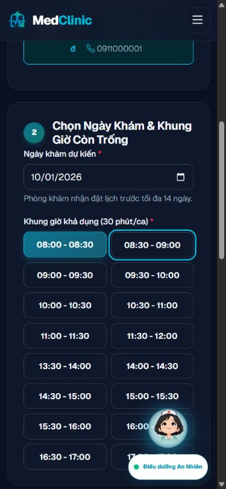

# Kết quả xử lý Impeccable audit — 01/10/2026

Đã triển khai các sửa lỗi thuộc 19 nhóm của audit giao diện, giữ thiết kế MedClinic hiện có. Lỗi khóa nút lưu sau khi hủy xác nhận đã được kiểm tra lại trên browser thật: chọn **Kiểm tra lại**, nút vẫn hoạt động và mở lại được hộp xác nhận. Các mục backend trong báo cáo kiểm tra dự án được theo dõi riêng; báo cáo này không xác nhận production readiness.

## Các nhóm đã xử lý

| ID | Thay đổi | Bằng chứng chính |
|---|---|---|
| UI-01 | Chặn gửi lặp tại document sau listener của form; chỉ khóa khi form thực sự gửi, giữ submitter và mở khóa khi quay lại trang | Browser hủy xác nhận hai lần; regression JavaScript. Mô phỏng microtask ban đầu không tái hiện đủ browser và đã được thay |
| UI-02 | Camera `(self)` riêng `/staff/reception`; các trang khác giữ camera bị chặn; có hướng dẫn nhập mã nếu thư viện/API camera không hoạt động | MockMvc header; cửa sổ QR hiện nút xin quyền. Chưa cấp quyền camera thật |
| UI-03 | Public portrait theo ID bác sĩ đang hoạt động; đường ảnh tài khoản bệnh nhân vẫn yêu cầu đăng nhập; ảnh lỗi có fallback | 5 test controller ảnh, test security, ảnh seed tải qua browser và HTTP |
| UI-04 | Sidebar đóng dùng inert/visibility; khi mở, nội dung nền inert; Tab/Shift+Tab ở trong drawer, Escape trả focus | Browser mobile kiểm tra vòng focus và Escape |
| UI-05 | Liên kết label nhập kho; đặt tên truy cập các trường và nút xóa dòng thuốc; aria-invalid/aria-describedby cho lỗi form đăng ký, focus vào lỗi đầu | AX modal nhập kho và kê đơn; source common helper |
| UI-06 | Mỗi biểu đồ có bảng dữ liệu server-rendered, caption, row/column headers và nội dung thay thế | AX dashboard, dữ liệu một cuộc hẹn H2; bảng vẫn hoạt động khi JS không tải |
| UI-07 | Primary light `#0e7490`; nút nền đậm hơn, sidebar label `#94a3b8`; alias màu theo theme | CSS và browser sáng/tối; trắng trên `#0e7490` khoảng 5,36:1 |
| UI-08 | Flash thông báo được giữ cho đến khi người dùng đóng hoặc chuyển trang | Source không còn timer 4.500ms; thông báo vẫn hiện sau các thao tác browser |
| UI-09 | Carousel có pause/resume; slide ngoài nhóm inert/aria-hidden; chỉ hiện chỉ báo nhóm hợp lệ, có thông báo cho thao tác người dùng; tôn trọng reduced motion | Browser desktop 3 nhóm; source responsive 1/2/3 slide |
| UI-10 | Mũi tên và vùng chạm chỉ báo 44px; chấm nhỏ nằm trong vùng chạm lớn; các control mobile tối thiểu 44px | CSS và browser mobile |
| UI-11 | Bubble trợ lý mặc định đóng và inert; nút native mở/đóng, có aria-expanded/controls | Browser 390px: bộ lọc và nút lọc hiển thị, không bị bubble che |
| UI-12 | Abort request cũ và dùng sequence để loại response stale; đổi chuyên khoa xóa lựa chọn/pending request | Regression đảo thứ tự response và clear khi đang tải; browser walk-in/booking |
| UI-13 | Loading, empty và error tách biệt; kiểm tra HTTP/payload, timeout 15 giây; nút retry giữ bác sĩ/ngày | Regression HTTP 503, payload sai, rỗng và retry thành công |
| UI-14 | Màu biểu đồ, legend, grid và border lấy từ token, cập nhật theo sự kiện theme | Regression theme; browser dashboard có dữ liệu, console không có lỗi |
| UI-15 | Chart.js cục bộ, cố định phiên bản 4.5.1, defer, chỉ tải ở dashboard có biểu đồ; kèm giấy phép MIT | Source/script browser; [release chính thức](https://github.com/chartjs/Chart.js/releases/tag/v4.5.1) |
| UI-16 | Thumbnail 128/256/512px cho ảnh JPG/PNG, srcset và sizes, cache có giới hạn | Sáu ảnh seed size=128 tổng **32.597 byte**, từ **3.799.950 byte**, giảm **99,14%**; unit test kích thước/tỉ lệ |
| UI-17 | SW chỉ cache static same-origin; không lưu HTML theo session/API/avatar riêng; navigation mất mạng dùng trang offline trung lập; xóa cache v1 của MedClinic | Regression SW: navigation/API/private/CDN không vào cache; browser trang offline |
| UI-18 | Thống nhất hotline, bỏ rating/số lượt/satisfaction giả và cam kết video/BHYT/tiêm chủng/24 giờ/5 giây/lưu trọn đời chưa có căn cứ; số bác sĩ/chuyên khoa lấy từ model | Source copy và browser trang chủ |
| UI-19 | H1 cho tiêu đề trang, H2/H3 cho các mục và modal; sửa heading bảng, lịch trực, phiếu hẹn và vé STT; số KPI không dùng heading | Render integration và kiểm tra tag của 30 template; browser bệnh án/dashboard có một H1 |

## Kiểm chứng

- `mvn -B -o '-Dmaven.repo.local=C:/Users/DUCANHZZ/.m2/repository' clean verify`: **153 test / 62 class; 144 PASS, 9 SQL Server skipped; 0 failure/error**.
- Sau các thay đổi heading/token cuối, chạy lại 14 test layout, render portal và security với `mvn verify`: PASS. Không thay đổi Java nghiệp vụ sau build sạch.
- JaCoCo cuối: **76,18% LINE / 58,08% BRANCH**, vượt gate 70%/50%.
- `node --test src/test/frontend/ui-regressions.cjs`: **9/9 PASS**, gồm hủy xác nhận, gửi lặp, back navigation, race/clear request, retry, cache riêng tư/offline và màu biểu đồ.
- Browser kiểm tra 320/390/1440px, sáng/tối, home/carousel, danh sách bác sĩ, login demo, admin/dashboard/nhập kho, reception/QR, walk-in, booking và bệnh án. Một cuộc hẹn thử được tạo trên H2 riêng để kiểm tra bệnh án; **không xác nhận lưu bệnh án hoặc thực hiện thanh toán**.
- Detector thủ công chạy một lần sau sửa: **54 cảnh báo / 13 rule**, từ 73 cảnh báo của audit ban đầu. Phân loại riêng: heuristic Thymeleaf/style không nhận thành lỗi chỉ vì scan; các heading/hover thực còn sót đã sửa và kiểm tra render lại. Không tuyên bố detector bằng 0 hoặc đã có Lighthouse score.
- Log và JSON trong `target/review/impeccable-fix-*` là bằng chứng tạm, có thể mất khi chạy `clean`.

## Ảnh bằng chứng

- [Dashboard có bảng dữ liệu và biểu đồ](evidence/impeccable-2026-10-01/dashboard.png).
- [Bộ lọc mobile với trợ lý thu gọn](evidence/impeccable-2026-10-01/doctors-mobile.png).
- [Form bệnh án sau khi hủy xác nhận](evidence/impeccable-2026-10-01/examine-cancel.png).

## Giới hạn và các việc còn lại

Camera thực tế cần người dùng cấp quyền trên localhost/HTTPS; chưa nghiệm thu thiết bị thật hoặc screen reader. Chưa đo Core Web Vitals, chưa chạy lại SQL Server/Docker/backup restore, chưa nghiệm thu thanh toán và email OTP ngoài bộ test.

JDK không có decoder WebP: ảnh bác sĩ upload dạng WebP được phục vụ nguyên bản qua endpoint công khai; JPG/PNG và toàn bộ sáu ảnh seed được resize. Thumbnail giữ tỉ lệ ảnh, có cache server tối đa 128 entries và cache public 5 phút.

Các thay đổi được giữ trong working tree, chưa commit/deploy. Bản xem thử chạy ở [localhost:18086](http://127.0.0.1:18086/) với profile dev và H2 `impeccable_fix`, bind riêng localhost. Database này là tạm và reset khi tiến trình khởi động lại; dữ liệu triển khai không được dùng.

Các mục backend cần tái kiểm tra và điều kiện nghiệm thu tiếp theo nằm trong [backlog](RESOLUTION_BACKLOG_2026-10-01.md).

## Bổ sung: khung giờ trong dark mode

Ảnh người dùng cung cấp cho thấy lỗi còn sót ở UI-07: nền nút khung giờ bị cố định trắng trong khi chữ lấy màu sáng của dark mode. Đã đổi nền sang token `--mc-surface`, bỏ CSS khung giờ trùng trong template booking, bổ sung focus bàn phím và giữ màu đã chọn khi hover. Khung giờ không khả dụng dùng token nền/chữ theo theme. Tăng phiên bản CSS lên `3.1` ở hai layout để tải bản mới.

Kiểm chứng trên bản localhost đã build lại: dark mode có nền `rgb(15,23,42)` và chữ `rgb(241,245,249)`; light mode có nền trắng và chữ `rgb(15,23,42)`. Nút đã chọn giữ chữ trắng trên nền xanh đậm. Browser kiểm tra 1440/390/320px không tràn ngang, focus rõ và console không có warning/error. Build `mvn -DskipTests package` PASS; không chạy lại toàn bộ bộ test cho thay đổi CSS/template này. Trạng thái disabled được kiểm tra qua CSS, chưa có khung giờ disabled trong dữ liệu H2 của lượt kiểm tra này.

