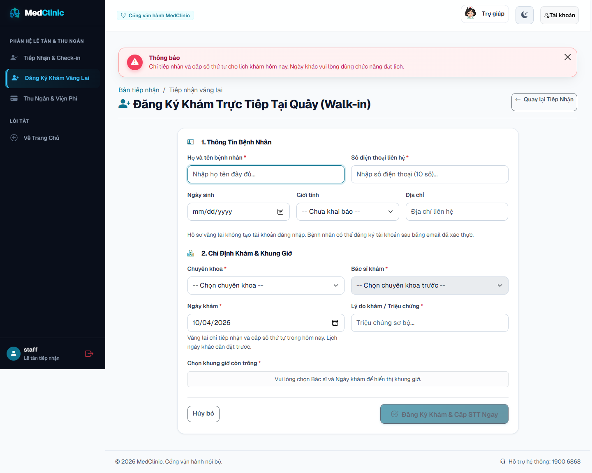

# Nghiệm thu sửa PW-01 và PW-02 — 04/10/2026

**Đã xử lý cả hai lỗi.** Lượt cuối đạt **242/242 Java test**, **25/25 frontend test** và **154/154 assertion Playwright CLI**. [Báo cáo trước sửa](PLAYWRIGHT_CHECK_2026-10-04.md) và bằng chứng 149/152 được giữ làm lịch sử, không ghi đè bằng kết quả mới.

Source: working tree chưa commit, branch `codex/completion-runtime-ci`, nền `fa56618`. Ứng dụng chính đã được build lại và cập nhật bằng Docker ở `http://127.0.0.1:8080`; database SQL Server và uploads được giữ. Preview H2 ở cổng **18088 vẫn là image cũ**, không khởi động lại để tránh mất dữ liệu trong bộ nhớ của phiên đang mở. Dùng cổng 8080 để xem bản sửa này.

## Tasklist đã hoàn tất

- [x] **PW-01:** service chỉ tiếp nhận/cấp STT cho lịch hôm nay theo business clock `Asia/Ho_Chi_Minh`, trước khi gọi bộ cấp số hoặc đổi trạng thái. Đặt trước trong 14 ngày vẫn được phép; lịch tương lai giữ `CONFIRMED` đến ngày khám.
- [x] Chặn bắt đầu khám sai ngày, kể cả ca cũ đã `CHECKED_IN` hoặc `IN_PROGRESS`; chặn mở form đang xử lý và lưu bệnh án sai ngày. Ca hoàn tất vẫn dẫn về thông báo đóng ca; lịch sử bệnh án vẫn được đọc.
- [x] Form vãng lai dùng ngày hiện tại do server cung cấp, có `min=max=today`, hướng dẫn đặt trước cho ngày khác và không tải slot khi ngày không hợp lệ. Backend từ chối request giả mạo trước khi tìm/tạo bệnh nhân hoặc đặt slot.
- [x] Thêm **23 regression ngày khám**: 15 unit case dùng clock cố định qua ranh giới UTC/Vietnam; 8 HTTP integration case cho ngày trước/ngày sau, đúng role và CSRF. Kiểm tra không đổi trạng thái, không cấp STT, không tạo bệnh nhân, không đặt slot, không trừ kho hoặc tạo bệnh án/hóa đơn khi từ chối.
- [x] Kiểm tra luồng hợp lệ: nhận vãng lai hôm nay, bắt đầu và lưu ca trong ngày, rollback khi tạo hóa đơn lỗi, cạnh tranh tồn kho và luồng SQL Server đầy đủ. Test SQL đặt trước rồi chuyển clock **chỉ trong test** đến ngày bệnh nhân tới; production clock không bị thay đổi.
- [x] **PW-02:** khai báo favicon SVG local trong cả main/dashboard; endpoint anonymous `/favicon.ico` trả nội dung logo SVG hiện có, HTTP 200, MIME `image/svg+xml`, cache public một ngày. Bỏ alternate icon PNG vì file logo mang đuôi PNG thực chất có signature JPEG; không chuyển đổi hoặc tạo ảnh mới.
- [x] Thêm regression favicon về quyền anonymous, bytes, MIME và cache; chạy lại CLI, cập nhật SRS/RTM/README và lưu bằng chứng.

## Kết quả kiểm tra cuối

| Kiểm tra | Kết quả |
|---|---|
| Maven `clean verify`, SQL guard bật | **242 test / 75 suite**, 0 failure/error/skip, `BUILD SUCCESS` |
| SQL Server | 26 integration test và 6 artifact/schema test, chỉ dùng `medclinic_e2e` / `medclinic_flyway_it` disposable |
| JaCoCo | LINE **84,86%**, BRANCH **68,76%**, đạt gate 70%/50% |
| Node frontend | **25/25**, không failure/skip |
| Playwright CLI wrapper thực chạy | `ops/run-playwright-check.ps1 -WithFixture`, CLI **0.1.22**, Microsoft Edge 154.0.4258.53 / Chromium headless, exit 0 |
| Browser tổng hợp | **154/154**, 0 nhóm lỗi; public 38, patient 21, staff 21, doctor 17, admin 30, interactions 17, clinical 5, walk-in 5 |
| Ma trận render | **115/115**, 23 tổ hợp trang/vai trò × 5 cấu hình viewport/theme; mỗi trang có favicon SVG |
| JavaScript/tài nguyên | 0 pageerror, 0 console error, 0 HTTP error và 0 request failure ở ma trận; favicon anonymous 200, đúng nội dung SVG/MIME |
| Request sai ngày | Check-in bị từ chối với thông báo; lịch tương lai vẫn xác nhận. Start, GET form và POST save trực tiếp bị chặn; thu ngân vẫn không có hóa đơn mới |
| Vãng lai | Ngày server, min/max hôm nay; ngày trước/ngày sau không hợp lệ và submit bị khóa. POST tương lai có CSRF bị từ chối, slot vẫn `AVAILABLE` |
| Booking tương lai | Đặt lịch, QR email Mailpit, hủy lịch, offline/recovery và dark mode vẫn đạt; mẫu nút giờ tương phản khoảng 16,30:1 |
| Runtime sau nghiệm thu | App 8080, SQL Server, Mailpit healthy; CLI session đã đóng và H2 fixture 18090 đã được xóa |

[Tổng hợp browser](evidence/playwright-fix-2026-10-04/summary.json), [Maven và coverage](evidence/playwright-fix-2026-10-04/test-summary.json), [public/favicon](evidence/playwright-fix-2026-10-04/public.json), [check-in](evidence/playwright-fix-2026-10-04/interactions.json), [khám](evidence/playwright-fix-2026-10-04/clinical.json), [vãng lai](evidence/playwright-fix-2026-10-04/walk-in.json), [runtime](evidence/playwright-fix-2026-10-04/runtime.json).



## Phạm vi bằng chứng

Lượt browser sau giờ slot trong ngày dùng **H2 riêng** để tạo hai lịch ngày kế tiếp, hủy một lịch và gửi các request biên. **0 bệnh án được lưu, 0 hóa đơn được tạo, 0 lần thu tiền thật.** Lượt CLI này không mở form khám hợp lệ cho ngày tương lai để thử thêm/xóa thuốc như lượt trước; thay bằng các assertion từ chối GET/POST. Vì bộ assertion được điều chỉnh và thêm kiểm tra favicon/vãng lai, tổng 154 không phải cùng một danh sách nguyên trạng với 152 trước sửa.

Luồng khám hợp lệ và bất biến dữ liệu được chứng minh bằng integration test H2/SQL Server, không gọi là một lượt browser hoàn chỉnh từ khám đến thanh toán mới. Không nghiệm thu lại camera, screen reader, touch thật, ngân hàng/SMTP nhà cung cấp, Firefox/Safari hoặc production. Không đưa cookie, OTP, email thô hay secret vào bằng chứng công khai. Các JSON/ảnh trước sửa vẫn ở thư mục evidence cũ; log thô và tool CLI nằm trong `output/` bị ignore.

## Chạy lại

```powershell
docker compose up -d --build
.\ops\run-playwright-check.ps1 -WithFixture
```

Cần Microsoft Edge, Node/npm và Compose demo với Mailpit. Runner tạo context riêng theo vai trò và H2 fixture có label, dọn đúng session/container do nó tạo; từ chối thay fixture cũ nếu thiếu `-ResetFixture`. Maven với SQL Server cần database test riêng theo [runbook](database/SQLSERVER_RUNBOOK.md).
