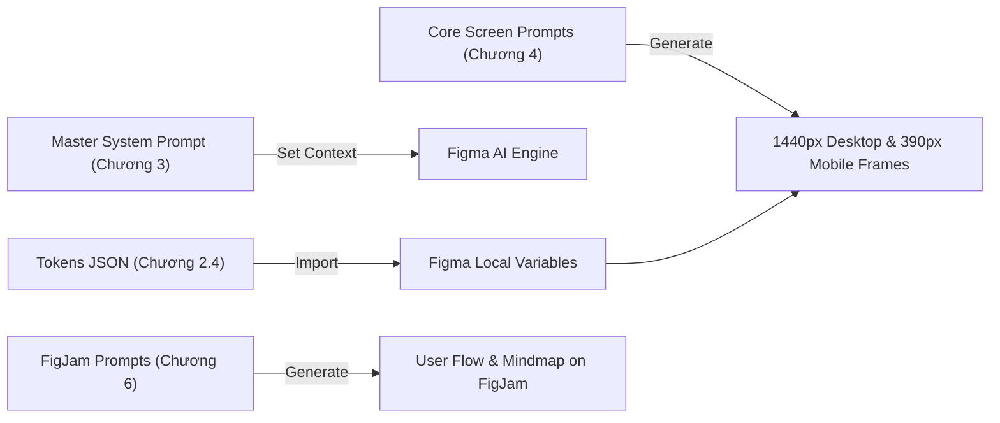
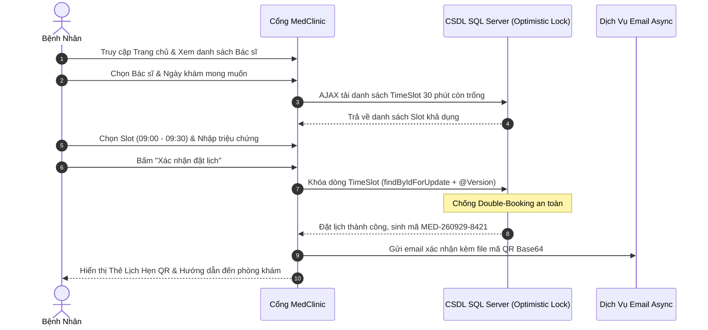
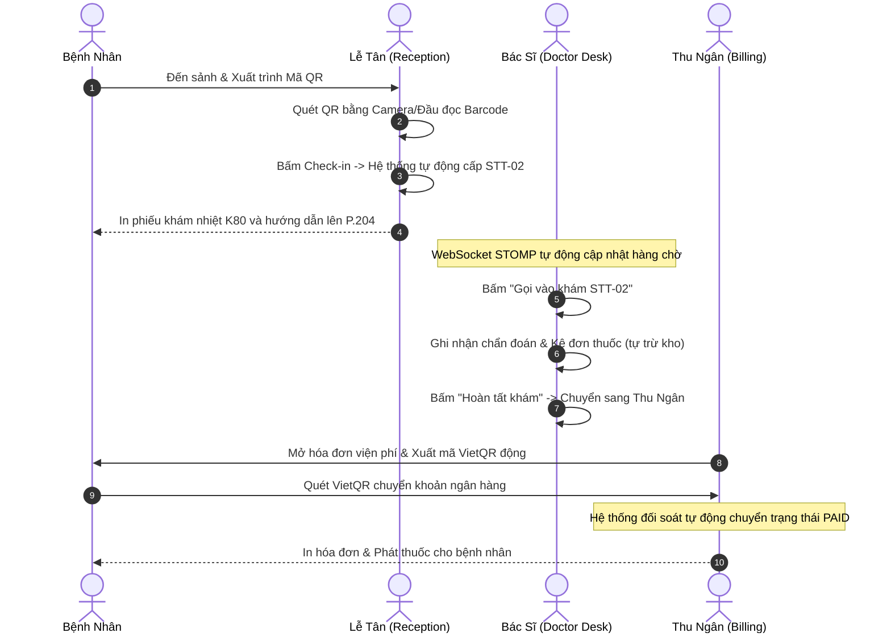

# 🏥 MedClinic — Figma AI UX/UI Design Specification & Prompt Engineering Pack
> **Tài Liệu Đặc Tả Thiết Kế UX/UI & Bộ Prompt Chuẩn Hóa Dành Riêng Cho Figma AI (Make Designs, First Draft, FigJam AI & Tokens Studio)** <br>
> **Dự án:** Hệ Thống Quản Lý & Đặt Lịch Khám Phòng Khám Tư Nhân MedClinic <br>
> **Phiên bản:** 2.0 (Medical Cyan & Slate Design System) <br>
> **Trạng thái:** Production Ready • WCAG 2.1 AA Compliant • Responsive Desktop (1440px) & Mobile (390px)

---

## 📑 Mục Lục (Table of Contents)

1. [Tổng Quan & Hướng Dẫn Sử Dụng Với Figma AI](#1-tổng-quan--hướng-dẫn-sử-dụng-với-figma-ai)
2. [Master Design Tokens (Figma Variables & Styles)](#2-master-design-tokens-figma-variables--styles)
   - [2.1 Bảng màu Semantic & Functional (Color Palette)](#21-bảng-màu-semantic--functional-color-palette)
   - [2.2 Thang đo Typography (Geist / Inter)](#22-thang-đo-typography-geist--inter)
   - [2.3 Thang đo Spacing, Radius & Elevation](#23-thang-đo-spacing-radius--elevation)
   - [2.4 Mã Token JSON (Dùng cho plugin Tokens Studio / Figma Local Variables)](#24-mã-token-json-dùng-cho-plugin-tokens-studio--figma-local-variables)
3. [Master System Prompt Cho Figma AI](#3-master-system-prompt-cho-figma-ai)
4. [Bộ Prompt Sinh Màn Hình Chi Tiết (8 Core Prompts for Figma AI)](#4-bộ-prompt-sinh-màn-hình-chi-tiết-8-core-prompts-for-figma-ai)
   - [Prompt 1: Public Homepage & Hero Mesh](#prompt-1-public-homepage--hero-mesh)
   - [Prompt 2: Doctors Directory & Profile Detail](#prompt-2-doctors-directory--profile-detail)
   - [Prompt 3: Patient 4-Step Booking Wizard](#prompt-3-patient-4-step-booking-wizard)
   - [Prompt 4: Patient QR Pass & Electronic Health Record](#prompt-4-patient-qr-pass--electronic-health-record)
   - [Prompt 5: Doctor Realtime Desk & Clinical Examination Workstation](#prompt-5-doctor-realtime-desk--clinical-examination-workstation)
   - [Prompt 6: Receptionist QR Check-in & Walk-in Desk](#prompt-6-receptionist-qr-check-in--walk-in-desk)
   - [Prompt 7: Cashier Billing & VietQR Dynamic Payment Modal](#prompt-7-cashier-billing--vietqr-dynamic-payment-modal)
   - [Prompt 8: Admin Operational KPI Dashboard & Inventory Alert](#prompt-8-admin-operational-kpi-dashboard--inventory-alert)
5. [Quy Chuẩn Component Blueprints & Auto-Layout Recipes](#5-quy-chuẩn-component-blueprints--auto-layout-recipes)
   - [5.1 Trợ lý ảo Điều dưỡng An Nhiên (Mascot Widget)](#51-trợ-lý-ảo-điều-dưỡng-an-nhiên-mascot-widget)
   - [5.2 TimeSlot 30-Phút Component](#52-timeslot-30-phút-component)
   - [5.3 Doctor Professional Card](#53-doctor-professional-card)
   - [5.4 Booking Stepper Bar](#54-booking-stepper-bar)
   - [5.5 Live Queue STT Card](#55-live-queue-stt-card)
   - [5.6 Bàn kê đơn thuốc động (Dynamic Prescription Table)](#56-bàn-kê-đơn-thuốc-động-dynamic-prescription-table)
   - [5.7 Thẻ thanh toán VietQR ngân hàng](#57-thẻ-thanh-toán-vietqr-ngân-hàng)
6. [Sơ Đồ Luồng Nghiệp Vụ Cho FigJam AI (User Flows)](#6-sơ-đồ-luồng-nghiệp-vụ-cho-figjam-ai-user-flows)
7. [Quy Trình Triển Khai Thực Tế Trong Figma (Handoff Guide)](#7-quy-trình-triển-khai-thực-tế-trong-figma-handoff-guide)

---

## 1. Tổng Quan & Hướng Dẫn Sử Dụng Với Figma AI

Tài liệu này cung cấp **bản thiết kế UX/UI toàn diện và bộ prompt có cấu trúc (Structured Prompt Pack)** được tối ưu hóa cho các công cụ AI trong hệ sinh thái Figma:
- **Figma AI (Make Designs / First Draft):** Nhấn `⌘ + K` (Mac) hoặc `Ctrl + K` (Windows), chọn *"Make designs"*, sau đó dán trực tiếp từng prompt trong mục 4.
- **Tokens Studio for Figma / Local Variables:** Sao chép khối JSON tại mục 2.4 để tạo ngay toàn bộ bộ biến màu sắc, kích thước, bo góc, bóng đổ vào file Figma.
- **FigJam AI:** Dán các đoạn mô tả tại mục 6 để tự động tạo sơ đồ tư duy, luồng người dùng (User Journey) và ma trận nghiệp vụ.



---

## 2. Master Design Tokens (Figma Variables & Styles)

### 2.1 Bảng màu Semantic & Functional (Color Palette)

| Tên Token (Variable Path) | Mã HEX | Vai trò nghiệp vụ / Ứng dụng | Độ tương phản WCAG |
|---|---|---|---|
| `color/primary/default` | `#0891B2` | Nút bấm chính, tab đang chọn, icon nổi bật, border active | AAA on White |
| `color/primary/hover` | `#0E7490` | Trạng thái hover cho nút chính, liên kết | AAA on White |
| `color/primary/strong` | `#155E75` | Tiêu đề đậm, văn bản thương hiệu, viền nhấn | AAA on White |
| `color/primary/soft` | `#ECFEFF` | Nền thẻ bác sĩ, nền slot chọn, background badge | AA Large |
| `color/primary/subtle` | `#CFFAFE` | Nền highlight hover, viền phụ bảng | AA Large |
| `color/secondary/default` | `#0D9488` | Nhãn chuyên khoa, tag dịch vụ hỗ trợ, nút phụ | AAA on White |
| `color/navy/950` | `#090E1A` | Nền thanh điều hướng Sidebar quản trị (Dashboard) | Contrast Ratio > 15:1 |
| `color/navy/900` | `#0F172A` | Màu chữ chính (Headings, Body Text), Footer | Contrast Ratio 16.2:1 |
| `color/slate/500` | `#64748B` | Chữ thứ cấp (Subtitle, Timestamp, Mã đặt chỗ phụ) | Contrast Ratio 4.6:1 (AA) |
| `color/background/canvas` | `#F8FAFC` | Nền toàn trang, nền khu vực làm việc | Dịu mắt, chống chói |
| `color/surface/white` | `#FFFFFF` | Nền thẻ Card, Modal dialog, Input form | Clean Surface |
| `color/surface/subtle` | `#F1F5F9` | Nền header bảng, ô readonly, slot đã đặt | Neutral contrast |
| `color/border/default` | `#E2E8F0` | Đường phân cách, viền card, viền input | Chuẩn 1px line |
| `color/border/strong` | `#CBD5E1` | Viền khung tìm kiếm, viền ô nhập liệu khi focus | Rõ nét |
| `color/status/success` | `#059669` | Trạng thái ĐÃ KHÁM, ĐÃ THANH TOÁN, Đã Check-in | WCAG AAA |
| `color/status/warning` | `#D97706` | Trạng thái CHỜ KHÁM, Cảnh báo tồn kho thấp | WCAG AAA |
| `color/status/danger` | `#E11D48` | Trạng thái ĐÃ HỦY, Nút xóa, Hotline cấp cứu | WCAG AAA |
| `color/status/info` | `#0284C7` | Trạng thái ĐÃ ĐẶT LỊCH, Thông báo hướng dẫn | WCAG AAA |
| `color/mascot/glow` | `rgba(8,145,178,0.35)` | Hào quang phát sáng xung quanh Điều dưỡng An Nhiên | Hiệu ứng nổi bật |

### 2.2 Thang đo Typography (Geist / Inter)

- **Font Family Chính:** `Geist`, `Inter`, hoặc `Be Vietnam Pro` (Hỗ trợ 100% tiếng Việt có dấu, nét chữ quang học hiển thị tối ưu trên màn hình Retina).
- **Text Styles trong Figma:**

| Style Name | Kích cỡ (Size / Line-height) | Font Weight | Ký tự cách (Tracking) | Ứng dụng |
|---|---|---|---|---|
| `Typography/Display-XL` | 44px / 52px | Bold (750) | -0.025em | Tiêu đề Hero Trang chủ |
| `Typography/H1-Large` | 32px / 40px | Bold (700) | -0.025em | Tiêu đề trang chính (Page Header) |
| `Typography/H2-Medium` | 24px / 32px | SemiBold (650) | -0.02em | Tiêu đề phân đoạn, Tên bác sĩ |
| `Typography/H3-Small` | 20px / 28px | SemiBold (600) | -0.015em | Tiêu đề Card, Tên bước Stepper |
| `Typography/Body-Default` | 15px / 24px | Regular (400) / Medium (500) | -0.01em | Đoạn văn, thông tin chi tiết |
| `Typography/Body-Bold` | 15px / 24px | SemiBold (600) | -0.01em | Nhãn nhạy cảm, Giá khám, STT |
| `Typography/Small` | 13px / 20px | Regular (400) / Medium (500) | 0em | Ghi chú, phụ đề ngày giờ |
| `Typography/Caption-Bold` | 11px / 16px | Bold (700) | +0.04em | Badge trạng thái, Eyebrow tag (Uppercase) |

### 2.3 Thang đo Spacing, Radius & Elevation

- **Spacing Grid:** Hệ số 4px & 8px: `4px, 8px, 12px, 16px, 20px, 24px, 32px, 40px, 48px, 64px`.
- **Corner Radius:**
  - `radius/sm`: `10px` (Buttons, Text inputs, TimeSlot chips)
  - `radius/md`: `14px` (Small cards, Alert boxes, Dropdowns)
  - `radius/lg`: `18px` (Main cards, Doctor cards, Stepper containers)
  - `radius/xl`: `22px` (Hero containers, Modal dialogs)
  - `radius/full`: `9999px` (Badges, Status pills, Mascot avatar)
- **Elevation Shadows:**
  - `elevation/sm`: `0 1px 3px 0 rgba(15, 23, 42, 0.07), 0 1px 2px -1px rgba(15, 23, 42, 0.04)`
  - `elevation/md`: `0 4px 12px -2px rgba(15, 23, 42, 0.06), 0 2px 6px -2px rgba(15, 23, 42, 0.04)`
  - `elevation/lg`: `0 12px 24px -4px rgba(15, 23, 42, 0.08), 0 4px 8px -2px rgba(15, 23, 42, 0.03)`
  - `elevation/mascot-glow`: `0 8px 24px -2px rgba(8, 145, 178, 0.35), 0 0 25px rgba(56, 189, 248, 0.3)`

---

### 2.4 Mã Token JSON (Dùng cho plugin Tokens Studio / Figma Local Variables)

Dán đoạn JSON sau vào cửa sổ Import của plugin **Tokens Studio for Figma** hoặc **Figma Variables REST API** để khởi tạo tự động toàn bộ Variables:

```json
{
  "color": {
    "primary": {
      "default": { "value": "#0891b2", "type": "color" },
      "hover": { "value": "#0e7490", "type": "color" },
      "strong": { "value": "#155e75", "type": "color" },
      "soft": { "value": "#ecfeff", "type": "color" },
      "subtle": { "value": "#cffafe", "type": "color" }
    },
    "secondary": {
      "default": { "value": "#0d9488", "type": "color" },
      "accent": { "value": "#06b6d4", "type": "color" }
    },
    "neutral": {
      "navy-dark": { "value": "#090e1a", "type": "color" },
      "text-title": { "value": "#0f172a", "type": "color" },
      "text-muted": { "value": "#64748b", "type": "color" },
      "bg-canvas": { "value": "#f8fafc", "type": "color" },
      "surface-white": { "value": "#ffffff", "type": "color" },
      "surface-subtle": { "value": "#f1f5f9", "type": "color" },
      "border-light": { "value": "#e2e8f0", "type": "color" },
      "border-strong": { "value": "#cbd5e1", "type": "color" }
    },
    "status": {
      "success": { "value": "#059669", "type": "color" },
      "warning": { "value": "#d97706", "type": "color" },
      "danger": { "value": "#e11d48", "type": "color" },
      "info": { "value": "#0284c7", "type": "color" }
    }
  },
  "borderRadius": {
    "sm": { "value": "10px", "type": "borderRadius" },
    "md": { "value": "14px", "type": "borderRadius" },
    "lg": { "value": "18px", "type": "borderRadius" },
    "xl": { "value": "22px", "type": "borderRadius" },
    "pill": { "value": "9999px", "type": "borderRadius" }
  },
  "spacing": {
    "xs": { "value": "4px", "type": "spacing" },
    "sm": { "value": "8px", "type": "spacing" },
    "md": { "value": "16px", "type": "spacing" },
    "lg": { "value": "24px", "type": "spacing" },
    "xl": { "value": "32px", "type": "spacing" },
    "2xl": { "value": "48px", "type": "spacing" }
  }
}
```

---

## 3. Master System Prompt Cho Figma AI

Trước khi sinh bất kỳ frame nào bằng tính năng **Make designs** của Figma AI, hãy thiết lập ngữ cảnh chung (hoặc dán đoạn System Prompt này vào đầu câu lệnh):

```markdown
SYSTEM CONTEXT:
You are an elite Lead Healthcare Product Designer creating high-fidelity, production-ready UI for "MedClinic" — a modern private clinic management & patient appointment booking system.

DESIGN PRINCIPLES:
1. Visual Style: Modern Healthcare SaaS, Clean, Trustworthy, Light theme, high readability (WCAG 2.1 AA).
2. Primary Palette: Medical Cyan (#0891b2), Hover (#0e7490), Deep Navy (#0f172a), Slate (#64748b), Pure White (#ffffff), Light Grey Canvas (#f8fafc).
3. Accents: Emerald Green (#059669) for Success/Available, Amber (#d97706) for Pending/Waiting, Rose Red (#e11d48) for Danger/Emergency.
4. Typography: Geist or Inter font, geometric, high-contrast, clean Vietnamese accent support.
5. Geometry & Layout: 8px grid system, rounded corners (10px, 14px, 18px), soft modern elevation shadows, 100% Auto-Layout with strict horizontal/vertical alignment and hug/fill constraints.
6. Mascot Component: "Điều dưỡng An Nhiên" (A friendly 92px circular nurse avatar widget floating bottom-right at x:calc(100%-110px), y:calc(100%-120px) with cyan glowing halo, pulsing green live status badge, and speech bubble anchored directly above her head).
7. Language: Vietnamese with natural clinical terminology (Bác sĩ, Chuyên khoa, Đặt lịch, Bệnh án điện tử, Mã QR, Hàng chờ STT, VietQR).
```

---

## 4. Bộ Prompt Sinh Màn Hình Chi Tiết (8 Core Prompts for Figma AI)

### Prompt 1: Public Homepage & Hero Mesh
> **Khổ Frame:** Desktop `1440 x 1024 px` & Mobile `390 x 844 px` <br>
> **Mục tiêu:** Cổng đón tiếp khách hàng trực tuyến, tra cứu bác sĩ & dịch vụ khám

```text
Design a modern, high-converting Public Homepage for "MedClinic" healthcare system.

FRAME SPECIFICATION:
- Desktop: 1440px width, responsive auto-layout vertical, canvas background #f8fafc.
- Header: Sticky top navigation (height 72px, background white with 1px border #e2e8f0). Left: MedClinic logo (cyan cross icon + bold typography "MedClinic"). Center: Nav links ("Trang chủ", "Đội ngũ Bác sĩ", "Chuyên khoa", "Bảng giá", "Quy trình khám"). Right: Hotline 1900 8888 pill badge + "Đăng nhập" button (outline) + "Đặt lịch khám" button (filled gradient #0891b2 to #0e7490, corner radius 10px).

SECTION 1 - HERO BANNER WITH CLINICAL MESH & MEGA SEARCH:
- Height 460px, rounded-22px container with subtle background image of a clean, bright medical clinic lobby overlaid with a radial gradient and cyan dot-grid mesh pattern.
- Left column (60%):
  * Eyebrow pill: "Nền tảng Đặt khám & Tiếp nhận Y tế Thông minh" with green check shield icon.
  * Headline H1: "Đặt khám nhanh • Đúng bác sĩ • Không chờ đợi" (40px, bold, color #0f172a).
  * Subtitle: "Chủ động chọn chuyên khoa, bác sĩ và khung giờ 30 phút còn trống. Nhận ngay mã QR check-in tự động, vào thẳng bàn khám mà không cần xếp hàng lấy số." (16px, color #64748b).
  * Mega Search Box: Rounded-20px white search container with magnifying glass icon, search input: "Tìm bác sĩ, chức danh hoặc chuyên khoa khám bệnh..." + primary cyan button "Tìm bác sĩ".
  * Search Suggestion Chips: "Phổ biến: [Nội tổng quát] [Tai Mũi Họng] [Nhi khoa] [Tim mạch] [Da liễu] [Mắt]".
- Right column (40%):
  * Modern clinical card containing 3 feature rows: "Khung giờ 30 phút", "Mã check-in QR tự động", "Bệnh án điện tử trọn đời".

SECTION 2 - MEDPRO-STYLE 6-ITEM QUICK SERVICE HUB (GRID):
- 6 quick action service cards in a row (or 3x2 on tablet):
  1. "Khám Chuyên Khoa" (Hospital icon in cyan badge) - "Chọn khoa khám phù hợp triệu chứng"
  2. "Khám Theo Bác Sĩ" (Doctor badge icon in blue) - "BS.CKII, Thạc sĩ giàu kinh nghiệm"
  3. "Đặt Khám Nhanh" (Calendar check icon in emerald) - "Chọn ngày & khung giờ còn trống"
  4. "Thẻ Check-in QR" (QR scan icon in amber) - "Tra cứu lịch hẹn & vé khám số"
  5. "Bệnh Án Điện Tử" (Medical journal icon in purple) - "Xem toa thuốc & tiền sử khám bệnh"
  6. "Tư Vấn Y Tế 24/7" (Headset icon in rose) - "Hotline hỗ trợ & Điều dưỡng An Nhiên"

SECTION 3 - LIVE OPERATIONAL STATS STRIP:
- 4 metric tiles in a clean white rounded-card strip:
  * "2,800+ Lượt khám thành công"
  * "15+ Bác sĩ chuyên khoa giỏi"
  * "0 Phút Chờ đợi lấy số tại quầy"
  * "99% Bệnh nhân hài lòng"

SECTION 4 - FEATURED SPECIALTY GRID:
- Grid of 6 specialty cards (Nội tổng quát, Tai Mũi Họng, Nhi khoa, Tim mạch, Da liễu, Mắt) with modern duotone icons and link "Xem tất cả bác sĩ →".

SECTION 5 - TOP FEATURED DOCTORS CAROUSEL/GRID:
- 3 Doctor Cards with professional doctor photos, title, specialty, 4.9-star rating, experience years, consultation fee, and buttons "Xem hồ sơ" + "Đặt khám".

SECTION 6 - 4-STEP SMART PATIENT JOURNEY:
- 4 horizontal cards:
  * 01. "Chọn Bác Sĩ & Giờ Khám"
  * 02. "Nhận Thẻ Lịch Hẹn QR"
  * 03. "Check-in Nhận STT Trong 5 Giây"
  * 04. "Khám & Bệnh Án Số Hóa"

SECTION 7 - EMERGENCY TRIAGE HOTLINE STRIP:
- Banner across width: Gradient soft rose/cyan with telephone headset icon, text: "Chưa rõ triệu chứng hoặc cần hướng dẫn đặt khám? Gọi ngay: 1900 6868 - Miễn phí tư vấn 24/7".

FLOATING WIDGET - MASCOT AN NHIÊN:
- Bottom-right corner (fixed position): 92px circular avatar of nurse An Nhiên with subtle cyan glowing halo, green pulsing status pill "Trực tuyến 24/7", and speech bubble above: "Xin chào! Bạn cần điều dưỡng An Nhiên hỗ trợ đặt lịch khám không?".
```

---

### Prompt 2: Doctors Directory & Profile Detail
> **Khổ Frame:** Desktop `1440 x 1024 px` & Mobile `390 x 844 px` <br>
> **Mục tiêu:** Tra cứu danh sách bác sĩ chuyên khoa, xem học hàm học vị, đánh giá và đặt lịch

```text
Design a professional Doctor Directory & Doctor Profile page for MedClinic.

LAYOUT - 2 COLUMNS:
- Left Column (Sidebar Filter, width 320px):
  * White card with rounded 16px, border #e2e8f0.
  * Search input: "Tìm theo tên bác sĩ...".
  * Specialty radio group: "Tất cả chuyên khoa", "Nội tổng quát", "Tai Mũi Họng", "Nhi khoa", "Cơ xương khớp", "Mắt", "Da liễu".
  * Experience slider / checkboxes: "Trên 5 năm", "Trên 10 năm", "Trên 15 năm".
  * Consultation fee range filter: "< 300.000đ", "300.000đ - 500.000đ", "> 500.000đ".
  * Clear filter button.

- Right Column (Doctor Cards Grid, width 860px):
  * Header: "Đội ngũ Bác sĩ Chuyên khoa (12 Bác sĩ)" + Sort dropdown ("Kinh nghiệm cao nhất", "Giá thấp đến cao", "Đánh giá sao").
  * Doctor Cards (Display 4 detailed cards):
    Each card: White surface, border #e2e8f0, rounded 16px, padding 20px, hover elevation shadow.
    - Avatar: Left column square rounded-14px photo (size 120x120px) showing professional doctor in white coat.
    - Info:
      * Badge: Chuyên khoa ("BS CKII • Tai Mũi Họng") in cyan soft pill.
      * Name: "BS. CKII Trần Minh Tuấn" (20px bold #0f172a).
      * Qualifications: "Bác sĩ Chuyên khoa II - Bệnh viện Tai Mũi Họng Trung Ương".
      * Stats row: Experience: "18 năm kinh nghiệm" • Rating: "⭐ 4.9 (128 lượt khám)".
      * Contact info badges: Phone "0901.234.567" • Email "tuan.tran@medclinic.vn".
      * Consultation Price: "350.000 đ / lượt khám" (bold text primary cyan).
    - Actions: Button "Xem hồ sơ & Lịch khám" (outline) + Button "Đặt lịch với BS" (filled cyan gradient).
```

---

### Prompt 3: Patient 4-Step Booking Wizard
> **Khổ Frame:** Desktop `1440 x 1024 px` & Mobile `390 x 844 px` <br>
> **Mục tiêu:** Luồng đặt lịch khám chống trùng lịch, chọn khung giờ 30 phút thời gian thực

```text
Design an intuitive, high-conversion 4-Step Appointment Booking Interface for MedClinic.

TOP STEPPER PROGRESS BAR (Horizontal Auto-Layout):
- Step 1: "Chuyên khoa & Bác sĩ" (State: Completed, Cyan checkmark icon, line filled).
- Step 2: "Ngày & Giờ khám" (State: Active, Cyan numbered circle #2 with ring glow, bold title).
- Step 3: "Thông tin bệnh nhân" (State: Pending, Grey circle #3).
- Step 4: "Xác nhận & Hoàn tất" (State: Pending, Grey circle #4).

MAIN LAYOUT - 2 COLUMNS (Col 8 / Col 4):
- Left Column (Form Workstation, width 760px):
  * Selected Doctor preview bar: Compact card showing Dr. Tran Minh Tuan (Tai Mũi Họng) with small avatar and "Phí khám: 350.000 đ".
  * Date Picker: Horizontal carousel date selector showing next 7 days:
    Each date item: "Thứ 2 - 28/09", "Thứ 3 - 29/09" (Selected item has cyan gradient background and white text).
  * 30-Minute TimeSlot Grid:
    - Section "Buổi Sáng (08:00 - 12:00)": 8 slot buttons (08:00, 08:30, 09:00, 09:30, 10:00, 10:30, 11:00, 11:30).
      Show 3 states:
      1. Available: White background, border #cbd5e1, hover cyan soft.
      2. Selected: Cyan gradient fill #0891b2, white bold text, cyan glow. (Selected: 09:00 - 09:30).
      3. Booked/Disabled: Light grey background #f1f5f9, text greyed out #94a3b8, strikethrough or badge "Hết chỗ".
    - Section "Buổi Chiều (13:30 - 17:00)": 6 slot buttons.
  * Chief Complaint / Symptoms Input:
    - Textarea with label "Triệu chứng hoặc lý do khám bệnh *" (Placeholder: "Mô tả biểu hiện của bạn: Đau họng, sốt từ 2 ngày trước...").
    - File attachment button: "Đính kèm kết quả xét nghiệm / đơn thuốc cũ (nếu có)".

- Right Column (Sticky Booking Summary Card, width 380px):
  * White card with rounded 18px, border #e2e8f0, shadow-md.
  * Header: "Tóm Tắt Lịch Khám" with medical calendar icon.
  * Summary items:
    - Bác sĩ phụ trách: BS. CKII Trần Minh Tuấn
    - Chuyên khoa: Tai Mũi Họng - Phòng khám 204 (Tầng 2)
    - Ngày hẹn: Thứ Ba, 29/09/2026
    - Khung giờ: 09:00 - 09:30 Sáng
    - Tiền khám: 350.000 đ
  * Guarantee notice: "Miễn phí hủy lịch trước 02 giờ. Không tính phí phát sinh khi đặt trực tuyến."
  * Large Primary Action Button: "Tiếp tục: Nhập thông tin bệnh nhân →" (Full width, height 48px, bold text).
```

---

### Prompt 4: Patient QR Pass & Electronic Health Record
> **Khổ Frame:** Desktop `1440 x 1024 px` & Mobile `390 x 844 px` <br>
> **Mục tiêu:** Thẻ check-in QR điện tử và sổ tay tiền sử bệnh án, toa thuốc của bệnh nhân

```text
Design the Patient Appointment Pass & Electronic Health Record (EHR) screens for MedClinic.

VIEW 1 - DIGITAL APPOINTMENT PASS (Mobile Boarding Pass Style Card):
- Clean medical card (width 360px centered), rounded 20px, perforated notch line separating top ticket from bottom receipt.
- Top section:
  * Clinic Name: "PHÒNG KHÁM ĐA KHOA MEDCLINIC"
  * Booking Reference: "MÃ ĐẶT HẸN: MED-260929-8421" in bold monospace font.
  * Status badge: "ĐÃ XÁC NHẬN" (Cyan badge).
  * Large high-resolution QR Code (size 180x180px) in white square container with cyan corner guides.
  * Instructions: "Xuất trình mã QR này tại quầy tiếp nhận để nhận ngay Số Thứ Tự (STT) khám không cần xếp hàng."
- Middle section:
  * Grid 2x2:
    - Bác sĩ: BS. CKII Trần Minh Tuấn | Phòng khám: P.204 (Tầng 2)
    - Giờ khám: 09:00 - 09:30 | Ngày: 29/09/2026
- Bottom action buttons:
  * "Lưu ảnh mã QR về máy" (Button outline cyan)
  * "Thêm vào Apple / Google Wallet" (Button dark navy)
  * "Hủy lịch hẹn này" (Text red warning)

VIEW 2 - ELECTRONIC MEDICAL HISTORY (Desktop 1440px):
- Page title: "Sổ Tay Bệnh Án & Toa Thuốc Điện Tử"
- Timeline of past visits (Vertical timeline with cyan nodes):
  * Visit Item 1 (Date: 15/08/2026):
    - Title: "Khám Viêm amidan cấp mủ" - BS. Trần Minh Tuấn
    - Diagnosis (ICD-10): J03.9 - Viêm amidan cấp tính
    - Doctor's advice: "Uống nhiều nước ấm, súc họng nước muối sinh lý 3 lần/ngày, tái khám sau 5 ngày nếu sốt cao."
    - Prescribed Medicines Table:
      * Augmentin 1g (14 viên) - Uống sáng 1v, chiều 1v sau ăn
      * Paracetamol 500mg (10 viên) - Uống khi sốt trên 38.5°C
      * Alpha Choay (20 viên) - Ngậm dưới lưỡi 2 viên/lần x 2 lần/ngày
    - PDF Actions: Button "Tải Toa Thuốc PDF" + Button "Xem Hóa Đơn Viện Phí".
```

---

### Prompt 5: Doctor Realtime Desk & Clinical Examination Workstation
> **Khổ Frame:** Desktop `1440 x 900 px` <br>
> **Mục tiêu:** Bàn làm việc bác sĩ, quản lý hàng chờ STT Realtime (STOMP WebSocket) và kê đơn thuốc

```text
Design an advanced Clinical Examination Workstation & Live Queue Desk for Doctors in MedClinic.

TOP APP BAR (Dashboard Layout):
- Left: MedClinic Doctor Desk title + "Bác sĩ đang khám: BS. CKII Trần Minh Tuấn" + Clinic room "Phòng khám 204".
- Center: Realtime Live Queue Tracker: "Đang chờ: 4 bệnh nhân • Đang khám: STT-02 • Đã hoàn tất: 7 ca" with green live pulse dot indicator.
- Right: Current Time "09:15:20" + Doctor profile avatar + Logout icon.

MAIN LAYOUT - 2 EQUAL COLUMNS:
- Left Column (Patient Case & Medical History, width 48%):
  * Patient Summary Card:
    - Header: Avatar circle + "Bệnh nhân: NGUYỄN VĂN AN" (Nam, 36 tuổi, Sinh năm 1990).
    - Badges: STT Khám: "STT-02" (Large blue badge) • Mã hẹn: "MED-260929-8421" • SĐT: "0901.234.567".
    - Cheif Complaint banner (Soft yellow alert): "Lý do khám: Ho khan kèm đau rát cổ họng 3 ngày nay, nuốt khó, không sốt cao."
  * Accordion "Tiền sử bệnh án tại MedClinic (2 lần khám trước)":
    - Collapse item: "15/08/2026: Viêm amidan cấp (BS. Tuấn) - Đã khỏi sau 5 ngày dùng kháng sinh".
    - Drug Allergies tag: "Dị ứng: Không có ghi nhận dị ứng thuốc (Penicillin An Toàn)".

- Right Column (Clinical Examination & Smart Rx Prescription Builder, width 52%):
  * Section 1: Clinical Diagnosis:
    - Input: "Chẩn đoán bệnh (ICD-10) *" (Input value: "J02.9 - Viêm họng cấp tính").
    - Textarea: "Diễn giải lâm sàng & Triệu chứng ghi nhận" (Niêm mạc họng đỏ, amidan không xuất huyết...).
  * Section 2: Smart Dynamic Prescription Table (Auto-deducts pharmacy inventory):
    - Row 1 (Search input): Select medicine dropdown with search ("Gõ tên thuốc..."). Show dropdown popup showing: "Paracetamol 500mg (Còn tồn: 250 viên - Đơn giá: 1.500đ)".
    - Table with 4 columns: [Tên thuốc & ĐVT] | [Số lượng] | [Liều dùng & Cách uống] | [Xóa]
    - Row item 1: "Amoxicillin 500mg (Viên)" | [20] | "Uống 2 viên/lần, 2 lần/ngày sau ăn" | [Trash icon red]
    - Row item 2: "Siro ho bổ phế (Chai)" | [ 1] | "Uống 10ml/lần x 3 lần/ngày" | [Trash icon red]
    - Stock Warning Banner (soft amber): "Kho dược: Amoxicillin còn tồn 120 viên, đủ đáp ứng đơn này."
  * Section 3: Doctor's Advice & Re-examination:
    - Textarea: "Lời dặn của bác sĩ" (Uống nhiều nước ấm, tránh uống nước đá, kiêng đồ cay nóng).
    - Checkbox: "Hẹn tái khám sau: [ 7 ] ngày".
  * Bottom Action Bar:
    - Button "Lưu Tạm" (Outline secondary).
    - Button "Hoàn Tất Khám & Chuyển Thu Ngân" (Filled large primary gradient button, height 48px).
```

---

### Prompt 6: Receptionist QR Check-in & Walk-in Desk
> **Khổ Frame:** Desktop `1440 x 900 px` <br>
> **Mục tiêu:** Bàn tiếp nhận bệnh nhân tại sảnh chờ, quét mã QR check-in tự động cấp STT và tiếp nhận vãng lai

```text
Design a high-efficiency Reception Check-in & Walk-in Station for MedClinic Staff.

TOP BAR:
- Title: "Bàn Tiếp Nhận & Check-in Y Tế" with barcode icon.
- Actions: Button "Quét Bằng Camera" (modal launcher) + Button "Đăng ký Khám Vãng Lai (Walk-in)" (cyan button) + Link "Chuyển sang Quầy Thu Ngân".

BARCODE & SEARCH TOOLBAR (Prominent Top Banner):
- Large input field (height 54px): Autofocused search box with QR scan icon: "Quét mã QR tại đây HOẶC nhập Mã đặt hẹn (MED-...), SĐT, Họ tên bệnh nhân...".
- Large Button "Tra Cứu Nhanh" (Cyan fill).

STATUS FILTER TABS:
- Tabs: "Tất cả hôm nay (24)" | "Chờ check-in (14)" | "Đã cấp STT (8)" | "Đã vào khám (2)".

MAIN DATA TABLE (100% Auto-layout):
- Table columns:
  1. Mã Hẹn (MED-260929-8421)
  2. Bệnh Nhân (Họ tên, SĐT, Năm sinh)
  3. Bác Sĩ & Chuyên Khoa (BS. Trần Minh Tuấn • Tai Mũi Họng)
  4. Khung Giờ (09:00 - 09:30)
  5. Trạng Thái (Badge: "ĐÃ ĐẶT LỊCH" info sky)
  6. Hành Động (Primary Button "Check-in & Cấp STT")

SUCCESS MODAL OVERLAY - "CHECK-IN THÀNH CÔNG & IN PHIẾU KHÁM":
- Dialog window centered on dark backdrop.
- Green checkmark circle animation icon.
- Ticket Preview Box (Thermal K80 Receipt format):
  * Header: "PHÒNG KHÁM ĐA KHOA MEDCLINIC"
  * Large STT Number: "STT - 03" (Font size 48px bold, centered)
  * Patient: Nguyễn Văn An (Nam - 1990)
  * Clinic: Phòng Khám 204 (Tầng 2 - Khoa Tai Mũi Họng)
  * Bác sĩ khám: BS. CKII Trần Minh Tuấn
  * Estimated time: "Dự kiến khám lúc: 09:10"
- Actions: Button "In Phiếu Khám Ngay (K80)" (Black button) + Button "Đóng & Tiếp nhận ca tiếp" (White button).
```

---

### Prompt 7: Cashier Billing & VietQR Dynamic Payment Modal
> **Khổ Frame:** Desktop `1440 x 900 px` <br>
> **Mục tiêu:** Quản lý viện phí, xuất hóa đơn tài chính và cổng thanh toán mã VietQR chuyển khoản tự động

```text
Design a modern Clinic Cashier Billing & VietQR Bank Transfer Interface for MedClinic.

TOP HEADER:
- Title: "Quầy Thu Ngân & Viện Phí" with credit card icon.
- Stats strip: "Hóa đơn chờ thu: 5" • "Đã thu hôm nay: 18.450.000 đ" • "Chuyển khoản VietQR: 14 ca".

MAIN BILLING DETAIL VIEW (Invoice Card, width 960px centered):
- Invoice Header: "HÓA ĐƠN VIỆN PHÍ & DƯỢC PHẨM #INV-260929-082" | Status: "CHỜ THANH TOÁN" (Amber badge).
- Patient details: Nguyễn Văn An • Mã khám: MED-260929-8421 • Bác sĩ: BS. Trần Minh Tuấn.
- Breakdown Table:
  * Mục 1: Tiền khám chuyên khoa Tai Mũi Họng | SL: 1 | Đơn giá: 350.000 đ | Thành tiền: 350.000 đ
  * Mục 2: Thuốc Amoxicillin 500mg | SL: 20 viên | Đơn giá: 2.000 đ | Thành tiền: 40.000 đ
  * Mục 3: Siro ho bổ phế | SL: 1 chai | Đơn giá: 65.000 đ | Thành tiền: 65.000 đ
- Total amount row: "TỔNG CỘNG THANH TOÁN: 455.000 đ" (Font size 24px, bold cyan #0891b2).

PAYMENT METHOD SELECTOR TABS:
- Tab 1: "Tiền mặt tại quầy"
- Tab 2: "Chuyển khoản VietQR (Ngân hàng)" (Selected state)

VIETQR PAYMENT CARD MODAL (Integrated on right):
- Clean bank card container with MB Bank / Vietcombank logo:
  * Dynamic VietQR Code frame (Size 200x200px) with Napas 247 logo in center.
  * Bank details with 1-click Copy buttons:
    - Ngân hàng thụ hưởng: MB Bank (Ngân hàng Quân Đội)
    - Số tài khoản: 090123456789 [Sao chép]
    - Chủ tài khoản: PHONG KHAM DA KHOA MEDCLINIC
    - Số tiền chính xác: 455.000 đ [Sao chép]
    - Nội dung chuyển khoản: MEDCLINIC INV082 [Sao chép]
  * Realtime Polling Status: Animated spinner with text "Hệ thống đang tự động kiểm tra giao dịch chuyển khoản...".
  * Cashier override button: "Xác nhận đã nhận tiền sau khi đối soát sao kê".
```

---

### Prompt 8: Admin Operational KPI Dashboard & Inventory Alert
> **Khổ Frame:** Desktop `1440 x 1024 px` <br>
> **Mục tiêu:** Bảng tổng quan KPI ban giám đốc, phân tích biểu đồ doanh thu và giám sát cảnh báo kho dược

```text
Design a high-end Executive Analytics Dashboard & Pharmacy Stock Management screen for MedClinic.

SIDEBAR NAVIGATION (Deep Navy #090e1a, width 260px):
- Top: MedClinic Brand logo with Cyan medical cross.
- Menu items:
  * "Tổng quan KPI" (Active state: cyan soft background, cyan text, white indicator bar).
  * "Quản lý Bác sĩ"
  * "Chuyên khoa"
  * "Kho Dược & Giá thuốc" (Badge: "3 thuốc sắp hết" amber)
  * "Quản lý Người dùng & RBAC"
  * "Báo cáo Doanh thu"

TOP BAR:
- Title: "Tổng Quan Vận Hành Phòng Khám" + Time filter ("Hôm nay", "7 ngày qua", "Tháng này").
- Admin profile with avatar and role tag "Super Admin".

ROW 1 - 4 KPI METRIC TILES (Gap 20px, 4 equal columns):
- Card 1: "Tổng Bệnh Nhân" | Value: "2,840" | Trend: "+12.5% so với tháng trước" (Green up arrow).
- Card 2: "Bác Sĩ Trực Hôm Nay" | Value: "14 / 18" | Status: "Đầy đủ ca sáng/chiều".
- Card 3: "Lịch Khám Hôm Nay" | Value: "48 ca" | Subtext: "32 đã hoàn tất • 12 đang chờ • 4 hủy".
- Card 4: "Doanh Thu Hôm Nay" | Value: "26.850.000 đ" | Trend: "+8.4% so với trung bình tuần".

ROW 2 - CHARTS & OPERATIONAL DATA (2 Columns: 60% / 40%):
- Left Column (Chart.js Bar Chart frame):
  * Card title: "Phân bổ lượt khám theo Chuyên khoa trong tuần".
  * Visual bar chart showing columns for: Nội tổng quát (142), Tai Mũi Họng (98), Nhi khoa (85), Da liễu (64), Mắt (45).
- Right Column (Donut Chart frame):
  * Card title: "Tỷ lệ trạng thái lịch hẹn".
  * Donut chart showing: Đã khám (65% emerald green), Chờ khám (25% amber), Đã hủy (10% rose red).

ROW 3 - PHARMACY INVENTORY LOW-STOCK ALERT TABLE:
- Alert header banner (Soft warning amber): "Cảnh báo: Có 3 loại thuốc có số lượng tồn kho thấp hơn ngưỡng an toàn (<= 15 đơn vị)."
- Action: Button "Nhập thêm thuốc mới" (Filled button).
- Compact Table:
  * Tên thuốc: "Paracetamol 500mg" | Tồn kho: "12 vỉ" (Badge Red Danger) | Ngưỡng an toàn: "50 vỉ" | Hành động: Button "Nhập kho (Restock)".
  * Tên thuốc: "Augmentin 1g" | Tồn kho: "8 hộp" (Badge Red Danger) | Ngưỡng an toàn: "30 hộp" | Hành động: Button "Nhập kho (Restock)".
```

---

## 5. Quy Chuẩn Component Blueprints & Auto-Layout Recipes

### 5.1 Trợ lý ảo Điều dưỡng An Nhiên (Mascot Widget)
Trợ lý An Nhiên được xây dựng dạng **Floating Overlay Widget** cố định ở góc dưới cùng bên phải màn hình:

```text
COMPONENT: Mascot_Widget_AnNhien
├── Placement: Fixed (Right: 32px, Bottom: 28px), z-index: 1050
├── Auto-Layout: Vertical, Align Center, Gap: 8px
│
├── Layer 1 (Top): Mascot_SpeechBubble (Width: 272px, Padding: 16px, Rounded: 20px 20px 6px 20px)
│   ├── Background: White 98% with Backdrop Blur 16px, Border: 1px solid rgba(8,145,178,0.25)
│   ├── Shadow: 0 20px 40px -10px rgba(8,145,178,0.22)
│   ├── Header: Tag "ĐIỀU DƯỠNG AN NHIÊN" (#0891b2, 11px bold) + Close button (X)
│   ├── Body: "Hôm nay bạn cần hỗ trợ gì? Đặt lịch khám nhanh hay tra cứu bác sĩ?" (13px, #0f172a)
│   ├── Action Chips: [Đặt lịch khám] [Xem bác sĩ] [Hotline 24/7]
│   └── Tail: 12x12px rotated square at bottom-right pointing down to avatar head
│
├── Layer 2 (Middle): Mascot_Avatar_Launcher (Size: 92 x 92px)
│   ├── Glowing Halo: Inset 6px circular frame, Gradient radial Cyan (rgba(236,254,255,0.95) to rgba(8,145,178,0.25))
│   ├── Shadow: 0 8px 24px -2px rgba(8, 145, 178, 0.35)
│   └── Avatar Image: Circular mask 80x80px showing smiling Vietnamese Nurse in clinical scrub uniform
│
└── Layer 3 (Bottom): Mascot_Status_Badge (Height: 28px, Padding: 6px 12px, Rounded: 9999px)
    ├── Background: White, Border: 1px solid rgba(8,145,178,0.35), Shadow: 0 4px 14px rgba(8,145,178,0.25)
    ├── Pulse Indicator: 9x9px Circle Emerald Green #10b981 with ping halo
    └── Text: "Trực tuyến 24/7" (11px, Bold #155e75)
```

---

### 5.2 TimeSlot 30-Phút Component
- **Kích thước tiêu chuẩn:** Width: `110px`, Height: `44px`, Radius: `10px`.
- **Variants:**
  1. `Variant=Available`: Background: `#FFFFFF`, Border: `1.5px solid #CBD5E1`, Text: `14px Medium #0F172A`. Hover: Border `#0891B2`, Background `#ECFEFF`, translateY(-1.5px).
  2. `Variant=Selected`: Background: `Linear Gradient (#0891B2 -> #0E7490)`, Border: `1.5px solid #0891B2`, Text: `14px Bold #FFFFFF`, Shadow: `0 4px 14px rgba(8,145,178,0.32)`.
  3. `Variant=Booked`: Background: `#F1F5F9`, Border: `1px solid #E2E8F0`, Text: `14px Regular #94A3B8`, Cursor: `Not-allowed`, Opacity: `0.75`.

---

### 5.3 Doctor Professional Card
- **Frame Auto-Layout:** Horizontal, Padding: `20px`, Gap: `20px`, Radius: `18px`, Fill: `#FFFFFF`, Stroke: `1px solid #E2E8F0`, Shadow: `elevation/sm`.
- **Left:** Avatar Frame `110x110px`, Radius: `14px`, Clip content.
- **Center:** Vertical Auto-Layout (Fill container, Gap: `6px`):
  - Specialty Chip: Padding `4px 10px`, Radius: `9999px`, Fill: `#ECFEFF`, Text: `12px Bold #0891B2`.
  - Doctor Name: `18px Bold #0F172A`.
  - Credentials: `13px Regular #64748B`.
  - Stats row: Star Rating + Consultation count + Experience years.
  - Contact row: Phone & Email chips with icons.
- **Right:** Vertical Auto-Layout (Align Right, Gap: `8px`):
  - Price label: `12px Regular #64748B`.
  - Price value: `20px Bold #0891B2` (ví dụ: `350.000 đ`).
  - CTA Button: Height `38px`, Radius `10px`, Text `Đặt lịch khám`.

---

### 5.4 Booking Stepper Bar
- **Frame Auto-Layout:** Horizontal, Align Center, Justify Space-Between, Width: `100%`, Height: `56px`.
- **Step Node Structure:**
  - Circle (Size `36x36px`, Radius `9999px`):
    - *Completed:* Fill `#059669` (Icon checkmark white).
    - *Active:* Fill `#0891B2` (Number white bold + outer glow ring 4px `#CFFAFE`).
    - *Pending:* Fill `#F1F5F9`, Border `1.5px solid #CBD5E1`, Number grey `#64748B`.
  - Step Label: Vertical layout (Title `14px Bold`, Subtitle `12px Regular`).
  - Connector Line: Height `2px`, Fill `#059669` (khi đã xong) hoặc `#E2E8F0` (khi chưa tới).

---

### 5.5 Live Queue STT Card
- **Frame Auto-Layout:** Horizontal, Align Center, Padding: `16px 20px`, Gap: `16px`, Radius: `14px`.
- **Left Badge:** Square Frame `54x54px`, Radius: `12px`, Fill: `#0891B2`, Text: `STT-02` (White Bold 18px).
- **Center Info:** Patient Name `16px Bold #0F172A` + Phone + Appointment Time (`09:00 - 09:30`).
- **Right Actions:** Status Tag (`Đang chờ` Amber / `Đang khám` Cyan) + Action Button (`Gọi vào khám` / `Khám xong`).

---

### 5.6 Bàn kê đơn thuốc động (Dynamic Prescription Table)
- **Header:** Background `#F8FAFC`, Border-bottom `2px solid #E2E8F0`, 4 cột: [Thuốc & Hàm lượng], [Số lượng], [Cách dùng / Liều], [Thao tác].
- **Data Rows:** Auto-Layout row, Height `52px`, vertical center.
  - Column 1: Drug Name (`Amoxicillin 500mg`) + Stock badge (`Còn 120 viên` in green pill).
  - Column 2: Stepper Number input (`[ - ]  20  [ + ]`).
  - Column 3: Text input with quick presets (`Uống 2 viên/lần, 2 lần/ngày sau ăn`).
  - Column 4: Icon button Trash red `#E11D48`.

---

### 5.7 Thẻ thanh toán VietQR ngân hàng
- **Frame Auto-Layout:** Vertical, Padding: `24px`, Gap: `16px`, Radius: `18px`, Fill: `#FFFFFF`, Border: `1.5px solid #0891B2`, Shadow: `elevation/lg`.
- **Header:** Bank Brand (`MB Bank - Ngân hàng TMCP Quân Đội`) + Napas 247 logo.
- **Center:** VietQR Frame `200x200px` with precise QR matrix and cyan corner brackets.
- **Copyable Detail Rows:** (Mỗi dòng có nút [Sao chép] icon copy):
  - Số tài khoản: `090123456789`
  - Chủ tài khoản: `PHONG KHAM DA KHOA MEDCLINIC`
  - Số tiền: `455.000 đ`
  - Nội dung chuyển khoản: `MEDCLINIC INV082`
- **Footer:** Realtime pulse loader "Hệ thống tự động duyệt hóa đơn ngay khi nhận được biến động số dư".

---

## 6. Sơ Đồ Luồng Nghiệp Vụ Cho FigJam AI (User Flows)

Dán các đoạn mã Mermaid hoặc mô tả sau vào **FigJam AI** để tự động kết xuất toàn bộ bản đồ trải nghiệm người dùng (User Experience Journey):

### Luồng 1: Hành trình Đặt Lịch Khám Trực Tuyến & Nhận Mã QR


### Luồng 2: Tiếp Nhận Tại Quầy, Bác Sĩ Khám & Thu Ngân VietQR


---

## 7. Quy Trình Triển Khai Thực Tế Trong Figma (Handoff Guide)

Để xây dựng một file thiết kế Figma hoàn chỉnh từ tài liệu này, bạn chỉ cần thực hiện theo **4 bước đơn giản**:

### Bước 1: Khởi tạo File & Cấu hình Trang (Pages Setup)
Tạo file mới trên Figma có tên: **`MedClinic — Design System & UI Screens`**. <br>
Tạo 6 Pages riêng biệt theo quy chuẩn:
1. `00 · Cover & Readme`: Trang bìa đồ án, tác giả, link mã nguồn GitHub.
2. `01 · Foundations & Tokens`: Nơi chứa Bảng màu, Kiểu chữ, Khoảng cách (áp dụng Tokens từ Mục 2).
3. `02 · Reusable Components`: Nơi chứa Mascot An Nhiên, Doctor Card, Stepper, TimeSlots, VietQR Modal (Mục 5).
4. `03 · Public & Patient Flow`: Trang chủ, Danh sách bác sĩ, Wizard đặt lịch 4 bước, Thẻ QR.
5. `04 · Internal Portals`: Bàn khám bác sĩ, Tiếp nhận QR lễ tân, Quầy thu ngân, Admin KPI.
6. `05 · Interactive Prototype`: Kết nối tương tác click/hover giữa các màn hình.

### Bước 2: Thiết lập Variables & Styles
- Cài đặt plugin **Tokens Studio for Figma** (miễn phí trên Figma Community).
- Mở plugin, chọn **Tools > Import > Paste JSON**, dán toàn bộ đoạn mã JSON tại [Mục 2.4](#24-mã-token-json-dùng-cho-plugin-tokens-studio--figma-local-variables).
- Chọn *"Create Styles & Variables"*. Toàn bộ mã màu `#0891b2`, `#0f172a`, bo góc và font chữ sẽ được thiết lập tự động!

### Bước 3: Sinh Giao Diện Bằng Figma AI (Make Designs)
- Nhấn tổ hợp phím `⌘ + K` (Mac) hoặc `Ctrl + K` (Windows) để mở thanh công cụ Figma AI.
- Chọn tính năng **"Make designs"** (hoặc mở thanh First Draft).
- Dán đoạn **Master System Prompt (Mục 3)** và lần lượt từng câu lệnh **Prompt 1 đến Prompt 8 (Mục 4)** vào ô chat.
- Figma AI sẽ tự động sinh ra các Frame tương ứng với đầy đủ Auto-Layout và component chất lượng cao.

### Bước 4: Tinh chỉnh & Kết nối Prototype
- Gán component `Mascot_Widget_AnNhien` vào góc dưới của các frame Public.
- Kết nối Prototype cho luồng đặt lịch:
  - Bấm nút "Đặt lịch khám" trên Trang chủ -> Dẫn sang màn hình 4-Step Booking Wizard.
  - Chọn TimeSlot khả dụng -> Hiển thị trạng thái Selected và cập nhật Tóm tắt lịch khám.
  - Bấm "Xác nhận đặt lịch" -> Dẫn sang màn hình Digital Appointment Pass có mã QR.
  - Bấm "Quét mã QR" ở màn hình Lễ tân -> Mở Modal Check-in thành công & hiển thị phiếu in STT.
  - Bấm "Thanh toán VietQR" tại màn hình Thu ngân -> Mở Modal mã VietQR động với hiệu ứng đếm ngược.

---

> **Bản quyền tài liệu:** Nhóm phát triển MedClinic System. <br>
> Được thiết kế chuẩn hóa và đồng bộ 100% với mã nguồn Spring Boot 4 & CSS Design System trong repository.
